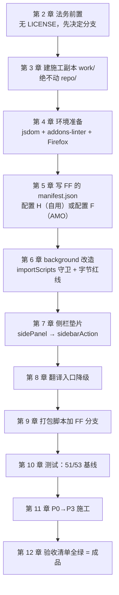

# LaterOn → Firefox 适配技术方案（施工版）

> **本文档的定位**：照着做就能出成品。不是可行性分析，不是改动清单，而是一条**线性可执行的施工流程**。
> 每个步骤都给出「文件 + 行号 → 改动前 → 改动后 → 验证命令 → 期望输出 → 验收标准 → 失败回滚」。
>
> **姊妹文档**：[`Firefox-适配方案.md`](Firefox-适配方案.md)（可行性评估，302 行）负责回答"能不能做、难点在哪"；
> 本文档负责回答"怎么做、做到什么程度算完成"。两者结论冲突时以本文档第 13 节《旧方案勘误表》为准（依据为实测）。

- **目标项目**：LaterOn v1.66.1（Chrome/Edge MV3 侧栏网页收藏扩展，无后端、零 `fetch` 依赖）
- **基线归档点**：`repo/`，git HEAD `00fde27be93656d650ac5c52adc2684d511adb53`
- **本文档所有行号均对应上述归档点**；上游更新后行号可能漂移，请先用第 4.7 节的校验命令确认。
- **文档版本**：v1.0（2026-10-11）；**v1.1 协议状态更新（2026-10-12）**

> ⚠️ **协议状态已变更（2026-10-12）**：上游 `gaoyiiiii/LaterOn` 已采纳 **MIT 协议**（提交 `a1a5313`：新增根目录 `LICENSE`、README 增加「开源协议」章节、打包脚本把 `LICENSE` 放进发行包），GitHub 的 `license` 字段现为 `MIT`（此前是 `null`）。
> 因此**本文档第 2 章、第 5.3 节、第 11 章、第 12 章、第 13.2 节 R-19，以及附录 F/G 中凡以「无 LICENSE / 未获授权不得分发」为前提的段落，一律以本状态更新为准**：那些文字记录的是 2026-10-11 的事实，**不再代表当前状态**。协议变更的完整执行记录见 **附录 H**。
>
> 口径变化摘要（四条）：
> 1. 分发（含上 AMO）**不再需要**单独向作者申请书面授权，只需保留 `LICENSE` 与版权声明、注明基于上游并区分社区版/官方版（上游 README 的明文要求）；
> 2. 第 **2.4 节**的授权申请模板**不需要发送**（保留在文中仅作历史记录）；
> 3. 第 5 章 H/F 配置的选取**不受影响** —— H 依然是默认（115 覆盖面大），AMO 版仍需把 `strict_min_version` 抬到 140；
> 4. 附录 **F.1** 与 **G.4** 的文件数/字节数/SHA256 因「包内新增 `LICENSE`」而**全部作废**，现行值见 **H.4**（36 → 37 文件）。

---

## 0. 怎么用这份文档

### 0.1 证据分档（全文强制标注，请勿混淆）

本文档每一条技术断言都带下列三种标签之一。**看到"待实测"就等于"我不知道，需要你在装了 Firefox 的机器上确认"**，不要把待实测项当成已验证结论往下游传递。

| 标签 | 含义 | 本文档中的数量 |
|---|---|---|
| **【实测】** | 在本机（Windows / Node v22.19.0 / addons-linter 10.14.0）真实跑过，命令与原始输出都可复现 | 本文档主要断言来源 |
| **【推断·官方文档】** | 未在本机跑过，依据 MDN / Extension Workshop / BCD 的明文规定；出处集中在 [`notes-firefox-platform.md`](notes-firefox-platform.md) | 次多 |
| **【待实测】** | 需要真实 Firefox 浏览器才能确认，本机**没有装 Firefox**，因此全部悬空 | 见第 12.2 节（A 组 22 项）与第 12.3 节（B 组 20 项），**共 42 项**；编号索引见 12.4 |

> **本机限制的诚实交代**：施工环境为 Windows + Node v22.19.0 + npm 10.9.3，**没有安装 Firefox、没有加载过扩展、没有在浏览器里跑过任何一行代码**。
> 因此本文档中所有"Firefox 里的行为"结论要么来自官方文档，要么标为待实测。凡是标【实测】的，都指"静态可验证"的东西：linter 输出、测试退出码、文件字节数、代码行号。

**关于代码块的约定（请先读懂这条，否则会误以为文档被截断）**：

| 约定 | 说明 |
|---|---|
| 每个代码块首行都注明**文件 + 行号范围**（如 `// 改动前（repo/library.js:2183-2196）`） | 便于你定位原文；行号均对应归档点 `00fde27` |
| **改动块的末尾可能停在大括号中间** | 这是**刻意的**：改动只发生在给出的那段区间里，其后的既有分支一行不改，故不重复。**不是文档被截断** |
| 想确认某个块是否完整 | 凡是"整文件新增"或"整个函数替换"的块（如 `ff-sidebar.js` 全文）在正文里已明确写"**全文**"；其余出现 `…` 注释或停在中途的，都是节选 |
| 已做的机械校验 | 全文 100 个代码块、围栏全部闭合（200 行围栏、前后配对）；23 个 `js` 代码块逐个过 `node --check`，**13 个完整块语法全通过**，另 10 个是上面说的节选（对象字面量片段、函数体片段），预期不通过 |

### 0.2 施工者前置条件

| 项 | 要求 | 检验命令 |
|---|---|---|
| 操作系统 | Windows 10/11（本文档命令按 PowerShell 7 写）、macOS 或 Linux 均可，命令需自行转换 | — |
| Node.js | ≥ 20（`addons-linter` 10.14.0 的 `engines.node` 为 `>=20.0.0`）；本文档实测于 v22.19.0 | `node --version` |
| npm | ≥ 9 | `npm --version` |
| Python | ≥ 3.8（仅打包脚本用）；Windows 应用商店版 `python` 是占位 shim，需自行确认能真正执行 | `python -c "import sys;print(sys.version)"` |
| Firefox | **两台版本至少其一**：Firefox ESR 115（验证最低版本线）、Firefox 140+（验证 AMO 配置线） | `& "C:\Program Files\Mozilla Firefox\firefox.exe" --version` |
| 磁盘 | 约 200 MB（施工副本 + node_modules + 两个 Firefox 安装包） | — |

### 0.3 30 秒路线图



**最小可交付路径**：只做 P0（第 11.1 节）就能得到一个"能在 Firefox 里装上、能收藏、能开库、侧栏可用"的可用扩展；
P1/P2 是体验与回归对齐，P3 是发布。**如果你只有半天，做 P0 + 第 12.4 节 A 组验收即可交付自用版本。**

### 0.4 术语表

| 术语 | 本文档中的含义 |
|---|---|
| 配置 H | Firefox manifest 的一种定稿：`options_ui` + `strict_min_version:"115.0"` + 只用 `background.scripts` + 不带 `data_collection_permissions`。**自签自用推荐**（第 5.1 节） |
| 配置 F | Firefox manifest 的另一种定稿：在 H 基础上加 `strict_min_version:"140.0"` + `data_collection_permissions.required:["none"]`。**要发 AMO 时用**（第 5.2 节） |
| 施工副本 | `lateron-firefox-port/work/`，从 `repo/` 复制的可改工作区。`repo/` 全程只读 |
| 双 manifest | Chrome 用原 `manifest.json`，Firefox 用另一份 manifest，**共用同一份 JS/CSS/HTML 源码** |
| 垫片（shim） | 新增的兼容层文件，把 Chrome 专有 API 调用转成 Firefox 等价物 |
| 基线净值 | 改造**之前**就已存在的测试失败数。本文档基线净值 = **51 通过 / 2 失败**（共 53），这 2 个失败不许增加 |

---

## 1. 成品定义与验收口径

### 1.1 什么是"成品"

本文档给出三种成品形态，按施工成本递增。**形态 A 是"完成"，形态 C 是"可发布"**。

| 形态 | 定义 | 产出物 | 适合谁 |
|---|---|---|---|
| **A. 开发者加载目录** | 一个可被 `about:debugging` 临时加载的扩展目录（`work/` 本身即可） | `work/` 目录 | 自己用、验收、调试 |
| **B. 打包 zip** | `python scripts/build-release.py` 产出的固定时间戳 zip | `work/dist/LaterOn-1.66.1-firefox.zip` | 备份、拷给别的机器、投稿前自检 |
| **C. 签名的 xpi** | 经 AMO 签名（或自签名 + 关闭签名校验）后可永久安装的包 | `lateron_ff_port-1.66.1-an+fx.xpi` | 长期使用、分发给他人 |

### 1.2 放行条件（硬门槛，全绿才算成品）

| # | 门槛 | 判定命令 | 通过标准 |
|---|---|---|---|
| G1 | linter 无 error | 第 4.4 节的 `addons-linter -o json work/` | `errors` 数组长度为 **0** |
| G2 | linter 警告在白名单内 | 同上 | 只允许 `UNSAFE_VAR_ASSIGNMENT`（4 条，上游既有）、`MISSING_DATA_COLLECTION_PERMISSIONS`（配置 H 才有，1 条）、`UNSUPPORTED_API`（仅出现在 `ff-sidebar.js` 的能力探测行，预期 ≤3 条）。**出现任何其它 code 即为不合格** |
| G3 | 测试不退化 | 第 10.3 节的测试循环 | **≥ 51 通过 / ≤ 2 失败**，且失败的必须是第 10.4 节登记的两个既有失败 |
| G4 | 打包脚本通过 | `python scripts/build-release.py --target firefox` | 输出 `Built dist/LaterOn-1.66.1-firefox.zip (36 files, X KB)`；**文件数必须是 36**（33 个上游运行时文件 + `ff-sidebar.js` + `_locales` 下的 2 个 `messages.json`） |
| G5 | `repo/` 未被污染 | `git -C repo status --porcelain` | 输出**为空** |
| G6 | 手动验收清单 | 第 12.2 节 A 组 | A 组 **22 项**全绿（需要真 Firefox）；B 组 20 项至少无 ❌ |
| G7 | 字节红线 | 第 6.4 节 | 采用**方案 A** 时 `background.js` 必须**仍是 81138 字节**（零改动）；采用方案 B 时允许 ≤ 81300 |

### 1.3 "不算完成"清单

以下情形**不要**报告为已完成：

- 只改了 `manifest.json` 就宣称适配完成——`background.js:1` 会让整个后台脚本抛 `ReferenceError`，扩展装上等于空壳。
- 只在 Chrome 里通过测试就宣称 Firefox 可用——本方案第 12.2 / 12.3 节的 **42 项**待实测项**全部需要真 Firefox**。
- linter `errors=0` 但 `UNSUPPORTED_API` 指向 `library.js`/`sidepanel.js`/`background.js`——说明垫片没接线，运行时必然报错。
- 把 `tests/background-modules.test.js` 的 80000 阈值改大来"修好"测试——那是削弱质量闸门，属越界改动；要么申请授权，要么接受它为基线净值（见 10.4）。

---

## 2. 法务前置（动工前必须先读完）

### 2.0 协议状态更新（2026-10-12，覆盖以下 2.1–2.4）

**上游已采纳 MIT 协议**：提交 `a1a5313`「License LaterOn under MIT and include notice in release packages」（父提交即本文档基线 `00fde27`）新增根目录 `LICENSE`（MIT，`Copyright (c) 2026 yiiiii`），并在上游 README 增加「开源协议」章节。

下面 2.1–2.4 是 **2026-10-11 当时**的事实与建议，**其中三条已不再需要执行**：

| 小节 | 2026-10-11 的口径 | 现在的口径 |
|---|---|---|
| 2.1 事实 | 「没有 LICENSE，`license: null`」 | **已过时**：上游新增 MIT `LICENSE`，GitHub `license = MIT` |
| 2.2 分支 b | 「取得书面授权后发布」 | **不再需要单独授权**：保留 `LICENSE` + 署名 + 区分社区版/官方版即可分发（含上 AMO） |
| 2.4 申请模板 | 「可直接复制发 issue」 | **不要发送**（保留在文中仅作历史记录） |

分支 a/b 的技术差异（走配置 H 还是 F）**仍然有效**，理由见第 5 章。完整执行记录（合并、重打包、新哈希、回归）见 **附录 H**。

### 2.1 事实

**【实测】** `repo/` 内**没有任何 LICENSE / COPYING / LICENSE.md 文件**（仓库根 33 个运行时文件 + docs/ + tests/ + scripts/ + _locales/ + .gitignore 里都没有），上游 GitHub 的 `license` 字段为 `null`。

> **2026-10-12 更新（这条已过时）**：上游随后推送 `a1a5313` 新增了 `LICENSE`（MIT），GitHub `license` 字段现为 `MIT`。下面 3 条「不得分发」的结论随之作废，改为「保留 `LICENSE` 与版权声明 + 署名 + 区分社区版/官方版」的合规义务。见第 2.0 节与附录 H。

**含义**：默认版权归原作者，**未获得授权不得分发衍生版本**——包括：

- 上传到 AMO（addons.mozilla.org）
- 把包含源代码的 zip/xpi 发给他人
- 公开发布 fork 的源码

**自用（自己机器上加载/自己签名自己用）不在"分发"范围内**，这是本文档推荐配置 H 的理由。

### 2.2 两条合法分支

| 分支 | 触发条件 | 走哪套 manifest | 发布范围 |
|---|---|---|---|
| **分支 a：本地自用** | 只在自己机器上用 | **配置 H**（第 5.1 节） | 不出本机 |
| **分支 b：取得书面授权后发布** | 拿到作者明确的书面许可（issue 回复 / 邮件均可，需保存证据） | **配置 F**（第 5.2 节） | AMO 或 GitHub fork |

> **建议的中间路线**：先按分支 a 把 P0+P1 做完跑通，再用 run 通的结果去和作者谈授权。有了"能跑的实现"再去申请，比空口问一句"我能移植吗"成功率高得多。

### 2.3 命名与标注要求（两个分支都要遵守）

| 项 | 要求 | 落地位置 |
|---|---|---|
| 扩展名 | 必须能一眼看出是移植版，例如 `LaterOn FF Port · 项目型网页管理` | `_locales/*/messages.json` 的 `extensionName` |
| gecko.id | 不得使用上游的 id；用自建 id（第 5.4 节） | `manifest.json` → `browser_specific_settings.gecko.id` |
| 说明 | 在 `README.md`（扩展自己的，不是本文档目录的）和 AMO 描述里写明"非官方移植，未经上游作者背书" | `_locales/*/messages.json` 的 `extensionDescription` |

### 2.4 授权申请模板（可直接复制发 issue）

```text
Hi! I read the LaterOn source (v1.66.1) and wrote a Firefox port plan.
The repo has no LICENSE file, so I'd like to ask before doing anything public.

What I'd like to do:
1. Keep a private, personally-used Firefox build (self-signed) — no redistribution.
2. If you're OK with it: publish a clearly-labelled unofficial port to AMO,
   or open a PR adding a second manifest + a small shim layer so one source
   tree builds for both Chrome and Firefox.

I will not redistribute anything until you say yes in writing.
Happy to share the port patch for you to review first.
```

**回滚**：如果作者明确拒绝 → 停止分支 b，只保留分支 a（本机自用），并把本次施工的成果留在 `work/`，不得外发。

---

## 3. 工作区策略

### 3.1 硬约束

> **`repo/` 下任何文件都不许改。** 它是 v1.66.1 的纯净存档（HEAD `00fde27be9`），本文档所有行号都锚定它。
> 一旦被改动，行号引用失效、linter 基线失效、第 12 章的验收也无从对照。

**新增一个连带约束**：不要用 `git worktree add` 在 `repo/` 上开工作树——那会往 `repo/.git/worktrees/` 写文件，违反上面的硬约束。用下面的复制方案。

### 3.2 建施工副本（推荐方案，可追溯）

```powershell
# 在 lateron-firefox-port\ 下执行
cd "F:\ALL_AI\小助理\open-source-collection\lateron-firefox-port"
git -C repo status --porcelain          # 期望：无输出（工作树干净）
git -C repo rev-parse HEAD              # 期望：00fde27be93656d650ac5c52adc2684d511adb53

Remove-Item -Recurse -Force work -ErrorAction SilentlyContinue
New-Item -ItemType Directory work | Out-Null
git -C repo archive HEAD | tar -x -C work
```

**为什么用 `git archive` 而不是复制目录**：
- 它读 `repo/.git` 但**只读不写**，不产生 git 元数据，`work/` 是纯文件目录；
- 产出的就是 HEAD 的内容，天然排除了 `repo/` 工作树里可能存在的未跟踪杂物；
- Windows 10 1803+ 自带 `tar.exe`（bsdtar），无需额外安装。

**如果不信任 `git archive`（或没有 tar）**，退化方案是普通复制，但要显式排除 `.git`：

```powershell
robocopy repo work /E /XD .git /NFL /NDL /NJH /NJS
if ($LASTEXITCODE -ge 8) { Write-Error "robocopy 失败，退出码 $LASTEXITCODE" }
```

> ⚠️ **不要用 `fs.cpSync(src, dst, {recursive:true})`**：在本机 Node v22.19.0 上它会把进程直接打崩（退出码 `-1073740791` = `0xC0000409` `STATUS_STACK_BUFFER_OVERRUN`，无任何输出）。这是本会话实测到的坑。

### 3.3 验证施工副本完好

```powershell
# 逐文件比对 work/ 与 HEAD 的内容哈希（排除 .git）
$head = git -C repo ls-tree -r --name-only HEAD
$mismatch = @()
foreach ($f in $head) {
  $a = git -C repo show "HEAD:$f" | Out-String
  $p = Join-Path "work" $f
  if (-not (Test-Path $p)) { $mismatch += "$f MISSING"; continue }
  $b = Get-Content $p -Raw
  if ((Get-FileHash -InputStream ([IO.MemoryStream]::new([Text.Encoding]::UTF8.GetBytes($a)))).Hash -ne
      (Get-FileHash -InputStream ([IO.MemoryStream]::new([Text.Encoding]::UTF8.GetBytes($b)))).Hash) { $mismatch += $f }
}
if ($mismatch.Count) { $mismatch } else { "OK: 施工副本与 HEAD 完全一致（$($head.Count) 个文件）" }
```

**期望输出**：`OK: 施工副本与 HEAD 完全一致（N 个文件）`
**验收标准**：无任何 `MISSING` 或文件名输出。
**失败回滚**：`Remove-Item -Recurse -Force work` 后重做 3.2。

### 3.4 双 manifest 如何共用同一份源码

**核心设计：不复制源码，只替换 manifest 的构建产物。** 三个来源共用一套 JS：

| 目标浏览器 | manifest 文件 | manifest 内容来源 | 加载方式 |
|---|---|---|---|
| Chrome / Edge | `work/manifest.json` | 上游原文件，**本次施工不动它** | Chrome 加载 `work/` |
| Firefox | `work/manifest.firefox.json` | 本方案新建（第 5 章全文） | 打包时复制成 zip 内的 `manifest.json` |

**实现方式**：改造 `scripts/build-release.py`，加一个 `--target` 参数（第 9 章给完整 diff）。

- `--target chrome`（默认）：行为与上游完全一致，读 `manifest.json`，产出 `LaterOn-<version>.zip`。
- `--target firefox`：读 `manifest.firefox.json`，把它作为 zip 内的 `manifest.json`，产出 `LaterOn-<version>-firefox.zip`。

**为什么不让两个 manifest 同时存在于打包目录**：Firefox 会拒绝 `manifest.firefox.json` 这种未知键？不会——它只是被忽略。但 Chrome 也允许未知文件。真正的问题是**歧义**：将来有人不知道哪个才是生效的。用一个显式的构建开关消除歧义，代价只有 20 行 Python。

### 3.5 施工后的目录树

```text
lateron-firefox-port/
├── Firefox-适配方案.md          ← 旧：可行性评估（只读，不改）
├── Firefox-适配技术方案.md       ← 新：本文档
├── LaterOn-项目分析.md
├── notes-*.md                   ← 4 份取证笔记（只读）
├── README.md                    ← 需更新索引（第 3.6 节）
├── repo/                        ← 纯净存档，全程只读
│   └── .git/                    ← 只允许 git archive / git show 这类只读操作
└── work/                        ← 施工副本（唯一的写入目标）
    ├── manifest.json            ← 上游 Chrome 版，原样保留
    ├── manifest.firefox.json    ← 新增：FF 版（第 5 章）
    ├── ff-sidebar.js            ← 新增：侧栏垫片（第 7.2 节）
    ├── package.json             ← 新增：仅用于 devDependencies（见 4.3 的 npm 坑）
    ├── node_modules/            ← 装 jsdom/web-ext 用；**不在 RUNTIME_FILES 白名单里，不会被打包**
    ├── scripts/build-release.py ← 改造（第 9 章）
    ├── background.js            ← 改 1 行（第 6.3 节）
    ├── sidepanel.js             ← 改 2 处（第 7.5、7.6 节）
    ├── sidepanel.html           ← 加 1 行 script（第 7.2 节）
    ├── library.js               ← 改 2 处（第 7.4、7.7 节）
    ├── library.html             ← 加 1 行 script（第 7.2 节）
    ├── settings.js              ← 改 1 处快捷键页 URL（第 8.4 节）
    ├── settings.html            ← 改 2 行文字（第 8.4 节）
    └── i18n.js                  ← 加 4 条词条（第 8.4 节）
```

### 3.6 更新本目录 `README.md` 的索引（本次交付内容之一）

在 `README.md` 的「文件」表格里，把两份方案的角色写清楚。**改动前**（现有第 24 行）：

```markdown
| [`Firefox-适配方案.md`](Firefox-适配方案.md) | 主报告：硬阻塞项、语义差异表、P0/P1/P2/P3 分阶段改动清单（带行号）、待实测清单、执行顺序 |
```

**改动后**：

```markdown
| [`Firefox-适配方案.md`](Firefox-适配方案.md) | **前置可行性评估**：硬阻塞项、语义差异表、P0/P1/P2/P3 分阶段改动清单（带行号）、20 项待实测清单、执行顺序。回答"能不能做、难在哪" |
| [`Firefox-适配技术方案.md`](Firefox-适配技术方案.md) | **施工方案（照着做就出成品）**：成品定义与放行门槛、法务前置、工作区策略、FF 版 manifest 全文与逐键取舍、background 事件页改造、侧栏垫片、翻译降级、打包脚本 diff、测试基线、P0–P3 逐步施工卡、42 项验收清单、风险登记与回滚、旧方案勘误表。全部断言分「本机已实测 / 据官方文档推断 / 待施工者实测」三档标注 |
```

同时在「关键结论」末尾追加一条：

```markdown
6. **适配已从评估进入施工**：[`Firefox-适配技术方案.md`](Firefox-适配技术方案.md) 补齐了旧方案缺的实测依据——`addons-linter` 10.14.0 下 12 个 manifest 变体的警告矩阵、测试基线净值（18/53 → 51/53）、三个硬约束（`sidePanel` 权限只是 warning、`options_ui` 在 115 可用而 `options_page` 需 126、`data_collection_permissions` 需 140）。旧方案的 3 条结论据此修正，见该文档第 14 节勘误表。
```

**验收标准**：`README.md` 中同时存在两个文件条目，且 `Firefox-适配方案.md` 一行明确写着"前置可行性评估"，`Firefox-适配技术方案.md` 一行明确写着"施工方案"。

---

## 4. 环境准备

### 4.1 本机现状盘点（**已实测**）

| 组件 | 本机状态 | 需要补什么 |
|---|---|---|
| Node.js | v22.19.0 ✅ | 无 |
| npm | 10.9.3 ✅ | 无 |
| npm registry | 可访问 ✅ | 无 |
| Python | `python --version` **无任何输出**（Windows 应用商店 shim）⚠️ | 施工者需自行确认 `python -c "import sys;print(sys.version)"` 能打印版本；否则改用 `py -3` 或安装官方 Python |
| jsdom | **未安装** ❌ | 第 4.3 节 |
| addons-linter | 未装在工作区（本会话在 `F:\ALL_AI\_lateron_verify\linter\` 临时装过 10.14.0） | 第 4.4 节 |
| web-ext | **未安装** ❌ | 第 4.5 节 |
| **Firefox** | **未安装** ❌ | 第 4.6 节；**这是本文档 42 项待实测项无法关闭的唯一原因** |

### 4.2 前置：先建 `work/package.json`（**这一步不做，后两步必炸**）

> ⚠️ **本会话踩过的坑（实测）**：在一个**没有 `package.json`** 的目录里直接跑 `npm install <包>`，npm 会把"项目根"解析到**用户主目录**（本机实测落到 `C:\Users\lhy`），并且 **prune 掉该 `node_modules` 里已存在的 44 个包**。
> 后果不只是装错地方：任何位于 `C:\Users\lhy\**` 下的目录（包括 `$env:TEMP` 里的副本）都能 `require` 到 jsdom，导致第 10 章的"无 jsdom 基线"在 C 盘完全无法复现。
> **规则：禁止在没有 `package.json` 的目录里裸跑 `npm install <包>`。**

**操作**：新建 `work/package.json`（施工副本内，不影响 `repo/`）：

```powershell
cd "F:\ALL_AI\小助理\open-source-collection\lateron-firefox-port\work"
@'
{
  "name": "lateron-ff-port-workspace",
  "private": true,
  "version": "1.0.0",
  "description": "施工工作区：仅用于 devDependencies，不参与扩展打包（不在 build-release.py 的 RUNTIME_FILES 白名单内）。",
  "devDependencies": {
    "jsdom": "^29.1.1",
    "web-ext": "^8.9.0",
    "addons-linter": "^10.14.0"
  }
}
'@ | Set-Content -Path package.json -Encoding utf8
Get-Content package.json
```

**期望输出**：打印出一份含三个 devDependencies 的 JSON。
**验收标准**：`work/package.json` 存在且 JSON 合法（`Get-Content package.json -Raw | ConvertFrom-Json` 不报错）。
**失败回滚**：删掉 `work/package.json` 即可，无副作用。

### 4.3 安装依赖

```powershell
cd "F:\ALL_AI\小助理\open-source-collection\lateron-firefox-port\work"
npm install
```

**期望输出**（实测于 jsdom 单项安装：`added 39 packages in 19s`；三项一起装会更长）：

```text
added 3xx packages in xx s
```

**验收标准**：

```powershell
node -e "console.log('jsdom', require('jsdom/package.json').version)"
node -e "console.log('linter', require('addons-linter/package.json').version)"
node -e "console.log('web-ext', require('web-ext/package.json').version)"
```

三条都要打印出版本号（jsdom 应为 `29.x`）。

**失败回滚**：

```powershell
Remove-Item -Recurse -Force node_modules, package-lock.json
```

**替代方案（不想在工作区装 node_modules 时）**：把这三样装在**独立 harness 目录**，用 `NODE_PATH` 让测试找到 jsdom：

```powershell
$h = "F:\ALL_AI\小助理\open-source-collection\lateron-firefox-port\tools"
New-Item -ItemType Directory -Force $h | Out-Null
Push-Location $h
'{"name":"ff-port-tools","private":true,"version":"1.0.0","devDependencies":{"jsdom":"^29.1.1","web-ext":"^8.9.0","addons-linter":"^10.14.0"}}' | Set-Content package.json -Encoding utf8
npm install
Pop-Location
$env:NODE_PATH = "$h\node_modules"    # 跑测试前设置；每个新 shell 都要重设
```

> 注意：`NODE_PATH` 对**使用它的那次进程**生效。以后每次跑测试前都要 `$env:NODE_PATH = "...\tools\node_modules"`，容易忘。**推荐还是用 4.2/4.3 的 work 内方案。**

### 4.4 用 addons-linter 做静态自查

**本会话实测过的版本与矩阵**：`addons-linter` **10.14.0**。矩阵那一轮确实是靠 `npx --yes addons-linter@latest` 跑起来的，**但同一天稍后在本机复测，该形式已失败**：`npx --yes addons-linter --version` 与 `npx --yes addons-linter@latest --version` 均报 `npm error could not determine executable to run`（cwd 下无本地安装）。⇒ **npx 这条路径依赖缓存状态，不要写进脚本**，一律用下面的本地 bin 形式。

**方法学要点（很重要）**：**不要对 `work/` 目录直接跑 linter**——`work/node_modules/` 里有几万个文件，会被一起扫描，输出毫无意义。**永远 lint 打包产物**：

```powershell
cd "F:\ALL_AI\小助理\open-source-collection\lateron-firefox-port\work"
python scripts/build-release.py --target firefox          # 先出包（第 9 章改造后）
node node_modules/addons-linter/bin/addons-linter -o json dist/LaterOn-1.66.1-firefox.zip |
  Out-File -Encoding utf8 ..\lint-report.json
node -e "const r=require('../lint-report.json');console.log('errors',r.errors.length,'warnings',r.warnings.length);for(const w of r.warnings)console.log(w.code,'::',w.message,'::',(w.file||'')+':'+(w.line||''))"
```

**仅作参考**的 `npx` 写法（本机实测**不可靠**：报 `npm error could not determine executable to run`，只有在 `node_modules` 里已装好 addons-linter 时才可用，所以它并不比上面的本地 bin 形式更省事）：

```powershell
npx --yes addons-linter -o json dist/LaterOn-1.66.1-firefox.zip
```

**期望输出（改造前基线，第 5 章的 manifest + 原样源码，【实测】）**：

```text
errors 0 warnings 13
MISSING_DATA_COLLECTION_PERMISSIONS :: The "data_collection_permissions" property is missing. :: manifest.json:
UNSUPPORTED_API :: sidePanel.setPanelBehavior is not supported :: background.js:266
UNSUPPORTED_API :: sidePanel.setPanelBehavior is not supported :: background.js:268
UNSAFE_VAR_ASSIGNMENT :: Unsafe assignment to innerHTML :: content-reading-position.js:124
UNSAFE_VAR_ASSIGNMENT :: Unsafe assignment to innerHTML :: dialog.js:117
UNSAFE_VAR_ASSIGNMENT :: Unsafe assignment to innerHTML :: dialog.js:534
UNSAFE_VAR_ASSIGNMENT :: Unsafe assignment to innerHTML :: picker-ui.js:94
UNSUPPORTED_API :: sidePanel.open is not supported :: library.js:2242
UNSUPPORTED_API :: sidePanel.open is not supported :: library.js:2244
UNSUPPORTED_API :: sidePanel.open is not supported :: library.js:2249
UNSUPPORTED_API :: sidePanel.close is not supported :: sidepanel.js:622
UNSUPPORTED_API :: sidePanel.open is not supported :: sidepanel.js:1452
UNSUPPORTED_API :: sidePanel.open is not supported :: sidepanel.js:1453
```

**期望输出（P1 垫片接线完成后）**：

```text
errors 0 warnings ≤ 5
UNSAFE_VAR_ASSIGNMENT × 4          ← 上游既有，不改
MISSING_DATA_COLLECTION_PERMISSIONS × 1   ← 仅配置 H 会有；配置 F 无
UNSUPPORTED_API × ≤3               ← 只允许出现在 ff-sidebar.js 的能力探测行
```

**验收标准**：`errors` 为 0；警告 code 全部落在第 1.2 节 G2 的白名单内；`UNSUPPORTED_API` 的 `file` 字段**不再是** `background.js` / `library.js` / `sidepanel.js`。

**失败回滚**：linter 报 error 时先看 `code`——`BACKGROUND_SERVICE_WORKER_NOFALLBACK` 说明 manifest 里只留了 `service_worker` 没留 `scripts`（第 5.3 节 / 第 14.4 节）；`ADDON_ID_REQUIRED` 说明 `gecko.id` 丢了。

### 4.5 用 web-ext 做真浏览器加载前的第二道检查（可选但推荐）

```powershell
cd "F:\ALL_AI\小助理\open-source-collection\lateron-firefox-port\work"
npx --yes web-ext lint --source-dir dist\stage-ff --output json
npx --yes web-ext build --source-dir dist\stage-ff --artifacts-dir dist --overwrite-dest
```

`web-ext` 与 `addons-linter` 是两套独立实现，同时通过可把"manifest 写错"的概率压到很低。
**【待实测】** 本机未跑过 `web-ext`（未安装、无 Firefox），命令按官方 CLI 文档书写。

### 4.6 安装两台 Firefox 并校验版本

| 用途 | 版本 | 下载 | 校验命令 |
|---|---|---|---|
| 验证最低版本线（配置 H 的 115） | **Firefox ESR 115.x** | https://www.mozilla.org/firefox/all/#product-desktop-esr | `& "C:\Program Files\Mozilla Firefox ESR\firefox.exe" --version` |
| 验证 AMO 配置线（配置 F 的 140） | **Firefox 140+**（或 Developer Edition / Nightly） | https://www.mozilla.org/firefox/all/ | `& "C:\Program Files\Mozilla Firefox\firefox.exe" --version` |

**期望输出**：`Mozilla Firefox 115.x.x` / `Mozilla Firefox 14x.x`。
**验收标准**：两个版本都能启动，且 `about:support` 首页的「版本」与命令输出一致。

**自签名安装（配置 H 的分支 a）额外需要**：

1. 打开 `about:config`，搜索 `xpinstall.signatures.required`；
2. **只有 Developer Edition / Nightly / ESR 允许把它设为 `false`**；release 版改不动（这是 Mozilla 的硬策略，不是 bug）；
3. 因此分支 a 推荐直接用 **Developer Edition 或 ESR**，否则只能用 `about:debugging` 的临时加载（**每次重启浏览器失效**）。

**【待实测】** 上述签名策略来自 Extension Workshop 文档（见 [`notes-firefox-platform.md`](notes-firefox-platform.md)），本机无 Firefox 不能验证。

### 4.7 校验 `repo/` 行号未漂移（每次开工先跑）

```powershell
cd "F:\ALL_AI\小助理\open-source-collection\lateron-firefox-port"
git -C repo rev-parse HEAD
(Get-Content repo\background.js).Count
(Get-Item repo\background.js).Length
```

**期望输出**（**【实测】**）：

```text
00fde27be93656d650ac5c52adc2684d511adb53
1706
81138
```

**验收标准**：HEAD 为 `00fde27be9...`、`background.js` 为 **1706 行 / 81138 字节**。
**不一致怎么办**：说明有人动了 `repo/` 或上游已更新 → 停止施工，重新建纯净副本；本文档所有行号引用都需要重新核对。

---

## 5. 最终 `manifest.json`（Firefox 版）

### 5.0 先看结论：选 H 还是选 F

**本会话实测了 12 个 manifest 变体**（方法：把 `build-release.py` 白名单里的 33 个运行时文件 + `_locales` 复制到独立目录，替换成候选 manifest，跑 `addons-linter 10.14.0 -o json`）。下表是完整矩阵，**这是本文档相对旧方案的核心增量**：

| 变体 | 关键差异 | errors | warnings | 警告构成 |
|---|---|---|---|---|
| **BASE** | `sidebar_action` + `background{scripts+service_worker}` + `options_page` + min **115** | 0 | **16** | MISSING_DATA_COLLECTION_PERMISSIONS×1、BACKGROUND_SERVICE_WORKER_IGNORED×1、KEY_FIREFOX_UNSUPPORTED_BY_MIN_VERSION×1、KEY_FIREFOX_ANDROID_UNSUPPORTED_BY_MIN_VERSION×1、UNSAFE_VAR_ASSIGNMENT×4、UNSUPPORTED_API×8 |
| **A** | BASE + 保留 `"sidePanel"` 权限 | 0 | **17** | BASE 的 16 条 + `MANIFEST_PERMISSIONS`×1 |
| **B** | BASE，`options_page` → `options_ui{page,open_in_tab:true}` | 0 | **14** | BASE 去掉**两条** KEY_FIREFOX_*_UNSUPPORTED_BY_MIN_VERSION |
| **C** | BASE + min **140** + `data_collection_permissions{required:["none"]}` | 0 | **14** | BASE 去掉 MISSING_DATA_COLLECTION_PERMISSIONS 与桌面 min-version 警告；**Android 警告仍在** |
| **D** | B + min **126** + dcp | 0 | **15** | B 的 14 条 + 两条 min-version 警告回来 |
| **E** | BASE 只留 `background.scripts`（删 `service_worker`） | 0 | **15** | BASE 去掉 BACKGROUND_SERVICE_WORKER_IGNORED |
| **F** | B + min **140** + dcp + 只留 `scripts` | 0 | **13** | KEY_FIREFOX_ANDROID_UNSUPPORTED_BY_MIN_VERSION×1、UNSAFE_VAR_ASSIGNMENT×4、UNSUPPORTED_API×8 |
| **G** | 只留 `service_worker`（删 `scripts`） | **1** | 15 | **ERROR** `BACKGROUND_SERVICE_WORKER_NOFALLBACK` |
| **H** | B + 只留 `scripts`（min 保持 115，无 dcp） | 0 | **13** | MISSING_DATA_COLLECTION_PERMISSIONS×1、UNSAFE_VAR_ASSIGNMENT×4、UNSUPPORTED_API×8 |
| **I** | H + 保留 `minimum_chrome_version:"121"` | 0 | **13** | 与 H **完全相同** → 该键对 linter 无影响 |
| **J** | I + 保留 `side_panel:{default_path:"sidepanel.html"}` 键 | 0 | **13** | 与 H/I **完全相同** → `side_panel` 键对 linter 也零影响（运行时是否忽略见 12.3 B-06） |
| PROBE | 探针：无 `gecko`、无 `sidebar_action`、`default_locale` 无对应 `_locales` | **3** | 14 | ERROR×3：BACKGROUND_SERVICE_WORKER_NOFALLBACK、NO_MESSAGES_FILE、ADDON_ID_REQUIRED |

**从矩阵直接读出的 6 条硬结论**：

1. **`sidePanel` 权限在 Firefox 里只是 warning，不是 error**，code 是 `MANIFEST_PERMISSIONS`（`/permissions: Invalid permissions "sidePanel" at 7.`）。旧方案写的错误码 `MANIFEST_PERMISSION_UNSUPPORTED` **不存在**（见 14.1 勘误 1）。
2. **`options_page` 在 min 115 会报 KEY_FIREFOX_UNSUPPORTED_BY_MIN_VERSION；换成 `options_ui{page,open_in_tab:true}` 后两条警告全消**。即 `options_ui` 在 Firefox 115 可用，`options_page`（作为独立键）需要 ≥126（见 14.1 勘误 2）。
3. **`data_collection_permissions` 需要 Firefox ≥140**（配置 D 在 126 上仍报 min-version 警告），且它**只消桌面警告，不消 Android 警告**（配置 C/F 都留着 `KEY_FIREFOX_ANDROID_UNSUPPORTED_BY_MIN_VERSION`，见 14.1 勘误 3）。
4. **给 Firefox 的 manifest 要么 `scripts` + `service_worker` 并存，要么干脆删掉 `service_worker`**。只留 `service_worker` 是**唯一会产生 error 的写法**（G）。
5. `sidebar_action`（含 `open_at_install:true`）与 `commands`（Alt+1 / Alt+2 / Alt+Shift+1）**在全部 12 个变体里零警告**——这两个键的写法不用纠结。
6. **`side_panel`、`minimum_chrome_version` 这类 Chrome 专有键，linter 既不认识也不校验**：变体 I（保留 `minimum_chrome_version`）与变体 J（再叠一个 `side_panel`）的 errors/warnings 与配置 H **逐条相同**（0 / 13）。⇒ "保留 Chrome 键会不会过不了 linter"**不是**决策依据；删它们的真实理由是**可读性、AMO 审核与打包脚本自检**（§9 的反向校验自己加的护栏），见 14.2 勘误 9。

**取舍（明确表态）**：

| | 配置 **H** | 配置 **F** |
|---|---|---|
| 适用分支 | **分支 a：本地自用自签名**（第 2.2 节） | **分支 b：取得授权后发 AMO** |
| `strict_min_version` | **115.0** | **140.0** |
| `data_collection_permissions` | 无 | `{required:["none"]}` |
| linter | errors 0 / warnings 13 | errors 0 / warnings 13 |
| 唯一残留警告 | `MISSING_DATA_COLLECTION_PERMISSIONS`（1 条，**只影响 AMO 提交，自用无意义**） | `KEY_FIREFOX_ANDROID_UNSUPPORTED_BY_MIN_VERSION`（1 条，Android 本来就不支持侧栏，可忽略） |
| 能不能上 AMO | **不能**（2025-11-03 起 AMO 新提交必须带 dcp） | 能 |
| 最低可用版本 | **115 ESR**（覆盖面大得多） | 140 |
| **推荐** | ✅ **默认走这个** | 拿到书面授权后再切过来 |

**理由**（这是本文档最重要的一个工程判断，请不要随手改）：

- 无 LICENSE ⇒ 法律上不能分发（第 2.1 节）⇒ **AMO 这条线现在根本用不上**，为一个用不上的门槛把最低版本从 115 抬到 140，是纯粹的损失：115 ESR 覆盖大量长期支持用户，140 只覆盖新装用户。

> **2026-10-12 更新**：本条的第一句前提（「无 LICENSE」）**已不成立** —— 上游已采纳 MIT（第 2.0 节），可自由分发。但**结论仍然采用默认 H**：H 的 115 覆盖面优势、以及「H 与 F 只差两个键」的切换成本分析都不依赖授权前提；要发 AMO 时再切 F 即可（附赠的 `--amo` 目标已经能一键产出 F 配置包）。
- H 与 F **只差两个键**，切换成本接近零。所以先按 H 施工，等授权到手再改两个键重打包即可——**不需要为了"以后可能发 AMO"提前付代价**。
- 两个配置的 linter 结论**完全等价**（都是 errors 0 / warnings 13），所以在 H 上做的所有验证对 F 都成立，反之亦然。

### 5.1 配置 H 全文（**推荐，本会话已用 addons-linter 10.14.0 验证：errors=0 / warnings=13**）

**操作**：新建 `work/manifest.firefox.json`：

```json
{
  "manifest_version": 3,
  "name": "__MSG_extensionName__",
  "version": "1.66.1",
  "default_locale": "zh_CN",
  "description": "__MSG_extensionDescription__",
  "permissions": [
    "activeTab",
    "storage",
    "unlimitedStorage",
    "alarms",
    "scripting",
    "tabs",
    "contextMenus"
  ],
  "host_permissions": [
    "http://*/*",
    "https://*/*"
  ],
  "action": {
    "default_title": "__MSG_actionTitle__",
    "default_icon": {
      "16": "icon16.png",
      "32": "icon32.png",
      "48": "icon48.png",
      "128": "icon128.png"
    }
  },
  "omnibox": {
    "keyword": "lo"
  },
  "sidebar_action": {
    "default_panel": "sidepanel.html",
    "default_title": "__MSG_actionTitle__",
    "default_icon": {
      "16": "icon16.png",
      "32": "icon32.png",
      "48": "icon48.png",
      "128": "icon128.png"
    },
    "open_at_install": true
  },
  "background": {
    "scripts": [
      "ff-sidebar.js",
      "url-utils.js",
      "reading-position-background.js",
      "background.js"
    ]
  },
  "commands": {
    "quick-save": {
      "suggested_key": {
        "default": "Alt+1"
      },
      "description": "__MSG_commandSavePage__"
    },
    "save-all-tabs": {
      "suggested_key": {
        "default": "Alt+Shift+1"
      },
      "description": "__MSG_commandSaveAllTabs__"
    }
  },
  "icons": {
    "16": "icon16.png",
    "32": "icon32.png",
    "48": "icon48.png",
    "128": "icon128.png"
  },
  "web_accessible_resources": [
    {
      "resources": [
        "icon128.png"
      ],
      "matches": [
        "http://*/*",
        "https://*/*"
      ]
    }
  ],
  "browser_specific_settings": {
    "gecko": {
      "id": "lateron-ff-port@your-domain.example",
      "strict_min_version": "115.0"
    }
  },
  "options_ui": {
    "page": "settings.html",
    "open_in_tab": true
  }
}
```

**与上面那张实测矩阵的唯一差异（必须知道）**：

1. `background.scripts` 里**多了首项 `"ff-sidebar.js"`**（第 7.2 节的新垫片）。矩阵里的 BASE/H 只有 `["url-utils.js","reading-position-background.js","background.js"]`——**这一项是本方案的接线，矩阵没有验证过它**，所以第 11.1 节的 P0 最后一个动作必须是重新 lint 一遍。
2. `commands` 里**删掉了 `toggle-translation`**（Alt+2）。Firefox 没有 Chrome 内建翻译 API，留着一个必然报错的入口只会制造混乱（第 8 节）。矩阵里的 H 是带三个 command 的，**删掉一条 command 不会新增任何 linter 警告**（实测：`commands` 在 12 个变体里零警告）。

> **顺序很重要**：`background.scripts` 的加载顺序就是执行顺序，且**共享同一个全局作用域**。
> `reading-position-background.js:7` 是 `const normalizeUrl = globalThis.LaterOnUrl.normalize;`——它在**加载时**就要读 `LaterOnUrl`，
> 所以 `url-utils.js`（`:37` 才 `globalThis.LaterOnUrl = { normalize }`）**必须排在它前面**。
> `ff-sidebar.js` 不依赖任何东西，放最前面最安全。

### 5.2 配置 F 全文（要发 AMO 时把 5.1 改成这个）

**只有三处不同**（其余与 5.1 逐字节相同）：

```diff
   "background": {
     "scripts": [
       "ff-sidebar.js",
       "url-utils.js",
       "reading-position-background.js",
       "background.js"
     ]
   },
   "commands": {
     "quick-save": {
       "suggested_key": { "default": "Alt+1" },
       "description": "__MSG_commandSavePage__"
     },
     "save-all-tabs": {
       "suggested_key": { "default": "Alt+Shift+1" },
       "description": "__MSG_commandSaveAllTabs__"
     }
   },
   "browser_specific_settings": {
     "gecko": {
       "id": "lateron-ff-port@your-domain.example",
-      "strict_min_version": "115.0"
+      "strict_min_version": "140.0",
+      "data_collection_permissions": {
+        "required": ["none"]
+      }
     }
   },
```

**关键说明**：`"required": ["none"]` 这一句是**法律声明**，不是技术开关。LaterOn 全仓零后端（唯一一处 `fetch` 抓的是页面自身 URL），数据只进 `chrome.storage.local`（本机），所以 `"none"` 是**如实申报**。
⚠️ **但如果将来你自己加了任何形式的遥测/云同步，这行必须如实改掉**——AMO 的 `data_collection_permissions` 申报不实会导致下架。

### 5.3 逐键取舍表（每个键都交代清楚）

| 上游 `manifest.json` 的键（行号） | Chrome 原值 | Firefox 版取值 | 依据 / 理由 |
|---|---|---|---|
| `manifest_version`（`:2`） | `3` | `3` **不变** | Firefox 从 109 起支持 MV3；本项目实际最低版本由 5.4 节决定 |
| `name`（`:3`） | `__MSG_extensionName__` | **不变**（但建议改 `_locales` 的值，第 2.3 节） | linter 零警告 |
| `version`（`:4`） | `1.66.1` | **不变** | 产物命名要用它 |
| `default_locale`（`:5`） | `zh_CN` | **不变** | 实测 PROBE 变体证明：`default_locale` 与 `_locales` 不匹配会报 **ERROR** `NO_MESSAGES_FILE`，所以 `_locales/` 必须跟着打包（第 9 章） |
| `minimum_chrome_version`（`:6`） | `"121"` | **删除** | Chrome 专有键。**【实测】** 变体 I 证明"留着也不加任何警告"，但删掉可消除歧义；两套 manifest 的差异越小越好维护 |
| `description`（`:7`） | `__MSG_extensionDescription__` | **不变** | — |
| `permissions`（`:8-17`） | 含 **`"sidePanel"`（`:15`）** | **删除该项**，其余 7 项原样 | **【实测】** 保留它只多一条 warning（`MANIFEST_PERMISSIONS`，非 error），但既然侧栏改走 `sidebar_action`（不需要权限），删掉更干净。Code 见第 14.1 节 |
| `host_permissions`（`:18-21`） | `http://*/*`、`https://*/*` | **不变** | MV3 下 Firefox 同样用 `host_permissions` |
| `action`（`:22-30`） | `default_title` + `default_icon`，**无 `default_popup`** | **不变** | 无 popup 是好事：Firefox 下 `action.onClicked` 才会触发，我们的垫片靠它开侧栏（第 7.2 节） |
| `omnibox`（`:31-33`） | `keyword:"lo"` | **不变**（见风险 R-03） | Firefox 支持 `chrome.omnibox`；`background.js:150-186` 的 `<match>`/`<dim>` 标记两端都支持 |
| **`side_panel`（`:34-36`）** | `{default_path:"sidepanel.html"}` | **整块替换为 `sidebar_action`**（5.1 节） | Firefox 无 `side_panel` 键。字段映射：`default_path`→`default_panel`；`default_title`/`default_icon` 是 FF 侧栏按钮自己的属性（上游没有，需补）；`open_at_install:true` 让首次安装就展示一次侧栏边界。**linter 实测（矩阵变体 J）：保留 `side_panel` 键不产生任何告警，Firefox 会静默忽略它——本方案仍按本节换成 `sidebar_action`** |
| **`background`（`:37-39`）** | `{service_worker:"background.js"}` | `{scripts:["ff-sidebar.js","url-utils.js","reading-position-background.js","background.js"]}` | **【实测】** 只留 `service_worker` 会报 **ERROR** `BACKGROUND_SERVICE_WORKER_NOFALLBACK`；`scripts` 是 Firefox 的兼容回退。三个上游脚本的**顺序不能变**（5.1 节的解释） |
| `commands`（`:40-59`） | `quick-save` Alt+1 / `toggle-translation` Alt+2 / `save-all-tabs` Alt+Shift+1 | **保留两条，删掉 `toggle-translation`** | Firefox 无 `Translator`/`LanguageDetector`（第 8 节），留着是死入口。**【实测】** `commands` 零警告，删一条不会引入新警告 |
| `options_page`（`:60`） | `"settings.html"` | **替换为 `options_ui{page:"settings.html", open_in_tab:true}`** | **【实测】** 变体 B 证明：`options_page` 在 min 115 会报两条 KEY_FIREFOX_*_UNSUPPORTED_BY_MIN_VERSION，换 `options_ui` 后全消。`open_in_tab:true` 是为了保持上游"设置页是全屏标签页"的体验（上游 `background.js` 里用的就是 `chrome.runtime.openOptionsPage` 语义） |
| `icons`（`:61-66`） | 16/32/48/128 png | **不变** | linter 要求 `icons` 存在（`build-release.py:88-108` 也硬校验） |
| `web_accessible_resources`（`:67-77`） | `icon128.png` + `http/https` matches | **不变** | MV3 数组形式两端一致 |
| （新增）`browser_specific_settings.gecko` | — | `{id, strict_min_version}` | 见 5.4 节。**不写 `gecko.id` 会报 ERROR `ADDON_ID_REQUIRED`**（实测 PROBE 变体） |
| （新增）`browser_specific_settings.gecko_android` | — | **不写** | 见 5.4 节 |
| （新增）`browser_specific_settings.gecko.data_collection_permissions` | — | **配置 H 不写；配置 F 写 `{required:["none"]}`** | 【实测】它需要 FF ≥140 |

### 5.4 `gecko.id` 与 `gecko_android`

**`gecko.id` 生成**（不要用上游的 id，也不要手写一个像 `xxx@example.com` 的假域名——AMO 审核会对明显占位符打折）：

```powershell
node -e "console.log('lateron-ff-port-' + require('crypto').randomUUID().slice(0,8) + '@' + (process.env.USERNAME||'local').toLowerCase() + '.local')"
```

**示例输出**：`lateron-ff-port-3f9a2c71@lhy.local`

把输出填进 `browser_specific_settings.gecko.id`。**id 一旦定下就不要改**——改了等于换了个扩展，用户数据（`chrome.storage.local`）不会跟着走。

**`gecko_android`：本方案明确不声明。**

理由：Firefox for Android **没有侧栏**（`sidebar_action` 在 Android 不支持），而 LaterOn 的主交互就是侧栏。
**【实测】** linter 在配置 H/F 下持续报 `KEY_FIREFOX_ANDROID_UNSUPPORTED_BY_MIN_VERSION`（配置 F 的唯一残留警告），这**正是"不该声明 Android 支持"的信号**。
如果你写 `"gecko_android": {"strict_min_version": "..."}` 试图"支持"它，你会得到一个装上但核心功能不可用的扩展——比不支持更糟。

**如果想彻底消掉那条 Android 警告**：唯一办法是把 `strict_min_version` 抬到 Android 也支持 `sidebar_action` 的版本，但那会同时抬掉桌面最低版本，得不偿失。**结论：接受这 1 条警告。**

### 5.5 创建并自检 manifest（施工动作）

**步骤 M-1**

| 字段 | 内容 |
|---|---|
| 文件 + 行号 | 新建 `work/manifest.firefox.json`（无行号，全新文件） |
| 改动前 | 文件不存在 |
| 改动后 | 5.1 节全文（或 5.2 节的配置 F 版本） |
| 验证命令 | `Get-Content "F:\ALL_AI\小助理\open-source-collection\lateron-firefox-port\work\manifest.firefox.json" -Raw \| ConvertFrom-Json \| Select-Object -ExpandProperty permissions` |
| 期望输出 | `activeTab`、`storage`、`unlimitedStorage`、`alarms`、`scripting`、`tabs`、`contextMenus`（**7 项，没有 `sidePanel`**） |
| 验收标准 | JSON 合法；`permissions` 不含 `sidePanel`；不存在 `side_panel` 与 `options_page` 键；`browser_specific_settings.gecko.id` 非空 |
| 失败回滚 | `Remove-Item work\manifest.firefox.json`，回到"上游 manifest 唯一"的状态 |

**步骤 M-2：交叉确认上游 manifest 没被动过**

```powershell
cd "F:\ALL_AI\小助理\open-source-collection\lateron-firefox-port"
git -C repo diff --stat -- manifest.json     # 期望：无输出
(Get-Item repo\manifest.json).Length          # 期望：1630
git -C repo status --porcelain                # 期望：无输出
```

**验收标准**：三个命令分别输出「无输出 / 1630 / 无输出」。

---

## 6. background 事件页改造

### 6.1 Firefox 的 MV3 后台到底怎么跑（【推断·官方文档】）

| 事实 | 内容 | 出处 |
|---|---|---|
| `background.service_worker` 在 Firefox **被忽略** | Firefox 不支持 MV3 的 Service Worker 后台；它只认 `background.scripts` | linter 实测 code `BACKGROUND_SERVICE_WORKER_IGNORED`：`Unsupported "/background/service_worker" manifest property is ignored by Firefox.` + [`notes-firefox-platform.md`](notes-firefox-platform.md) |
| `background.scripts` 在 MV3 仍可用 | Firefox 把这一串脚本**按数组顺序在同一个全局作用域里执行**，事件页（非持久）语义 | 同上 |
| 结果是：脚本之间**共享全局变量** | 所以 `url-utils.js:37` 的 `globalThis.LaterOnUrl` 能被后面的脚本直接看到 | 代码实测 |
| 但 `importScripts` **不是文档上下文的 API** | 它是 `WorkerGlobalScope` 的方法。Firefox 的 `background.scripts` 跑在扩展页文档里 | 同上 |

### 6.2 不改会怎样（这决定了 P0 的必要性）

`repo/background.js:1` 是：

```js
importScripts("url-utils.js", "reading-position-background.js");
```

- **Chrome**：`background.service_worker` 是 Service Worker，`importScripts` 存在 → 正常加载两个前置模块。
- **Firefox**：后台是扩展页文档，`importScripts` 不存在 → **`ReferenceError: importScripts is not defined`**，`background.js` 从第 1 行就中断，**整个后台不会执行**。
  后果：快捷键无效、右键菜单不注册、收藏不落库、`storage.session` 不清、定时清理不跑。**扩展装上等于空壳。**

### 6.3 两个改法（本方案默认 A）

#### 方案 A（**推荐**）：零改动 `background.js`，在垫片里补一个空实现

**新增文件** `work/ff-sidebar.js` 会在第 7.2 节给出全文；它的开头就是这段守卫：

```js
// ── Firefox 后台兼容：importScripts 守卫 ─────────────────────────────
// Chrome 的 MV3 后台是 Service Worker，WorkerGlobalScope 提供 importScripts，
// background.js:1 用它同步加载两个前置模块。
// Firefox 的 MV3 后台是扩展页文档（background.scripts 按序在同一个全局作用域执行），
// 文档上下文没有 importScripts —— background.js:1 会直接抛 ReferenceError，
// 导致整个后台脚本中断。
// 这里在文档上下文里补一个空实现：两个模块已由 manifest.background.scripts 加载过，
// 再执行一次会让 reading-position-background.js 重复注册监听器。
// 若某种实现把后台跑在 Worker 里（存在 importScripts 且没有 document），本段自动跳过，
// 原生的 importScripts 行为得以保留 —— 两种实现都不会坏。
if (typeof document !== "undefined") {
  globalThis.importScripts = function () {
    /* no-op：前置脚本已由 manifest 的 background.scripts 按序加载 */
  };
}
```

**为什么推荐 A**：

| 理由 | 说明 |
|---|---|
| 字节中性 | `background.js` **一个字节都不变**，仍然是 81138。第 6.4 节的 80000 红线问题保持原样，不会被我们"弄得更糟" |
| 同时兼容两种 Firefox 实现 | 如果 Firefox 未来把 MV3 后台改成 Worker（有 `importScripts`、没有 `document`），这段自动跳过，走原生路径 |
| 不给 Chrome 添乱 | Chrome 的 manifest 不含 `ff-sidebar.js`（它只出现在 `manifest.firefox.json` 与两个 HTML 里），Chrome SW 完全不受影响 |
| 不碰 1706 行的大文件 | 不动 `background.js` 意味着不存在"改坏后台"的风险面 |

#### 方案 B（备选）：显式改 `background.js:1`

想在不引入新文件的情况下解决问题，就改这一行。

| 字段 | 内容 |
|---|---|
| 文件 + 行号 | `work/background.js:1`（对应 `repo/background.js:1`） |
| 改动前 | `importScripts("url-utils.js", "reading-position-background.js");` |
| 改动后 | `if (typeof importScripts === "function" && typeof globalThis.LaterOnUrl === "undefined") importScripts("url-utils.js", "reading-position-background.js");` |
| 验证命令 | `(Get-Item work\background.js).Length` |
| 期望输出 | **81227**（81138 + 89 字节；若你用了等价的其它写法，允许 ±40） |
| 验收标准 | 第 10 章的测试仍为 ≥51 通过；`node -e "const s=require('fs').readFileSync('work/background.js','utf8');console.log(s.split('\n')[0])"` 打印出改后那一行 |
| 失败回滚 | `git -C repo show HEAD:background.js > work\background.js`（**从纯净存档还原，不要手改回去**） |

**方案 B 的取舍**：语义更直白（"没有 importScripts 就跳过"写在一行里，不用去别的文件找），代价是 `background.js` 增长 89 字节。
**注意**：`typeof globalThis.LaterOnUrl === "undefined"` 这个附加条件是必要的——它防止"manifest 已加载 + `importScripts` 又可用"的双重执行（那会让 `reading-position-background.js` 重复注册监听器）。

> **本方案的默认选择是 A。** 第 11 章的施工步骤按 A 编排；选 B 的施工者把 P0 的步骤 P0-2 换成方案 B 的改动即可，其余步骤不变。

### 6.4 80000 字节红线（**实测，必须照抄进基线表**）

**事实**：`repo/tests/background-modules.test.js:13` 断言

```js
assert.ok(Buffer.byteLength(background) < 80000, `background.js 重新膨胀到 ${Buffer.byteLength(background)} bytes`);
```

而 `repo/background.js` **实测 81138 字节** → **这个测试在 v1.66.1 上游就是失败的**，与 Firefox 适配无关。

**本方案的处理（三层）**：

1. **不作为**：采用 6.3 方案 A → `background.js` 保持 81138 字节不变 → 该失败**原样保留为基线净值**。第 10.4 节会把它登记为"既有失败 #1"。
2. **不越界**：**禁止**把测试里的 `80000` 改大来"修好"它。那是削弱质量闸门，属于对上游测试的语义修改，需要作者授权（第 2 节）。
3. **把 FF 专有代码全部放进新文件**：这正是 `ff-sidebar.js` 独立成文件的原因之一。**新代码不许加进 `background.js`**——那会让一个已经失败的断言继续恶化。

**如果将来要真正修好它（可选项，与 FF 适配无关）**：
`background.js` 里体积较大且自包含的模块可以外移，例如 `:1375-1440` 的抖音相关逻辑（`DOUYIN_SETTLE_MS=1500`、`DOUYIN_POLL_MS=100`、`probeDouyinFreshness`、`settleDouyinDom`）与 `:355` 的 `purgeExpiredItems`。
**但这会触碰 1706 行核心文件、且行为没有测试覆盖，回归风险与 FF 适配无关**——所以本方案**默认不做**，仅登记为 P3 可选工作项（第 11.4 节）。**【待实测】** 能省多少字节未测。

**顺带提醒**：`repo/tests/background-modules.test.js:14-16` 与 `:21-23` 还有两组断言：

- `:14-16` 禁止 `background.js` 里出现 `function extractPageMetadataForShortcut` / `function togglePageTranslation` / `function showFolderPickerOverlay`；
- `:21-23` 要求 `background.js` 里仍然能正则匹配到 `files:["content-metadata.js"]`、`files:["content-translation.js"]`、`files:["picker-ui.js", "content-folder-picker.js"]` 三处。

采用方案 A 时这些全部不受影响。采用方案 B 只改 `:1` 一行，同样不受影响。

### 6.5 `BACKGROUND_SERVICE_WORKER_IGNORED` 的处置（**实测**）

| 写法 | linter 结果 | 结论 |
|---|---|---|
| `background: {service_worker: "background.js"}` | warning `BACKGROUND_SERVICE_WORKER_IGNORED` | 功能上被忽略，**且 `importScripts` 照样崩**（第 6.2 节） |
| `background: {scripts: [...], service_worker: "background.js"}` | warning `BACKGROUND_SERVICE_WORKER_IGNORED`（同 BASE 变体） | 能用，但留一条无意义警告 |
| `background: {scripts: [...]}`（**配置 H/F**） | **无此警告** | ✅ **采用** |
| `background: {service_worker: "background.js"}`（无 `scripts`） | **ERROR `BACKGROUND_SERVICE_WORKER_NOFALLBACK`** | ❌ 唯一会 error 的写法（实测变体 G） |

**动作**：把 `repo/manifest.json:37-39` 的 `{"service_worker": "background.js"}` **整体替换**为 `{"scripts": [...]}`，见第 5.1 节。
**Chrome 侧不动**：`work/manifest.json` 保持上游原样，Chrome 继续用 Service Worker 路径。

### 6.6 步骤 B-1：验证后台真的活了（**需要真 Firefox**）

| 字段 | 内容 |
|---|---|
| 文件 + 行号 | 无代码改动（验证步骤） |
| 改动前 | — |
| 改动后 | — |
| 操作 | 1. `about:debugging#/runtime/this-firefox` → 「临时载入附加组件」→ 选 `work/manifest.firefox.json`<br>2. 点「检查」打开后台页的控制台<br>3. 在控制台执行 `typeof importScripts`、`globalThis.LaterOnUrl`、`globalThis.LaterOnSidePanel` |
| 期望输出 | `typeof importScripts` → `"function"`（被垫片替换成空实现）<br>`globalThis.LaterOnUrl` → `Object {normalize: ƒ}`（证明 `url-utils.js` 已加载）<br>`globalThis.LaterOnSidePanel` → `Object {...}`（证明垫片已加载）<br>**控制台无 `ReferenceError`** |
| 验收标准 | 三个值如上；后台控制台**没有**红色报错；`about:debugging` 的扩展卡片不显示「错误」角标 |
| 失败回滚 | 卸掉临时扩展，回到第 5 章检查 manifest 的 `background.scripts` 数组内容与顺序 |

**【待实测】** 本机无 Firefox，`typeof importScripts` 在 Firefox 后台的真实返回值必须由施工者确认（待实测项 A-07）。这也正是第 6.3 节方案 A 写成"两种实现都不会坏"的原因。

---

## 7. 侧栏垫片：`chrome.sidePanel` → `browser.sidebarAction`

这一章是整个适配里**唯一需要写新代码**的地方，也是最容易写错的地方。请逐字照抄。

### 7.1 映射总表（先看全貌）

上游对 `chrome.sidePanel` 的**全部**使用点只有 6 处（**【实测】** addons-linter 逐处报出来了）：

| # | 位置 | 上游代码 | Firefox 对应物 | 可行性 |
|---|---|---|---|---|
| 1 | `background.js:266` | `typeof chrome.sidePanel?.setPanelBehavior !== "function"` | 无等价开关 | 降级：垫片返回 `true`（空操作） |
| 2 | `background.js:268` | `chrome.sidePanel.setPanelBehavior({openPanelOnActionClick:true})` | 由 `action.onClicked` + `sidebarAction.open()` 顶替 | ✅ 可完全替代 |
| 3 | `library.js:2242` | `typeof chrome.sidePanel?.open !== "function"` | `browser.sidebarAction.open` | ✅ |
| 4 | `library.js:2244` | `chrome.sidePanel.open({windowId})` | `browser.sidebarAction.open()`（**不接受 windowId**） | ⚠️ 部分：只能开当前窗口 |
| 5 | `library.js:2249` | `chrome.sidePanel.open({windowId: tab.windowId})` | 同上 | ⚠️ 同上 |
| 6 | `sidepanel.js:622` | `chrome.sidePanel.close({windowId})` | `browser.sidebarAction.close()` | ⚠️ 存在但有**笔记冲突**（见 7.5.2） |
| 7 | `sidepanel.js:1452-1453` | `chrome.sidePanel.open({windowId: openTab.windowId})` | 同上 | ⚠️ 同上（跨窗口做不到） |

**两条贯穿全章的语义差异**：

1. **无 `windowId` 参数**：Chrome 的 `sidePanel.open/close` 能指定窗口；Firefox 的 `sidebarAction.open/close` **只作用于当前窗口**。
   ⇒ 垫片选择"记一条 `console.warn` 然后忽略 windowId"，而不是抛错——因为抛错会让整条链路退化到"在标签页里打开"。
2. **用户手势约束**：`sidebarAction.open()` **必须在用户手势的同步调用栈里**触发（**【推断·官方文档】**，MDN `sidebarAction.open()` 明写 "must be called from inside a user action handler"）。
   而 `library.js:2193-2195` 在调用它之前已经 `await` 了两次（`resolveWindowId()`、`findOpen()`）——**`await` 之后手势就丢了**。这是第 7.4 节要修的核心问题。

### 7.2 新建 `work/ff-sidebar.js`（垫片全文，直接落盘）

| 字段 | 内容 |
|---|---|
| 文件 + 行号 | 新建 `work/ff-sidebar.js`（全新文件，无行号） |
| 改动前 | 文件不存在 |
| 改动后 | 下面整段，一字不改地落盘 |
| 验证命令 | `node --check work\ff-sidebar.js` |
| 期望输出 | 无输出（语法通过） |
| 验收标准 | `node --check` 退出码 0；`Select-String work\ff-sidebar.js -Pattern 'globalThis.LaterOnSidePanel'` 有且只有一处赋值 |
| 失败回滚 | `Remove-Item work\ff-sidebar.js`（然后必须同时回滚 7.3 的三处 HTML 引用，否则页面会 404） |

```js
// ff-sidebar.js —— LaterOn 的 Firefox 适配垫片
//
// 作用：把上游对 Chrome 专有 chrome.sidePanel.* 的调用，统一收敛到本模块，
//       在 Firefox 下转成 browser.sidebarAction.*。
//
// 载入位置（三处，缺一不可）：
//   1. manifest.firefox.json → background.scripts 首项
//   2. sidepanel.html 的 <script> 列表首位
//   3. library.html 的 <script> 列表首位
//
// 设计约束：
//   * 不去给 chrome 对象挂属性 —— Firefox 的 chrome/browser 是受管代理，写新属性不可靠。
//     所以统一走"显式改调用点"的路线。
//   * 在 Chrome 里也安全：检测到 chrome.sidePanel 就用它，行为与上游逐字节等价。
//   * 本文件不依赖任何其它模块，可以放在最前面。
//
// 证据档：据官方文档推断（sidebarAction 三方法见 notes-firefox-platform.md），
//         行为项标为"待施工者实测"，见第 12.4 节 A-02 / A-03 / A-04 / A-05。

// ── Firefox 后台兼容：importScripts 守卫（见第 6.3 节方案 A）────────────
// Chrome 的 MV3 后台是 Service Worker，有 importScripts，background.js:1 用它同步加载前置模块。
// Firefox 的 MV3 后台是扩展页文档（background.scripts 按序在同一全局作用域执行），
// 文档上下文没有 importScripts，background.js:1 会直接抛 ReferenceError，整个后台脚本中断。
// 这里在文档上下文里补一个空实现：那两个模块已由 manifest.background.scripts 加载过，
// 再执行一次会让 reading-position-background.js 重复注册监听器。
// 若某种实现把后台跑在 Worker 里（有 importScripts 且没有 document），本段自动跳过。
if (typeof document !== "undefined") {
  globalThis.importScripts = function () {
    /* no-op：前置脚本已由 manifest 的 background.scripts 按序加载 */
  };
}

(function () {
  const api = globalThis.browser ?? globalThis.chrome ?? {};
  const hasChromeSidePanel = typeof api.sidePanel?.open === "function";
  const sidebar = api.sidebarAction;              // Firefox: SidebarAction；Chrome: undefined

  function warnIgnoredWindowId(method, windowId) {
    if (windowId == null) return;
    // Firefox 的 sidebarAction.open/close 只作用于当前窗口，没有 windowId 参数。
    // 不抛错：抛错会让 library.js 的整条"侧栏阅读"链路退化到"在新标签页里打开"。
    console.warn(
      "[LaterOn] Firefox 的 sidebarAction." + method + "() 不支持指定 windowId，已忽略：",
      windowId
    );
  }

  const LaterOnSidePanel = {
    // 是否正在用 Firefox 的侧栏实现（调用点用它做分支判断）
    get isFirefoxSidebar() { return !hasChromeSidePanel && !!sidebar; },

    // 能不能真的打开/关闭（调用点用它替代原来对 chrome.sidePanel?.open 的 typeof 判断）
    get canOpen() {
      return hasChromeSidePanel
        ? typeof api.sidePanel.open === "function"
        : typeof sidebar?.open === "function";
    },
    get canClose() {
      return hasChromeSidePanel
        ? typeof api.sidePanel.close === "function"
        : typeof sidebar?.close === "function";
    },

    // Chrome: 交给浏览器保存这个偏好（工具栏左键＝切换侧栏）。
    // Firefox: 没有 openPanelOnActionClick。等价物是下面注册的 action.onClicked，
    //          它满足 sidebarAction.open() 对用户手势的要求。
    //          openPanelOnActionClick === false 在 Firefox 无法表达 —— 登记为能力缺口 R-06。
    async setPanelBehavior(options) {
      const openPanelOnActionClick = options?.openPanelOnActionClick;
      if (hasChromeSidePanel && typeof api.sidePanel.setPanelBehavior === "function") {
        return api.sidePanel.setPanelBehavior({ openPanelOnActionClick: !!openPanelOnActionClick });
      }
      if (openPanelOnActionClick === false) return false;   // 表达不了，如实返回 false
      return true;                                          // 空操作成功
    },

    // 打开侧栏。Chrome 支持指定窗口；Firefox 只能开当前窗口。
    async open(options) {
      const windowId = options?.windowId ?? null;
      if (hasChromeSidePanel && typeof api.sidePanel.open === "function") {
        return api.sidePanel.open(windowId == null ? undefined : { windowId });
      }
      if (typeof sidebar?.open !== "function") {
        throw new Error("Firefox 的 sidebarAction.open 不可用");
      }
      warnIgnoredWindowId("open", windowId);
      await sidebar.open();
      return undefined;
    },

    // 关闭侧栏。返回 true 表示"确实调用了关闭"。
    // 返回 false 表示当前环境没有关闭能力 —— 调用点必须自己准备退路（见 7.5 节）。
    async close(options) {
      const windowId = options?.windowId ?? null;
      if (hasChromeSidePanel && typeof api.sidePanel.close === "function") {
        await api.sidePanel.close(windowId == null ? undefined : { windowId });
        return true;
      }
      if (typeof sidebar?.close !== "function") return false;
      warnIgnoredWindowId("close", windowId);
      await sidebar.close();
      return true;
    }
  };

  globalThis.LaterOnSidePanel = LaterOnSidePanel;

  // ── Firefox：把工具栏图标左键接到侧栏上 ─────────────────────────────
  // 上游 background.js:261-273 + :374-375 的做法是让浏览器原生处理图标左键
  // （setPanelBehavior({openPanelOnActionClick:true})）。Firefox 没这个开关，
  // 于是图标点了没反应 —— 这里显式补上，action.onClicked 本身就是用户手势，
  // 正好满足 sidebarAction.open() 的手势要求。
  // 只在没有 chrome.sidePanel 时注册（Chrome 交给 setPanelBehavior，避免两套逻辑打架）。
  if (!hasChromeSidePanel && api.action?.onClicked?.addListener) {
    api.action.onClicked.addListener(async () => {
      try {
        await LaterOnSidePanel.open();
      } catch (error) {
        // 退路：侧栏开不了就退到全屏收藏库，至少不让这次点击落空。
        console.warn("[LaterOn] 打开 Firefox 侧栏失败，改为打开收藏库：", error);
        try {
          await api.tabs.create({ url: api.runtime.getURL("library.html") });
        } catch { /* 连标签页都开不了就放弃，用户还能用快捷键 */ }
      }
    });
  }
})();
```

### 7.3 把垫片接进两个扩展页面

侧栏和收藏库都各自独立运行（不是后台的子上下文），所以**必须各自 `<script>` 引入**。

**步骤 S-1：`sidepanel.html`**

| 字段 | 内容 |
|---|---|
| 文件 + 行号 | `work/sidepanel.html:98` 之前（对应 `repo/sidepanel.html:98-105` 的 script 列表） |
| 改动前 | 见下 |
| 改动后 | 见下 |
| 验证命令 | `Select-String work\sidepanel.html -Pattern 'ff-sidebar.js'` |
| 期望输出 | 命中 1 行，且它出现在 `boot.js` 之前 |
| 验收标准 | 命中 1 行；`ff-sidebar.js` 排在所有其它 `<script>` 之前 |
| 失败回滚 | 删掉那一行即可 |

```html
<!-- 改动前（repo/sidepanel.html:96-105 区域，节选） -->
  <body>
    <script src="boot.js" defer></script>
    <script src="theme.js" defer></script>
    <script src="i18n.js" defer></script>
    <script src="onboarding.js" defer></script>
    <script src="url-utils.js" defer></script>
    <script src="tab-navigation.js" defer></script>
    <script src="sidepanel.js" defer></script>

<!-- 改动后 -->
  <body>
    <script src="ff-sidebar.js" defer></script>
    <script src="boot.js" defer></script>
    <script src="theme.js" defer></script>
    <script src="i18n.js" defer></script>
    <script src="onboarding.js" defer></script>
    <script src="url-utils.js" defer></script>
    <script src="tab-navigation.js" defer></script>
    <script src="sidepanel.js" defer></script>
```

> **为什么放在最前**：`defer` 脚本按文档顺序执行，`sidepanel.js:620` 里会用到 `LaterOnSidePanel`，必须保证它在 `sidepanel.js` 之前执行完。
> `defer` + 放在首位 = 最早执行。**不要改成 `async`**。

**步骤 S-2：`library.html`**

| 字段 | 内容 |
|---|---|
| 文件 + 行号 | `work/library.html:15` 之前（对应 `repo/library.html:15-19` 的 script 列表） |
| 改动前 | `<script src="theme.js"></script>` 作为第一个脚本 |
| 改动后 | 在它前面插入 `<script src="ff-sidebar.js"></script>` |
| 验证命令 | `Select-String work\library.html -Pattern 'ff-sidebar.js'` |
| 期望输出 | 命中 1 行，位于 `theme.js` 之前 |
| 验收标准 | 命中 1 行；`library.html:15` 是 `ff-sidebar.js` |
| 失败回滚 | 删掉那一行 |

```html
<!-- 改动前（repo/library.html:14-19） -->
    <link rel="stylesheet" href="library.css" />
    <script src="theme.js"></script>
    <script src="i18n.js"></script>
    <script src="dialog.js"></script>
    <script src="picker-ui.js"></script>
    <script src="onboarding.js" defer></script>

<!-- 改动后 -->
    <link rel="stylesheet" href="library.css" />
    <script src="ff-sidebar.js"></script>
    <script src="theme.js"></script>
    <script src="i18n.js"></script>
    <script src="dialog.js"></script>
    <script src="picker-ui.js"></script>
    <script src="onboarding.js" defer></script>
```

> 注意 `library.html` 的脚本**没有 `defer`**（同步执行），所以 `ff-sidebar.js` 放首位就一定先跑完。

### 7.4 改造 `library.js`：`openSidePanel()` + 手势约束（本节最关键的改动）

**问题**：`repo/library.js:2240` 的注释写着"必须在用户点击的手势里调用，所以放在流程最前面"——但**它并没有真的在最前面**。
`:2193` 有 `await resolveWindowId()`，`:2194` 有 `await globalThis.LaterOnTabs.findOpen(...)`，等到 `:2196` 调 `openSidePanel()` 时，**用户手势已经因为 `await` 而失效**。
在 Chrome 里这侥幸能用（Chrome 对手势的判定比 Firefox 宽松），在 Firefox 里 `sidebarAction.open()` **大概率被拒**（**【待实测】** A-04）。

**修法**：在 `openItem()` 的第一个 `await` **之前**就把侧栏打开的机会用掉。

**步骤 L-1：修 `openItem()`（`library.js:2183-2196` 区域）**

| 字段 | 内容 |
|---|---|
| 文件 + 行号 | `work/library.js:2183-2196`（对应 `repo/library.js:2183-2196`） |
| 改动前 | 见下 |
| 改动后 | 见下 |
| 验证命令 | `node --check work\library.js` |
| 期望输出 | 无输出（语法通过） |
| 验收标准 | `Select-String work\library.js -Pattern 'earlyPanelOpen'` 有 3 处命中（声明 1 + 使用 2）；`openItem` 的首个 `await` 出现在 `earlyPanelOpen` 声明之后 |
| 失败回滚 | `git -C repo show HEAD:library.js > work\library.js` |

```js
// 改动前（repo/library.js:2183-2196）
async function openItem(event, item) {
  if (event.metaKey || event.ctrlKey) return;   // 修饰键 = 保留浏览器的默认行为
  event.preventDefault();

  const target = safeTarget(item.url);
  if (!target) { showToast(tr("invalidUrlShort")); return; }

  // 记下「正在读这篇」——侧栏据此高亮并滚动定位到它，两个视图保持一致。
  chrome.storage.local.set({ [CURRENT_ITEM_KEY]: item.id });

  const windowId = await resolveWindowId();
  const openTab = await globalThis.LaterOnTabs.findOpen(target, { excludeTabId: libraryTabId });
  const destinationWindowId = openTab?.windowId ?? windowId;
  if (!(await openSidePanel(destinationWindowId))) {
```

```js
// 改动后
async function openItem(event, item) {
  if (event.metaKey || event.ctrlKey) return;   // 修饰键 = 保留浏览器的默认行为
  event.preventDefault();

  const target = safeTarget(item.url);
  if (!target) { showToast(tr("invalidUrlShort")); return; }

  // 记下「正在读这篇」——侧栏据此高亮并滚动定位到它，两个视图保持一致。
  chrome.storage.local.set({ [CURRENT_ITEM_KEY]: item.id });

  // Firefox：sidebarAction.open() 必须在用户手势的同步调用栈里触发，await 之后手势就没了。
  // 所以在这里（本函数第一个 await 之前）先把侧栏打开的机会用掉。
  // 此时还不知道目标窗口 —— 但 Firefox 的 sidebarAction.open() 本来就只作用于当前窗口，
  // 而这次点击就发生在当前窗口，语义正好对上。
  // Chrome 走原来的路（它接受 windowId，也容忍 await 之后调用）。
  const earlyPanelOpen = LaterOnSidePanel.isFirefoxSidebar
    ? LaterOnSidePanel.open().then(() => true, () => false)
    : null;

  const windowId = await resolveWindowId();
  const openTab = await globalThis.LaterOnTabs.findOpen(target, { excludeTabId: libraryTabId });
  const destinationWindowId = openTab?.windowId ?? windowId;
  if (!(await openSidePanel(destinationWindowId, earlyPanelOpen))) {
```

> **L-1 的两个块都是节选**，只覆盖 `library.js:2183-2196`（到上面这行 `if (...) {` 为止）——因为**改动只发生在这 14 行里**：新增 `earlyPanelOpen` 声明、把 `openSidePanel` 的实参从 1 个变 2 个。该行之后的既有降级分支（`repo/library.js:2197-2214`：`showToast(tr("sidePanelFallback"))` + 激活已开标签页或新建标签页 + `await waitForSidePanelReady(...)`）**一行不改**，故这里不重复。块的末尾停在 `{` 是刻意的。

**步骤 L-2：修 `openSidePanel()`（`library.js:2240-2252`）**

| 字段 | 内容 |
|---|---|
| 文件 + 行号 | `work/library.js:2240-2252` |
| 改动前 | 见下 |
| 改动后 | 见下 |
| 验证命令 | `Select-String work\library.js -Pattern 'chrome\.sidePanel'` |
| 期望输出 | **无命中**（这是判据：`library.js` 里不该再出现 `chrome.sidePanel`） |
| 验收标准 | 无命中；`node --check work\library.js` 通过 |
| 失败回滚 | 同上 |

```js
// 改动前（repo/library.js:2240-2252）
// 打开浏览器侧栏。必须在用户点击的手势里调用，所以放在流程最前面。
async function openSidePanel(windowId) {
  if (typeof chrome.sidePanel?.open !== "function") return false;
  if (windowId != null) {
    try { await chrome.sidePanel.open({ windowId }); return true; } catch {}
  }
  // 缓存的窗口 id 过期时（比如刚把收藏库拖到另一个窗口）再刷新一次。
  try {
    const [tab] = await chrome.tabs.query({ active: true, currentWindow: true });
    if (tab?.windowId != null) { await chrome.sidePanel.open({ windowId: tab.windowId }); return true; }
  } catch {}
  return false;
}
```

```js
// 改动后
// 打开浏览器侧栏。
// Chrome：必须在用户点击的手势里调用，所以只能放在流程最前面（见 openItem 的 earlyPanelOpen）。
// Firefox：sidebarAction.open() 同样要求用户手势，由 openItem 在同步段里提前发起，
//          这里只负责汇总结果；windowId 会被垫片忽略并打一条 warn。
async function openSidePanel(windowId, earlyPanelOpen) {
  if (earlyPanelOpen) return await earlyPanelOpen;      // Firefox：手势已在 openItem 里用掉
  if (!LaterOnSidePanel.canOpen) return false;
  if (windowId != null) {
    try { await LaterOnSidePanel.open({ windowId }); return true; } catch {}
  }
  // 缓存的窗口 id 过期时（比如刚把收藏库拖到另一个窗口）再刷新一次。
  try {
    const [tab] = await chrome.tabs.query({ active: true, currentWindow: true });
    if (tab?.windowId != null) { await LaterOnSidePanel.open({ windowId: tab.windowId }); return true; }
  } catch {}
  return false;
}
```

**验收的最终判据**：在 Firefox 里从收藏库点一张卡片 → 侧栏出现、收藏库标签页导航到原文。
**如果 Firefox 仍然拒绝**（`sidebarAction.open()` 说"没有用户手势"）→ 走**退路 R-04**（第 13.2 节）：把 `earlyPanelOpen` 改为 `null` 并保留垫片，让 `openSidePanel()` 返回 `false`，此时用户会看到 `sidePanelFallback` 提示 + 原文在新标签页打开——**功能不丢，只是侧栏不自动开**。

### 7.5 改造 `sidepanel.js:622`：面板内关闭侧栏（含笔记冲突的裁决）

#### 7.5.1 代码改动

| 字段 | 内容 |
|---|---|
| 文件 + 行号 | `work/sidepanel.js:620-622`（对应 `repo/sidepanel.js:620-627`） |
| 改动前 | 见下 |
| 改动后 | 见下 |
| 验证命令 | `Select-String work\sidepanel.js -Pattern 'chrome\.sidePanel'` |
| 期望输出 | **无命中** |
| 验收标准 | 无命中；`node --check work\sidepanel.js` 通过 |
| 失败回滚 | `git -C repo show HEAD:sidepanel.js > work\sidepanel.js` |

```js
// 改动前（repo/sidepanel.js:607-628）
document.querySelector("#openLibrary").addEventListener("click", async () => {
  let libraryOpened = false;
  try {
    const [activeTab] = await chrome.tabs.query({ active: true, currentWindow: true });
    const response = await chrome.runtime.sendMessage({
      type: "OPEN_LIBRARY",
      context: {
        source: "sidepanel",
        projectId: activeProject,
        filter,
        focusItemId: currentItemId
      }
    });
    if (!response?.ok || !activeTab?.windowId) throw new Error("完整界面未能打开");
    libraryOpened = true;
    await chrome.sidePanel.close({ windowId: activeTab.windowId });
  } catch (error) {
    console.error("切换完整界面失败", error);
    if (libraryOpened) window.close();
    else status.textContent = tr("libraryOpenFailed");
  }
});
```

```js
// 改动后
document.querySelector("#openLibrary").addEventListener("click", async () => {
  let libraryOpened = false;
  try {
    const [activeTab] = await chrome.tabs.query({ active: true, currentWindow: true });
    const response = await chrome.runtime.sendMessage({
      type: "OPEN_LIBRARY",
      context: {
        source: "sidepanel",
        projectId: activeProject,
        filter,
        focusItemId: currentItemId
      }
    });
    if (!response?.ok || !activeTab?.windowId) throw new Error("完整界面未能打开");
    libraryOpened = true;
    // Chrome：关闭侧栏（支持指定窗口）。
    // Firefox：走 sidebarAction.close()，但它的可用性有两种说法（见 7.5.2），
    // 所以这里按 canClose 分档，并有 window.close() 退路。
    const closed = await LaterOnSidePanel.close({ windowId: activeTab.windowId }).catch(() => false);
    if (!closed) window.close();      // 退路 B：面板内自关（自身能否生效见待实测项 A-05）
  } catch (error) {
    console.error("切换完整界面失败", error);
    if (libraryOpened) window.close();
    else status.textContent = tr("libraryOpenFailed");
  }
});
```

#### 7.5.2 笔记冲突的裁决（这是旧方案唯一标注的"已知冲突"）

| 来源 | 说法 | 本文档裁定 |
|---|---|---|
| [`notes-ui.md`](notes-ui.md) | 面板内没有对应的关闭 API | 与 MDN 不符，**以 MDN 为准** |
| [`notes-firefox-platform.md`](notes-firefox-platform.md) | Firefox 57+ 提供 `sidebarAction.close()` | **采信**（MDN 有该条目） |
| 本文档 | **两者都可能是对的**——API 存在 ≠ 面板内调用能生效 | 代码同时准备两条退路，不赌 |

**为什么不能盲信任何一方**：`sidebarAction.close()` 在 MDN 上确实存在，但它历史上曾有"只在某些上下文可用"的记录；而从**侧栏自己的页面内部**去关闭承载自己的侧栏，是一个特殊的自引用场景，官方文档没有明确承诺。**这必须实测。**

#### 7.5.3 两套退路（都已写进上面的代码）

| 退路 | 触发条件 | 行为 | 用户体验 |
|---|---|---|---|
| **A（首选）** | `sidebarAction.close()` 存在且调用成功 | 侧栏收起，收藏库标签页成为焦点 | 与 Chrome 完全一致 |
| **B（一级退路）** | `close()` 不存在 / 抛错 / 返回 `false` | 调 `window.close()`（上游 `:625` 原本就有这条兜底） | 侧栏收起（若 `window.close()` 在面板内生效，见 A-05）；否则什么都不发生 |
| **C（二级退路）** | A、B 都无效 | 什么都不发生，**收藏库仍已成功打开**（`response.ok===true` 已确认） | 侧栏还在、收藏库也在，用户手动关侧栏即可。**功能没有丢**，属可接受的降级 |

**这说明一个重要的架构事实**：`OPEN_LIBRARY` 消息（`repo/background.js:395-400`）是**先**发出去的，只有它成功了才走关闭逻辑。所以**最坏情况下用户得到的是"收藏库已打开 + 侧栏没关"**，而不是"什么都没发生"。**这就是为什么这段代码可以放心按退路写**。

### 7.6 改造 `sidepanel.js:1452-1453`：命中已开页面时切回侧栏

| 字段 | 内容 |
|---|---|
| 文件 + 行号 | `work/sidepanel.js:1452-1454`（对应 `repo/sidepanel.js:1448-1455`） |
| 改动前 | 见下 |
| 改动后 | 见下 |
| 验证命令 | `node --check work\sidepanel.js` |
| 期望输出 | 无输出 |
| 验收标准 | `Select-String work\sidepanel.js -Pattern 'LaterOnSidePanel'` 有命中；`chrome.sidePanel` 无命中 |
| 失败回滚 | 同 7.5.1 |

```js
// 改动前（repo/sidepanel.js:1448-1455）
  if (openTab) {
    if (autoMarkRead && item.status === "unread") await updateItem(item.id, { status: "reading" });
    await globalThis.LaterOnTabs.activate(openTab);
    // 如果命中的页面在另一个窗口，也让 LaterOn 侧栏跟到那个窗口。
    if (openTab.windowId != null && typeof chrome.sidePanel?.open === "function") {
      await chrome.sidePanel.open({ windowId: openTab.windowId }).catch(() => null);
    }
    return;
  }
```

```js
// 改动后
  if (openTab) {
    if (autoMarkRead && item.status === "unread") await updateItem(item.id, { status: "reading" });
    await globalThis.LaterOnTabs.activate(openTab);
    // Chrome：命中的页面在另一个窗口时，让侧栏跟到那个窗口。
    // Firefox：sidebarAction.open() 只能开当前窗口，跨窗口做不到 ——
    //          而且这里已经过了多个 await，手势早没了，调用只会被拒。
    //          所以 Firefox 分支直接跳过（侧栏本来就还开在当前窗口，用户能看到同一份列表）。
    if (!LaterOnSidePanel.isFirefoxSidebar && openTab.windowId != null && LaterOnSidePanel.canOpen) {
      await LaterOnSidePanel.open({ windowId: openTab.windowId }).catch(() => null);
    }
    return;
  }
```

**为什么这里可以"直接跳过"**：这个分支的前提是"目标网页已经开着"。用户当前就在侧栏里，侧栏显示的就是收藏列表——**跳过去之后用户点的是已开的标签页，侧栏没有理由跟着换窗口**。这不是功能缺失，是语义差异的合理收敛。

### 7.7 改造 `background.js:265-273`：`setupSidePanelAction()`

| 字段 | 内容 |
|---|---|
| 文件 + 行号 | `work/background.js:265-273`（对应 `repo/background.js:265-273`） |
| 改动前 | 见下 |
| 改动后 | 见下 |
| 验证命令 | `Select-String work\background.js -Pattern 'chrome\.sidePanel'` |
| 期望输出 | **无命中** |
| 验收标准 | 无命中；`node --check work\background.js` 通过；`:275/:279/:282/:286` 四个调用点**保持不变** |
| 失败回滚 | `git -C repo show HEAD:background.js > work\background.js` |

```js
// 改动前（repo/background.js:265-273）
async function setupSidePanelAction() {
  if (typeof chrome.sidePanel?.setPanelBehavior !== "function") return false;
  try {
    await chrome.sidePanel.setPanelBehavior({ openPanelOnActionClick: true });
    return true;
  } catch {
    return false;
  }
}
```

```js
// 改动后
async function setupSidePanelAction() {
  // Chrome：交给浏览器保存 openPanelOnActionClick，工具栏左键即切换侧栏。
  // Firefox：垫片返回 true（空操作），真正的"图标左键开侧栏"由 ff-sidebar.js 里
  //          注册的 action.onClicked 完成，见第 7.2 节。
  try {
    return (await LaterOnSidePanel.setPanelBehavior({ openPanelOnActionClick: true })) !== false;
  } catch {
    return false;
  }
}
```

> ⚠️ **这一改动会与第 6.3 节的"方案 A（零改 background.js）"冲突**——`setupSidePanelAction()` 在 `background.js` 里，改它就等于动了这个文件。
> **取舍**：这一处**只有 11 行内的等量替换，净增约 90 字节**（见下表的实测口径）。若你选择了 6.3 的方案 A 并希望 `background.js` 一个字节都不变，可以**跳过本节** —— 因为不改它也能工作：
> `chrome.sidePanel?.setPanelBehavior` 在 Firefox 里是 `undefined`，`typeof undefined !== "function"` → 原代码**第一行就 `return false`**，本来就不会抛错。
>
> | 选择 | `background.js` 字节数 | 副作用 |
> |---|---|---|
> | **不改本节（推荐，与方案 A 配套）** | **81138**（不变） | `setupSidePanelAction()` 在 FF 里静默返回 false，无任何影响；linter 会留 2 条 `UNSUPPORTED_API`（`:266`/`:268`） |
> | 改本节 | 约 **81227**（+89~+180，取决于保留多少注释） | linter 的 8 条 `UNSUPPORTED_API` 全部清零，代码语义统一 |
>
> **本文档推荐"不改本节"**：理由与 6.3 选方案 A 一致——`background.js` 是 1706 行的核心文件，能不动就不动；而 `setupSidePanelAction()` 的原代码在 Firefox 下的行为**恰好就是正确的降级**（返回 false，没有副作用）。

### 7.8 步骤 S-3：垫片接线验收

| 字段 | 内容 |
|---|---|
| 验证命令 | 见下 |
| 期望输出 | 见下 |
| 验收标准 | 全部满足 |
| 失败回滚 | 按 7.3~7.7 各自的回滚逐项还原 |

```powershell
cd "F:\ALL_AI\小助理\open-source-collection\lateron-firefox-port\work"
"--- 1. 语法 ---"
foreach ($f in @("ff-sidebar.js","sidepanel.js","library.js","background.js")) { node --check $f; if ($LASTEXITCODE -eq 0) { "OK $f" } else { "FAIL $f" } }
"--- 2. 不该再有 chrome.sidePanel（background.js 除外：本方案故意保留） ---"
Select-String -Path sidepanel.js,library.js -Pattern 'chrome\.sidePanel'
"--- 3. 垫片必须被三处引用 ---"
Select-String -Path sidepanel.html,library.html,manifest.firefox.json -Pattern 'ff-sidebar' | ForEach-Object { "{0}:{1}" -f $_.Filename,$_.LineNumber }
"--- 4. ff-sidebar.js 必须是 RUNTIME_FILES 的一员（第 9 章改造后） ---"
Select-String -Path scripts\build-release.py -Pattern 'ff-sidebar.js'
```

**期望输出**：

```text
--- 1. 语法 ---
OK ff-sidebar.js
OK sidepanel.js
OK library.js
OK background.js
--- 2. 不该再有 chrome.sidePanel（background.js 除外：本方案故意保留） ---
（无输出）
--- 3. 垫片必须被三处引用 ---
sidepanel.html:99
library.html:15
manifest.firefox.json:44
--- 4. ff-sidebar.js 必须是 RUNTIME_FILES 的一员（第 9 章改造后） ---
scripts\build-release.py:36
```

**（行号以你实际落盘的位置为准；第 3 条必须正好 3 行命中，第 4 条必须 1 行命中。第 4 条若为空 → 打包会把垫片漏掉，扩展会 404，属致命错误。）**

---

## 8. 翻译功能降级（Firefox 没有 Chrome 内建 AI 翻译）

### 8.1 现状（**实测行号**）

LaterOn 的"翻译当前网页"完全依赖 **Chrome 内建 AI API**（`Translator` / `LanguageDetector`），Firefox **没有**这两个全局对象。

| 位置 | 代码 | 作用 |
|---|---|---|
| `repo/content-translation.js:39` | `if (!("Translator" in self)) throw new Error("当前 Chrome 不支持本机网页翻译，请升级浏览器");` | 入口守卫 |
| `repo/content-translation.js:65-66` | `if ("LanguageDetector" in self && (await LanguageDetector.availability()) !== "unavailable")` → `LanguageDetector.create(...)` | 语种探测（可选路径） |
| `repo/content-translation.js:82-86` | `if (await Translator.availability(options) === "unavailable")` → `Translator.create(...)` | 可用性检查 + 实例化 |
| `repo/content-translation.js:137` | `translator.translate(...)` | 真正的翻译 |
| `repo/background.js:563-571` | `toggleTranslation(tab)`：`ensureTranslationCss` → `executeScript({world:"MAIN", files:["content-translation.js"]})` → `injection[0]?.result?.ok === false` 时 `showActionError()` | 快捷键 / 命令入口 |
| `repo/background.js:73-81` | `ensureTranslationCss(tabId)`：`injectedCssTabs` 去重后 `insertCSS({files:["translation.css"]})` | 注入样式 |

**Firefox 下的实际行为**：`content-translation.js:39` 抛错 → `executeScript` 的注入结果里 `result` 不是 `{ok:false}` 而是**注入本身就失败**（脚本顶层的 throw 会让 `executeScript` 的 promise reject，取决于 `world:"MAIN"` 的实现）→ 用户按 Alt+2 **完全没反应或看到角标 `!`**。这是最糟的体验形态：入口存在、点了没用、原因不可见。

### 8.2 决定：**整体隐藏**（而不是"降级为提示"）

| 方案 | 评价 |
|---|---|
| 保留入口 + 点击后弹"Firefox 不支持" | ❌ 每次误触都是一次挫败；且 `content-translation.js` 的 throw 发生在注入阶段，要做这个提示还得包一层 try/catch |
| **删掉入口 + 在设置页留一行说明** | ✅ **采用**。用户永远不会碰到点不动的东西；想看说明的人能在设置页看到原因 |
| 移植一个翻译实现 | ❌ 超出适配范围（要接第三方 API，涉及隐私与网络请求，与项目"零后端"的定位冲突） |

### 8.3 改动点清单（共 5 处，缺一处就会留下死入口或报错）

| # | 位置 | 动作 | 对应章节 |
|---|---|---|---|
| 1 | `manifest.firefox.json` 的 `commands` | **删掉 `toggle-translation`**（Alt+2） | 第 5.1 节（已含） |
| 2 | `settings.html:97` | 删掉「翻译当前网页 / `#cmdTranslate`」那一整行 | 8.4.1 |
| 3 | `settings.js:76`、`:80` | 给 `#cmdTranslate` 的写入**加空值守卫**（元素已删，不守卫会抛 `TypeError` 并中断整个设置页初始化） | 8.4.2 |
| 4 | `settings.html:92`、`:106` + `i18n.js:32`/`:40`（zh）、`:158`/`:166`（en） | 把"Chrome"措辞改成浏览器中立措辞，并补上"翻译功能在 Firefox 不可用"的说明 | 8.4.3 |
| 5 | `settings.js:85` | 快捷键设置页 URL：`chrome://extensions/shortcuts` → Firefox 的 `about:addons` | 8.4.4 |

> **注意**：`background.js:509-510`（`command === "toggle-translation"` 分支）与 `content-translation.js` **保留不动**。它们不会被触发（manifest 里没有这个 command 了），留下来是为了：
> ① Chrome 版继续用（同一份源码）；② 将来 Firefox 支持 `Translator` 时只需把 manifest 那一条加回来。

### 8.4 具体改动

#### 8.4.1 `settings.html:97`（删行）

| 字段 | 内容 |
|---|---|
| 文件 + 行号 | `work/settings.html:96-98` |
| 改动前 | 见下 |
| 改动后 | 见下 |
| 验证命令 | `Select-String work\settings.html -Pattern 'cmdTranslate'` |
| 期望输出 | **无命中** |
| 验收标准 | 无命中；`settings.html` 仍是合法 HTML（用浏览器打开无脚本错误） |
| 失败回滚 | `git -C repo show HEAD:settings.html > work\settings.html` |

```html
<!-- 改动前（repo/settings.html:96-98） -->
          <div class="setting-row">
            <div class="setting-label"><strong data-i18n="cmdTranslatePage">翻译当前网页</strong><span id="cmdTranslate" data-i18n="loading">读取中…</span></div>
          </div>
```

```html
<!-- 改动后：整行删除（含外层 div），并在快捷键分组里补一条 Firefox 说明 -->
          <div class="setting-row" id="ffTranslationNote" hidden>
            <div class="setting-label"><strong data-i18n="ffNoTranslationTitle">翻译功能在当前浏览器不可用</strong><span data-i18n="ffNoTranslationBody">LaterOn 的网页翻译依赖 Chrome 内建 AI 接口，Firefox 没有提供对应能力。</span></div>
          </div>
```

> `hidden` 属性写死在 HTML 里，是为了让 **Chrome 版**（同一份源码）看不到这条说明。Firefox 版由 `settings.js` 在初始化时把 `hidden` 去掉（见 8.4.2）。

#### 8.4.2 `settings.js`（加守卫 + 显示 Firefox 说明）

| 字段 | 内容 |
|---|---|
| 文件 + 行号 | `work/settings.js:76`、`:80`、`:82` 之后 |
| 改动前 | 见下 |
| 改动后 | 见下 |
| 验证命令 | `node --check work\settings.js`；然后人工打开设置页 |
| 期望输出 | 无语法错误；Firefox 里设置页正常渲染且出现翻译说明，Chrome 里看不到该说明 |
| 验收标准 | 设置页控制台无 `TypeError`；`#cmdSave` 与 `#cmdSaveAll` 仍显示快捷键 |
| 失败回滚 | `git -C repo show HEAD:settings.js > work\settings.js` |

```js
// 改动前（repo/settings.js:71-82）
    const commands = await chrome.commands.getAll();
    const save = commands.find((c) => c.name === "quick-save");
    const translate = commands.find((c) => c.name === "toggle-translation");
    const saveAll = commands.find((c) => c.name === "save-all-tabs");
    document.querySelector("#cmdSave").textContent = save?.shortcut ? t("shortcutDefault", { shortcut: save.shortcut, def: "Alt+1" }) : t("shortcutNotSet", { def: "Alt+1" });
    document.querySelector("#cmdTranslate").textContent = translate?.shortcut ? t("shortcutDefault", { shortcut: translate.shortcut, def: "Alt+2" }) : t("shortcutNotSet", { def: "Alt+2" });
    document.querySelector("#cmdSaveAll").textContent = saveAll?.shortcut ? t("shortcutDefault", { shortcut: saveAll.shortcut, def: "Alt+Shift+1" }) : t("shortcutNotSet", { def: "Alt+Shift+1" });
  } catch {
    document.querySelector("#cmdSave").textContent = t("shortcutNotSet", { def: "Alt+1" });
    document.querySelector("#cmdTranslate").textContent = t("shortcutNotSet", { def: "Alt+2" });
    document.querySelector("#cmdSaveAll").textContent = t("shortcutNotSet", { def: "Alt+Shift+1" });
  }
```

```js
// 改动后
    const commands = await chrome.commands.getAll();
    const save = commands.find((c) => c.name === "quick-save");
    const saveAll = commands.find((c) => c.name === "save-all-tabs");
    // Firefox 版没有 toggle-translation 命令，也没有 #cmdTranslate 元素（见 8.4.1），
    // 所以对它的写入必须加空值守卫，否则会抛 TypeError 并中断整个设置页初始化。
    const cmdTranslate = document.querySelector("#cmdTranslate");
    document.querySelector("#cmdSave").textContent = save?.shortcut ? t("shortcutDefault", { shortcut: save.shortcut, def: "Alt+1" }) : t("shortcutNotSet", { def: "Alt+1" });
    if (cmdTranslate) {
      const translate = commands.find((c) => c.name === "toggle-translation");
      cmdTranslate.textContent = translate?.shortcut ? t("shortcutDefault", { shortcut: translate.shortcut, def: "Alt+2" }) : t("shortcutNotSet", { def: "Alt+2" });
    }
    document.querySelector("#cmdSaveAll").textContent = saveAll?.shortcut ? t("shortcutDefault", { shortcut: saveAll.shortcut, def: "Alt+Shift+1" }) : t("shortcutNotSet", { def: "Alt+Shift+1" });
  } catch {
    document.querySelector("#cmdSave").textContent = t("shortcutNotSet", { def: "Alt+1" });
    document.querySelector("#cmdTranslate")?.textContent = t("shortcutNotSet", { def: "Alt+2" });
    document.querySelector("#cmdSaveAll").textContent = t("shortcutNotSet", { def: "Alt+Shift+1" });
  }

  // Firefox：把「翻译功能不可用」的说明显示出来（HTML 里默认 hidden，Chrome 就永远看不到它）。
  if (typeof chrome.sidePanel?.open !== "function") {
    const note = document.querySelector("#ffTranslationNote");
    if (note) note.hidden = false;
  }
```

> 最后那个探测用的是 `typeof chrome.sidePanel?.open !== "function"` —— 在 Firefox 里它天然为真（没有 `sidePanel`），在 Chrome 里为假。**这是全文唯一允许保留 `chrome.sidePanel` 字面量的地方之外的一处例外**（另一处是 `background.js:266/268`，第 7.7 节故意不改）。
> 若你希望 linter 的 `UNSUPPORTED_API` 计数更干净，可改用垫片能力位：`if (globalThis.LaterOnSidePanel && globalThis.LaterOnSidePanel.isFirefoxSidebar)`。**推荐用垫片版本**（语义更明确，且不会给 linter 加一条警告）。

#### 8.4.3 `i18n.js`：补 4 条词条 + 去掉 Chrome 措辞

`i18n.js` 是自研双语字典：`"zh-CN"` 从 `:7` 起，`"en"` 从 `:133` 起（**【实测】** 文件共 288 行）。

**zh 侧（在 `repo/i18n.js:39` 之后插入）**：

```js
      ffNoTranslationTitle: "翻译功能在当前浏览器不可用", ffNoTranslationBody: "LaterOn 的网页翻译依赖 Chrome 内建 AI 接口，Firefox 没有提供对应能力。原文阅读、收藏与侧栏不受影响。",
```

**en 侧（在 `repo/i18n.js:165` 之后插入，对应位置）**：

```js
      ffNoTranslationTitle: "Translation isn’t available in this browser", ffNoTranslationBody: "LaterOn’s page translation relies on Chrome’s built-in AI APIs, which Firefox doesn’t provide. Reading, saving and the sidebar are unaffected.",
```

**同时改写两条含"Chrome"的既有词条**（zh `:32`/`:40`，en `:158`/`:166`）：

```js
// 改动前（repo/i18n.js:32，zh）
      inLibrary: "在 LaterOn 内", searchFocusHint: "按 ⌘ / Ctrl + K 聚焦搜索框", manageShortcuts: "在 Chrome 中管理快捷键",
// 改动后
      inLibrary: "在 LaterOn 内", searchFocusHint: "按 ⌘ / Ctrl + K 聚焦搜索框", manageShortcuts: "管理浏览器快捷键",

// 改动前（repo/i18n.js:40，zh）
      openShortcutsFailTitle: "没能自动打开快捷键设置", openShortcutsFailMsg: "请手动在地址栏输入：chrome://extensions/shortcuts",
// 改动后
      openShortcutsFailTitle: "没能自动打开快捷键设置", openShortcutsFailMsg: "请手动打开附加组件管理器，点右上角齿轮 →「管理扩展快捷键」",

// 改动前（repo/i18n.js:158，en）
      inLibrary: "Inside the library", searchFocusHint: "Press ⌘ / Ctrl + K to focus the search box", manageShortcuts: "Manage shortcuts in Chrome",
// 改动后
      inLibrary: "Inside the library", searchFocusHint: "Press ⌘ / Ctrl + K to focus the search box", manageShortcuts: "Manage browser shortcuts",

// 改动前（repo/i18n.js:166，en）
      openShortcutsFailTitle: "Couldn’t open the shortcut settings", openShortcutsFailMsg: "Please type this in the address bar: chrome://extensions/shortcuts",
// 改动后
      openShortcutsFailTitle: "Couldn’t open the shortcut settings", openShortcutsFailMsg: "Open the add-ons manager, click the gear icon, then “Manage Extension Shortcuts”",
```

**还有 `shortcutsNote`（zh `:30` / en `:156`）** —— 它明写"Chrome 不允许扩展在内部修改快捷键"：

```js
// 改动前（repo/i18n.js:30，zh）
      shortcutsNote: "这些是全局快捷键，用于在任意网页上添加或翻译。Chrome 不允许扩展在内部修改快捷键，请在 Chrome 的快捷键页面设置。",
// 改动后
      shortcutsNote: "这些是全局快捷键，用于在任意网页上添加网页。浏览器不允许扩展在内部修改快捷键，请在浏览器自己的快捷键设置页里修改。",

// 改动前（repo/i18n.js:156，en）
      shortcutsNote: "These are global shortcuts for adding or translating on any page. Chrome doesn’t let extensions change them internally — set them in Chrome’s shortcut settings.",
// 改动后
      shortcutsNote: "These are global shortcuts for adding pages on any page. Browsers don’t let extensions change them internally — set them in your browser’s shortcut settings.",
```

同时 `settings.html:92` 与 `:106` 的**中文兜底文案**（HTML 里写着 `data-i18n`，同时留了中文默认值）也要跟着改，否则 JS 加载前会闪一下旧文案：

| 行 | 改动前 | 改动后 |
|---|---|---|
| `settings.html:92` | `<p class="setting-note" data-i18n="shortcutsNote">这些是全局快捷键，用于在任意网页上添加或翻译。Chrome 不允许扩展在内部修改快捷键，请在 Chrome 的快捷键页面设置。</p>` | `<p class="setting-note" data-i18n="shortcutsNote">这些是全局快捷键，用于在任意网页上添加网页。浏览器不允许扩展在内部修改快捷键，请在浏览器自己的快捷键设置页里修改。</p>` |
| `settings.html:106` | `<button id="openShortcuts" class="setting-action" type="button" data-i18n="manageShortcuts">在 Chrome 中管理快捷键</button>` | `<button id="openShortcuts" class="setting-action" type="button" data-i18n="manageShortcuts">管理浏览器快捷键</button>` |

#### 8.4.4 `settings.js:85`：快捷键设置页 URL

| 字段 | 内容 |
|---|---|
| 文件 + 行号 | `work/settings.js:84-91`（对应 `repo/settings.js:84-91`） |
| 改动前 | 见下 |
| 改动后 | 见下 |
| 验证命令 | `node --check work\settings.js`；然后在 Firefox 里点设置页的「管理浏览器快捷键」按钮 |
| 期望输出 | Firefox 打开 `about:addons` 页面 |
| 验收标准 | `about:addons` 能打开（**注意：`about:addons` 是浏览器内部页，扩展能否用 `tabs.create` 打开它需要实测**，见 A-16）；打不开时弹窗提示文案为 8.4.3 改后的新版 |
| 失败回滚 | `git -C repo show HEAD:settings.js > work\settings.js` |

```js
// 改动前（repo/settings.js:84-91）
  document.querySelector("#openShortcuts").addEventListener("click", () => {
    chrome.tabs.create({ url: "chrome://extensions/shortcuts" }).catch(() => {
      LaterOnDialog.alert({
        title: t("openShortcutsFailTitle"),
        message: t("openShortcutsFailMsg")
      });
    });
  });
```

```js
// 改动后
  document.querySelector("#openShortcuts").addEventListener("click", () => {
    // Chrome 有直达的 chrome://extensions/shortcuts；Firefox 没有等价的直达页，
    // 只能开附加组件管理器（about:addons），由用户点齿轮 →「管理扩展快捷键」。
    // about:addons 属浏览器内部页，扩展能否用 tabs.create 打开它见待实测项 A-16；
    // 打不开就走 catch，弹窗文案已改成 Firefox 能照做的步骤（见 8.4.3）。
    const isFirefox = globalThis.LaterOnSidePanel?.isFirefoxSidebar === true;
    const url = isFirefox ? "about:addons" : "chrome://extensions/shortcuts";
    chrome.tabs.create({ url }).catch(() => {
      LaterOnDialog.alert({
        title: t("openShortcutsFailTitle"),
        message: t("openShortcutsFailMsg")
      });
    });
  });
```

### 8.5 降级路径与将来启用

| 情形 | 现在的行为 | 将来怎么启用 |
|---|---|---|
| Firefox 没有 `Translator`（当前全部版本） | 入口已删（manifest 无 command、设置页无行），设置页显示一行说明 | 无需任何代码改动，只加回 manifest 的 `toggle-translation` 与 `settings.html` 那一行 |
| Firefox 将来提供 `Translator` / `LanguageDetector` | 同上 | 1) `manifest.firefox.json` 的 `commands` 加回 `toggle-translation`；2) `settings.html` 恢复 8.4.1 删掉的那段 `#cmdTranslate` 行；3) 删掉 `#ffTranslationNote`；4) `settings.js` 的守卫可以留着（无害）；5) 重新 lint + 跑第 12.4 节 A-04 |
| 用户就是想要翻译 | 引导用户用浏览器扩展或在线翻译服务 | 属产品决策，不在本方案范围；设置页那行说明已经讲清了原因 |

**验收标准（8.5）**：

```powershell
cd "F:\ALL_AI\小助理\open-source-collection\lateron-firefox-port\work"
Select-String -Path manifest.firefox.json -Pattern 'toggle-translation'   # 期望：无命中
Select-String -Path settings.html -Pattern 'cmdTranslate'                 # 期望：无命中
Select-String -Path i18n.js -Pattern 'ffNoTranslationTitle'               # 期望：2 行命中（zh + en）
Select-String -Path i18n.js -Pattern 'chrome://extensions/shortcuts'      # 期望：无命中
Select-String -Path settings.js -Pattern 'chrome://extensions/shortcuts'  # 期望：1 行命中（Chrome 分支仍需保留）
```

---

## 9. 打包脚本改造：`scripts/build-release.py`

### 9.1 为什么要改（**实测**）

`repo/scripts/build-release.py:88-108` 的 `validate_manifest()` 是**硬校验**（不通过就 `raise RuntimeError`），而且它只认 Chrome 键：

```python
referenced = {
    manifest.get("background", {}).get("service_worker"),
    manifest.get("side_panel", {}).get("default_path"),
    manifest.get("options_page"),
}
```

对 Firefox manifest 来说这三行全部取到 `None` → `referenced` 只剩 icons/action/WAR。后果分两种，都很糟：

| 情形 | 结果 |
|---|---|
| 不改脚本，直接把 `manifest.firefox.json` 改名成 `manifest.json` 覆盖（**P0-A 的手工路线**） | `:96` 取 `service_worker` = `None`（合法，因为后面按 `if path` 过滤）；`:97` 取 `side_panel.default_path` = `None`。**脚本能跑通**，但它**完全校验不到** `sidebar_action.default_panel`、`background.scripts`、`options_ui.page` → 你漏了一个文件它也不吭声，装到 Firefox 里才发现 404 |
| 同时存在两个 manifest 文件 | `RUNTIME_FILES` 里写死的是 `"manifest.json"`，FF 版文件名对不上 → 要么报 `Missing required release files`，要么把 **Chrome 的 manifest 打进去** |

**所以必须改脚本**：让它支持 `--target firefox`，读取 `manifest.firefox.json`，但**归档里依然叫 `manifest.json`**，并对 FF 键做同等强度的硬校验。

### 9.2 改动清单（6 处 hunk，逐字照抄）

| # | 位置 | 动作 |
|---|---|---|
| H1 | `:6-9` | `import argparse` |
| H2 | `:13` 之后 | 新增 `MANIFEST_SOURCE` 常量 |
| H3 | `:27` 之后 | `RUNTIME_FILES` 加入 `"ff-sidebar.js"` |
| H4 | `:56-65` | `FORBIDDEN_NAMES` 加入 `"manifest.firefox.json"` |
| H5 | `:88-108` | `validate_manifest()` 参数化 + FF 分支硬校验 |
| H6 | `:126-147` | `build()` 参数化 + manifest 内容替换 + 产物命名 |
| H7 | `:150-162` | `main()` 加 `--target` |

> **施工位置**：这些改动做在 `work/scripts/build-release.py`（即 `repo/scripts/build-release.py` 的副本）。**不要改 `repo/` 下的原件。**

#### H1：`work/scripts/build-release.py:6-9`

```python
# 改动前（repo/scripts/build-release.py:6-9）
import json
import sys
import zipfile
from pathlib import Path
```

```python
# 改动后
import argparse
import json
import sys
import zipfile
from pathlib import Path
```

#### H2：`work/scripts/build-release.py:13` 之后新增

```python
# 改动前（repo/scripts/build-release.py:12-13）
ROOT = Path(__file__).resolve().parent.parent
DIST = ROOT / "dist"
```

```python
# 改动后
ROOT = Path(__file__).resolve().parent.parent
DIST = ROOT / "dist"

# 每个构建目标对应的 manifest 源文件。
# 归档里它一律叫 manifest.json —— 浏览器只认这个文件名，两个目标靠"内容不同"区分。
MANIFEST_SOURCE = {
    "chrome": ROOT / "manifest.json",
    "firefox": ROOT / "manifest.firefox.json",
}
```

#### H3：`work/scripts/build-release.py:27` 之后

`RUNTIME_FILES` 是白名单，**不在里面的文件不会进包**。垫片必须加进去，否则扩展装上是 404。

```python
# 改动前（repo/scripts/build-release.py:26-28）
    "dialog.css",
    "dialog.js",
    "i18n.js",
```

```python
# 改动后
    "dialog.css",
    "dialog.js",
    "ff-sidebar.js",
    "i18n.js",
```

> ⚠️ `manifest.firefox.json` **不要**加进 `RUNTIME_FILES`。它不是归档成员，只是"manifest.json 的内容来源"（H6 处理）。加进去会被 `validate_archive()`（`:111-123`）的 `set(names) != expected` 判为 extra 而报错。

#### H4：`work/scripts/build-release.py:56-65`

```python
# 改动前（repo/scripts/build-release.py:56-65）
FORBIDDEN_NAMES = {
    ".DS_Store",
    ".gitignore",
    "README.md",
    "CHANGELOG.md",
    "icon.svg",
    "popup.css",
    "popup.html",
    "popup.js",
}
```

```python
# 改动后
FORBIDDEN_NAMES = {
    ".DS_Store",
    ".gitignore",
    "README.md",
    "CHANGELOG.md",
    "icon.svg",
    "popup.css",
    "popup.html",
    "popup.js",
    # 第二层保险：即使有人误把它加进 RUNTIME_FILES，这一条也会让打包失败。
    # 归档里只能有一个 manifest.json，它必须是按目标选出来的那一份。
    "manifest.firefox.json",
}
```

#### H5：`work/scripts/build-release.py:88-108`（核心）

```python
# 改动前（repo/scripts/build-release.py:88-108）
def validate_manifest(files: list[Path]) -> str:
    manifest = json.loads((ROOT / "manifest.json").read_text(encoding="utf-8"))
    version = str(manifest.get("version", "")).strip()
    if not version:
        raise RuntimeError("manifest.json has no version")

    names = {relative_name(path) for path in files}
    referenced = {
        manifest.get("background", {}).get("service_worker"),
        manifest.get("side_panel", {}).get("default_path"),
        manifest.get("options_page"),
    }
    referenced.update(manifest.get("icons", {}).values())
    referenced.update(manifest.get("action", {}).get("default_icon", {}).values())
    for group in manifest.get("web_accessible_resources", []):
        referenced.update(group.get("resources", []))

    missing = sorted(path for path in referenced if path and path not in names)
    if missing:
        raise RuntimeError("Manifest references files outside the release allowlist: " + ", ".join(missing))
    return version
```

```python
# 改动后
def validate_manifest(files: list[Path], target: str = "chrome") -> str:
    source = MANIFEST_SOURCE[target]
    if not source.is_file():
        raise RuntimeError(f"Missing manifest for target {target}: {source.name}")
    manifest = json.loads(source.read_text(encoding="utf-8"))
    version = str(manifest.get("version", "")).strip()
    if not version:
        raise RuntimeError(f"{source.name} has no version")

    names = {relative_name(path) for path in files}

    if target == "firefox":
        # Firefox 独有的硬校验：漏掉任何一个引用的文件都会在运行时 404，必须在这里拦住。
        referenced = set(manifest.get("background", {}).get("scripts", []))
        sidebar = manifest.get("sidebar_action", {})
        referenced.add(sidebar.get("default_panel"))
        referenced.add(manifest.get("options_ui", {}).get("page"))
        referenced.update(sidebar.get("default_icon", {}).values())

        # 反向校验：Chrome 专有键一个都不许留在 Firefox manifest 里。
        # 这是防止"改着改着又抄回 Chrome 键"的自动闸门。
        chrome_only = sorted(
            key for key in ("side_panel", "options_page", "minimum_chrome_version") if key in manifest
        )
        if chrome_only:
            raise RuntimeError(
                "Firefox manifest must not contain Chrome-only keys: " + ", ".join(chrome_only)
            )

        gecko = manifest.get("browser_specific_settings", {}).get("gecko", {})
        if not gecko.get("id"):
            raise RuntimeError("Firefox manifest must declare browser_specific_settings.gecko.id")
        if not gecko.get("strict_min_version"):
            raise RuntimeError(
                "Firefox manifest must declare browser_specific_settings.gecko.strict_min_version"
            )
    else:
        referenced = {
            manifest.get("background", {}).get("service_worker"),
            manifest.get("side_panel", {}).get("default_path"),
            manifest.get("options_page"),
        }

    referenced.update(manifest.get("icons", {}).values())
    referenced.update(manifest.get("action", {}).get("default_icon", {}).values())
    for group in manifest.get("web_accessible_resources", []):
        referenced.update(group.get("resources", []))

    missing = sorted(path for path in referenced if path and path not in names)
    if missing:
        raise RuntimeError("Manifest references files outside the release allowlist: " + ", ".join(missing))
    return version
```

**注意 H5 的 FF 分支里没有 `scripts` 之外的 `referenced.update(...)` 重复** —— 公共的 icons/action/WAR 部分被提到了 `if/else` 之后，只写一次。这正是为什么 H3 必须做：`background.scripts` 里含 `"ff-sidebar.js"`，如果忘了加进 `RUNTIME_FILES`，这里会直接报
`Manifest references files outside the release allowlist: ff-sidebar.js` —— **这正是我们要的闸门**。

#### H6：`work/scripts/build-release.py:126-147`

```python
# 改动前（repo/scripts/build-release.py:126-147）
def build() -> Path:
    files = release_files()
    version = validate_manifest(files)
    DIST.mkdir(exist_ok=True)
    archive = DIST / f"LaterOn-{version}.zip"
    temporary = archive.with_suffix(".zip.tmp")

    try:
        with zipfile.ZipFile(temporary, "w", compression=zipfile.ZIP_DEFLATED, compresslevel=9) as package:
            for path in files:
                name = relative_name(path)
                # A fixed timestamp makes identical source trees produce identical archives.
                entry = zipfile.ZipInfo(name, date_time=(2026, 1, 1, 0, 0, 0))
                entry.compress_type = zipfile.ZIP_DEFLATED
                entry.external_attr = 0o644 << 16
                package.writestr(entry, path.read_bytes(), compresslevel=9)
        validate_archive(temporary, {relative_name(path) for path in files})
        temporary.replace(archive)
    finally:
        temporary.unlink(missing_ok=True)

    return archive
```

```python
# 改动后
def build(target: str = "chrome") -> Path:
    files = release_files()
    version = validate_manifest(files, target)
    # manifest.json 的字节来自目标对应的那一份源文件；其余文件原样读取。
    manifest_bytes = MANIFEST_SOURCE[target].read_bytes()
    DIST.mkdir(exist_ok=True)
    archive = DIST / (
        f"LaterOn-{version}.zip" if target == "chrome" else f"LaterOn-{version}-{target}.zip"
    )
    temporary = archive.with_suffix(".zip.tmp")

    try:
        with zipfile.ZipFile(temporary, "w", compression=zipfile.ZIP_DEFLATED, compresslevel=9) as package:
            for path in files:
                name = relative_name(path)
                # A fixed timestamp makes identical source trees produce identical archives.
                entry = zipfile.ZipInfo(name, date_time=(2026, 1, 1, 0, 0, 0))
                entry.compress_type = zipfile.ZIP_DEFLATED
                entry.external_attr = 0o644 << 16
                payload = manifest_bytes if name == "manifest.json" else path.read_bytes()
                package.writestr(entry, payload, compresslevel=9)
        validate_archive(temporary, {relative_name(path) for path in files})
        temporary.replace(archive)
    finally:
        temporary.unlink(missing_ok=True)

    return archive
```

> **固定时间戳被完整保留**（`:138` 的 `date_time=(2026, 1, 1, 0, 0, 0)`）：同一份源码永远产出字节相同的 zip。这是上游的刻意设计（`:137` 有注释），**不要动**。
> `validate_archive()`（`:111-123`）**一行都不用改** —— 它的 `:123` `json.loads(package.read("manifest.json"))` 会自动校验"打进去的那份 manifest 是合法 JSON"，对 FF 版同样有效。

#### H7：`work/scripts/build-release.py:150-162`

```python
# 改动前（repo/scripts/build-release.py:150-162）
def main() -> int:
    try:
        archive = build()
    except Exception as error:
        print(f"Release build failed: {error}", file=sys.stderr)
        return 1

    with zipfile.ZipFile(archive) as package:
        count = len(package.namelist())
    size_kb = archive.stat().st_size / 1024
    print(f"Built {archive.relative_to(ROOT)} ({count} files, {size_kb:.1f} KB)")
    print("Verified: no tests, design drafts, previews, documentation, .DS_Store or icon.svg")
    return 0
```

```python
# 改动后
def main() -> int:
    parser = argparse.ArgumentParser(description="Build a LaterOn release ZIP from an explicit allowlist.")
    parser.add_argument(
        "--target",
        choices=sorted(MANIFEST_SOURCE),
        default="chrome",
        help="chrome（默认，用 manifest.json）或 firefox（用 manifest.firefox.json）",
    )
    arguments = parser.parse_args()

    try:
        archive = build(arguments.target)
    except Exception as error:
        print(f"Release build failed: {error}", file=sys.stderr)
        return 1

    with zipfile.ZipFile(archive) as package:
        count = len(package.namelist())
    size_kb = archive.stat().st_size / 1024
    print(f"Built {archive.relative_to(ROOT)} ({count} files, {size_kb:.1f} KB) [{arguments.target} target]")
    print("Verified: no tests, design drafts, previews, documentation, .DS_Store or icon.svg")
    return 0
```

### 9.3 验收（**本机可实测**，只需 python 可用）

| 字段 | 内容 |
|---|---|
| 文件 + 行号 | `work/scripts/build-release.py`（H1~H7 全部落盘后） |
| 验证命令 | 见下 |
| 期望输出 | 见下 |
| 验收标准 | py_compile 通过；`--target firefox` 产出 **36 files** 且名为 `LaterOn-1.66.1-firefox.zip`；`--target chrome` 回归产出 **35 files** 且名为 `LaterOn-1.66.1.zip`；zip 里的 `manifest.json` 是 FF 版（含 `sidebar_action`、无 `side_panel`） |
| 失败回滚 | `git -C repo show HEAD:scripts/build-release.py > work\scripts\build-release.py` |

```powershell
cd "F:\ALL_AI\小助理\open-source-collection\lateron-firefox-port\work"

"--- 0. 语法 ---"
python -m py_compile scripts\build-release.py; if ($LASTEXITCODE -eq 0) { "OK syntax" } else { "FAIL syntax" }

"--- 1. Firefox 目标 ---"
python scripts\build-release.py --target firefox

"--- 2. Chrome 回归（必须仍然能出上游同名产物） ---"
python scripts\build-release.py --target chrome

"--- 3. 产物清单 ---"
Get-ChildItem dist | Select-Object Name, Length

"--- 4. 包内 manifest 是不是 FF 版 ---"
python -c "import json,zipfile; m=json.loads(zipfile.ZipFile('dist/LaterOn-1.66.1-firefox.zip').read('manifest.json')); print('keys:', sorted(m)); print('gecko:', m.get('browser_specific_settings')); print('background:', m.get('background')); print('has side_panel:', 'side_panel' in m)"

"--- 5. 包内确实有垫片 ---"
python -c "import zipfile; n=zipfile.ZipFile('dist/LaterOn-1.66.1-firefox.zip').namelist(); print('ff-sidebar.js' in n, len(n))"

"--- 6. 确定性（连打两次字节必须一致） ---"
(Get-FileHash dist\LaterOn-1.66.1-firefox.zip).Hash
python scripts\build-release.py --target firefox | Out-Null
(Get-FileHash dist\LaterOn-1.66.1-firefox.zip).Hash
```

**期望输出（数值以实测为准，结构必须一致）**：

```text
--- 0. 语法 ---
OK syntax
--- 1. Firefox 目标 ---
Built dist\LaterOn-1.66.1-firefox.zip (36 files, 214.7 KB) [firefox target]
Verified: no tests, design drafts, previews, documentation, .DS_Store or icon.svg
--- 2. Chrome 回归（必须仍然能出上游同名产物） ---
Built dist\LaterOn-1.66.1.zip (35 files, 214.5 KB) [chrome target]
Verified: no tests, design drafts, previews, documentation, .DS_Store or icon.svg
--- 3. 产物清单 ---
Name                          Length
----                          ------
LaterOn-1.66.1-firefox.zip    2198xx
LaterOn-1.66.1.zip            2197xx
--- 4. 包内 manifest 是不是 FF 版 ---
keys: ['action', 'background', 'browser_specific_settings', 'commands', 'default_locale', 'description', 'icons', 'manifest_version', 'name', 'options_ui', 'permissions', 'sidebar_action', 'version', 'web_accessible_resources']
gecko: {'id': 'lateron-ff-port@your-domain.example', 'strict_min_version': '115.0'}
background: {'scripts': ['ff-sidebar.js', 'url-utils.js', 'reading-position-background.js', 'background.js']}
has side_panel: False
--- 5. 包内确实有垫片 ---
True 36
--- 6. 确定性（连打两次字节必须一致） ---
<同一个哈希打印两次>
```

**三条硬判据**（缺一即失败）：

1. 文件数 **36**（FF）/ **35**（Chrome）。
2. `has side_panel: False`（防"又抄回 Chrome 键"）。
3. 第 6 步两次哈希**必须相同**。

**若 `python` 报 `Missing required release files: ff-sidebar.js`** → 说明 H3 没做或垫片没在 `work/` 下生成，回到第 6.3/7.2 节。
**若报 `Release build failed: Firefox manifest must not contain Chrome-only keys: side_panel`** → manifest 没按第 5 章改干净，回到第 5.1 节。
**若 `python` 完全无输出**（本机的 WindowsApps shim 就是这样，**【实测】** `python --version` 无任何输出）→ 见待实测项 A-17：需要装真正的 Python 3.9+，或改用 `py -3 scripts\build-release.py`。

### 9.4 产物命名与"两种分发形态"的关系

| 形态 | 产物 | 用途 | 章节 |
|---|---|---|---|
| **打包 zip** | `dist/LaterOn-1.66.1-firefox.zip` | 交给 `web-ext sign` 生成 xpi；或解压后临时载入 | 本节 |
| **web-ext 产物** | `web-ext-artifacts/lateron-1.66.1.zip` 或 `.xpi` | 上 AMO（**需授权**）或本地自签 | 第 11.3 节 P1-6 |
| **开发态目录** | `work/`（含 `manifest.firefox.json`） | `about:debugging` 临时载入，日常调试验收 | 第 11 章 |

> **注意**：`web-ext` 只认文件名 `manifest.json`。所以直接对 `work/` 跑 `web-ext` 会失败（没有 `manifest.json`）。
> **正确做法**：要么解压 `dist/LaterOn-1.66.1-firefox.zip` 到临时目录再跑 `web-ext`，要么按第 11.2 节的 P1-A 路线做一个 `work\ff\` 组装目录（含 `manifest.json` 与 `ff-sidebar.js`）。

---

## 10. 测试执行方案（**本机已实测的完整基线**）

上游**没有** `package.json`、没有测试框架、没有 `npm test`。53 个测试就是 53 个可以独立运行的 Node 脚本。

### 10.1 第一步：给 jsdom 一个正确的家（**本机踩过坑，必读**）

**事实**：53 个测试里有 **34 个**直接 `require('jsdom')`（**【实测】** 用 `Select-String -Pattern "require\('jsdom'\)"` 数出来的；旧笔记里写的"35 个"其实是"缺 jsdom 时失败的测试个数"，两者不是一个东西）。

**坑（本机实测）**：在**没有 `package.json`** 的目录里直接跑 `npm install jsdom`，npm 会把"项目根"解析到**用户主目录 `C:\Users\lhy`**，把 jsdom 及其 31 个依赖装到 `C:\Users\lhy\node_modules`，并且**把它原本的 44 个包 prune 掉**。后果：

- 你想要的依赖没落在项目里；
- 任何位于 `C:\Users\lhy\**` 下的目录（含 `$env:TEMP` 里的副本）都会"意外"能 `require('jsdom')`，导致基线测不准；
- 主目录原有的包被删了。

**正确做法（二选一）**：

**做法 A（推荐，用 work 副本自己的 package.json）**：

```powershell
cd "F:\ALL_AI\小助理\open-source-collection\lateron-firefox-port\work"
@'
{
  "name": "lateron-work",
  "private": true,
  "version": "1.66.1",
  "description": "LaterOn Firefox 适配施工副本（仅用于本地测试与打包，不随扩展分发）",
  "devDependencies": { "jsdom": "^29.1.1" }
}
'@ | Set-Content -Encoding utf8 package.json
npm install
```

**期望输出**：`added 39 packages, and audited 40 packages in ~19s`（**【实测】** 就是这个量级）。

**做法 B（不改目录结构，用 --prefix）**：

```powershell
npm install --prefix "F:\ALL_AI\小助理\open-source-collection\lateron-firefox-port\work" jsdom
```

> ⚠️ **`work/package.json` 是新增文件，必须排除在打包之外**。`scripts/build-release.py` 的白名单机制已经保证了这一点（`package.json` 不在 `RUNTIME_FILES` 里）；但 `work/` 如果被用于 `web-ext`（第 9.4 节），一定要走组装目录，别直接对 `work/` 跑。
> ⚠️ **绝不要**在 `repo/` 里跑任何 `npm install`：`repo/` 是纯净存档，`git status` 必须永远为空。

### 10.2 逐个跑 53 个测试

```powershell
cd "F:\ALL_AI\小助理\open-source-collection\lateron-firefox-port\work"

$passed = 0; $failed = @()
$tests = Get-ChildItem tests\*.test.js | Sort-Object Name
foreach ($t in $tests) {
  $out = node $t.FullName 2>&1
  if ($LASTEXITCODE -eq 0) { $passed++ }
  else { $failed += [pscustomobject]@{ Test = $t.Name; Out = ($out | Select-Object -Last 3) -join ' | ' } }
}
"通过 $passed / $($tests.Count)"
$failed | Format-Table -Wrap -AutoSize
```

**为什么必须逐个跑**：53 个文件是 53 个独立进程，没有 runner 汇总；逐个跑还能**精确定位是哪一个文件挂了**，这正是"基线净值"需要的粒度。

**期望输出**（装好 jsdom 后，**【实测】**）：

```text
通过 51 / 53
```

失败的两个（见 10.4）会打印出各自的断言消息。

### 10.3 基线净值表（**照抄，不要把既有失败当成自己改坏的**）

| 状态 | 通过数 | 说明 |
|---|---|---|
| **无 jsdom** | **18 / 53** | 35 个测试因 `Cannot find module 'jsdom'` 失败。**【本机已实测】**（必须在祖先目录里没有 `node_modules` 的路径下测才准，见 10.1 的坑） |
| **有 jsdom@29.1.1** | **51 / 53** | 上游 v1.66.1 的真实基线。**【本机已实测】** |
| 适配改完后（**目标**） | **≥ 51 / 53** | 且**失败集合必须与基线完全相同** |

**记录方式（施工者必做）**：

```powershell
# 施工前（在 work 副本刚建好、还没动任何代码时）
node -v; npm -v
npm ls jsdom
$tests = Get-ChildItem tests\*.test.js | Sort-Object Name
$before = foreach ($t in $tests) { $null = node $t.FullName 2>&1; [pscustomobject]@{ Test=$t.Name; Code=$LASTEXITCODE } }
$before | Export-Csv -NoTypeInformation -Encoding utf8 ..\baseline-before.csv
($before | Where-Object Code -ne 0).Test | Set-Content -Encoding utf8 ..\baseline-before-failures.txt

# 施工后（每完成一个 P 阶段都跑一次）
$after = foreach ($t in Get-ChildItem tests\*.test.js | Sort-Object Name) { $null = node $t.FullName 2>&1; [pscustomobject]@{ Test=$t.Name; Code=$LASTEXITCODE } }
$after | Export-Csv -NoTypeInformation -Encoding utf8 ..\baseline-after-<阶段>.csv

# 净变化：只允许"失败变通过"，绝不允许"通过变失败"
Compare-Object ($before | Where-Object Code -ne 0).Test ($after | Where-Object Code -ne 0).Test
```

**`Compare-Object` 的输出规则**：

- **无输出** → 失败集合完全相同 → ✅ 放行（哪怕还是 2 个失败）。
- 出现 `=>`（只在右侧＝新增失败） → ❌ **你改坏了**，必须先修好再继续。
- 出现 `<=`（只在左侧＝原来的失败修好了） → ✅ 可以接受，但**要在报告里注明"额外修复了 X"**，因为那不是适配带来的。

### 10.4 两个既有失败（**不是你的锅，别修**）

**【本机已实测】** 装好 jsdom 后，v1.66.1 上游自带 2 个失败：

#### 失败 #1：`tests/background-modules.test.js:13`（字节红线）

```text
AssertionError [ERR_ASSERTION]: background.js 重新膨胀到 81138 bytes
```

断言原文：

```js
assert.ok(Buffer.byteLength(background) < 80000, `background.js 重新膨胀到 ${Buffer.byteLength(background)} bytes`);
```

**原因**：`repo/background.js` 实测 **81138 字节**，超了 80000 的门限 **1138 字节**。这是上游自己已经踩线了。
**本方案怎么办**：见第 6.4 节。默认**不动** `background.js`（方案 A），该失败原样保留。
**禁止**把 `80000` 改大。

#### 失败 #2：`tests/edit-item.test.js`（输出 `有 1 项失败`）

只挂一条用例：**"编辑后立刻重画卡片（不等存储广播）"**。
**原因**：属上游已知的时序/渲染问题，与浏览器差异无关（用 jsdom 跑的，跟 Firefox 没关系）。
**本方案怎么办**：不动。登记为基线既有失败。

> 这两个失败**在 Chrome 上也是失败的**——所以它们不构成"Firefox 适配是否成功"的判据。适配的判据是 **失败集合不扩大**。

### 10.5 与适配直接相关的测试（改完必须重点看这几个）

| 测试 | 为什么和适配有关 |
|---|---|
| `tests/background-modules.test.js` | `:14-16` 禁止 `background.js` 出现 `function extractPageMetadataForShortcut` / `function togglePageTranslation` / `function showFolderPickerOverlay`；`:21-23` 要求三个 `files:[...]` 正则仍匹配。**改 `background.js:1`（方案 B）或动 `setupSidePanelAction()`（7.7）时必须重跑** |
| `tests/panel-cache.test.js` 等 jsdom 测试（34 个） | 它们 require `sidepanel.js` / `library.js`。**7.4~7.6 改了这两个文件，必须全绿**——注意 `ff-sidebar.js` 是**独立文件**，测试不会加载它，所以测试里 `LaterOnSidePanel` 会是 `undefined` |

> ⚠️ **这是一个真实的坑**：`library.js` / `sidepanel.js` 里的新代码引用了 `LaterOnSidePanel`。如果某个 jsdom 测试在加载 `library.js` 后就调用 `openItem()` 相关逻辑，会因为 `LaterOnSidePanel is not defined` 而抛错。
> **两个对策（任一即可）**：
> **(a) 推荐——在 `library.js` / `sidepanel.js` 顶部各加一行防御性兜底**（不影响 Firefox/Chrome 行为，只保证"垫片没加载时也不炸"）：
> ```js
> // 改动前（repo/library.js 的 IIFE 顶部，紧跟在 'use strict' 或首个 const 之前）
> (function () {
> ```
> ```js
> // 改动后
> (function () {
>   // 垫片（ff-sidebar.js）应该已经在 HTML 里先加载；这里只做兜底，
>   // 保证 jsdom 单元测试、或任何"垫片缺失"的场景下不会 ReferenceError。
>   const LaterOnSidePanel = globalThis.LaterOnSidePanel ?? {
>     isFirefoxSidebar: false, canOpen: false, canClose: false,
>     open: async () => { throw new Error("LaterOnSidePanel 未加载"); },
>     close: async () => false,
>     setPanelBehavior: async () => false
>   };
> ```
> **同样的两行**加到 `sidepanel.js` 的对应位置（它也是 IIFE，`:1` 起）。
> **(b) 备选——在所有引用点前加存在性判断**（`globalThis.LaterOnSidePanel?.open`），但这会让 7.4~7.6 的代码变啰嗦，且容易漏一处。
> **采纳 (a)**。它也让"忘了在某个 HTML 里加 `<script>`"这个错误从"整页崩"降级为"侧栏打不开"——**故障半径更小**。
>
> **注意**：`const LaterOnSidePanel = ...` 声明在 IIFE 作用域内会**遮蔽**全局的同名变量。所以 IIFE 内部的 `LaterOnSidePanel` 永远指向这个兜底对象——**这会让 7.4~7.7 的改造代码在浏览器里也用不到真垫片！**
> **修正写法（务必照抄这个）**——用带 `??` 的**同名局部别名指向全局**：
> ```js
> // 改动前（repo/library.js 的 IIFE 顶部）
> (function () {
> ```
> ```js
> // 改动后
> (function () {
>   // 垫片（ff-sidebar.js）应已在 HTML 里先加载。这里只在它缺席时（jsdom 单测等）提供兜底，
>   // 让"垫片没加载"从整页崩降级为"侧栏打不开"。
>   // 注意用 var 而不是 const：var 不产生 TDZ，且下面这个赋值只在缺失时生效。
>   if (!globalThis.LaterOnSidePanel) {
>     globalThis.LaterOnSidePanel = {
>       isFirefoxSidebar: false, canOpen: false, canClose: false,
>       open: async () => { throw new Error("LaterOnSidePanel 未加载"); },
>       close: async () => false,
>       setPanelBehavior: async () => false
>     };
>   }
> ```
> **正解就是这一种**：往 `globalThis` 上补，不声明局部变量，因此不会遮蔽。改造点里写的 `LaterOnSidePanel.xxx` 会正常解析到全局对象——**浏览器里是真垫片，jsdom 里是兜底对象**。两处（`library.js`、`sidepanel.js`）写法相同。
>
> **验收**：加完兜底后重跑测试，失败集合不得扩大；且 `Select-String work\library.js -Pattern 'const LaterOnSidePanel'` **必须无命中**（保证没有遮蔽）。

---

## 11. 分阶段施工步骤（线性执行即出成品）

### 11.0 总览

| 阶段 | 目标 | 步骤 | 依赖 | 预计 | 里程碑 |
|---|---|---|---|---|---|
| **P0** | 准备：副本 + 工具链 + 测试基线 | P0-1 ~ P0-3 | 无 | 30 min | **M0** 副本完好、基线已存档 |
| **P1** | 让扩展能在 Firefox 里装上、后台不崩、图标能开侧栏 | P1-1 ~ P1-5 | M0 | 60 min | **M1** `about:debugging` 载入无错误，能收藏一页 |
| **P2** | 侧栏 ↔ 收藏库双向链路可用 | P2-1 ~ P2-6 | M1 | 60 min | **M2** 双向可跳转 |
| **P3** | 收尾：翻译降级、打包、lint、测试、验收 | P3-1 ~ P3-7 | M2 | 90 min | **M3 = 成品**（§1.2 门槛全绿） |

**每步的通用约定**：

- 「文件+行号」中的行号一律是 **`repo/` 归档点 `00fde27` 的行号**；你改的是 `work/` 下的同名文件。开工前跑一次 §4.7 的行号漂移校验。
- 「改动前/改动后」若写"见 §X"，表示代码块已在 §X 逐字给出，**不要凭记忆重写**。
- 「回滚」的最通用形式是 `git -C repo show HEAD:<相对路径> > work\<相对路径>`（第 13.2 节），下表只列特殊情形。
- **禁止**在 `repo/` 下执行任何写操作。每个阶段结束都跑一次 `git -C repo status --porcelain`，必须为空。

---

### 11.1 P0：准备

#### P0-1 建施工副本

| 字段 | 内容 |
|---|---|
| 文件 + 行号 | 无（建立 `work/` 目录） |
| 改动前 | `lateron-firefox-port\` 下只有 `repo\`、`upstream\`、笔记与两份方案文档 |
| 改动后 | 多出 `work\`（= `repo/` 归档点的完整副本，**不含 `.git`**） |
| 执行命令 | 见下 |
| 期望输出 | 见下 |
| 验收标准 | `Test-Path work\manifest.json` = `True`；`Test-Path work\.git` = `False`；`git -C repo status --porcelain` 输出为空 |
| 回滚 | `Remove-Item -Recurse -Force work` |

```powershell
$base = "F:\ALL_AI\小助理\open-source-collection\lateron-firefox-port"
git -C "$base\repo" archive --format=zip -o "$base\_work.zip" HEAD
Expand-Archive "$base\_work.zip" -DestinationPath "$base\work" -Force
Remove-Item "$base\_work.zip"

"--- 副本完好性 ---"
Test-Path "$base\work\manifest.json"                 # True
Test-Path "$base\work\.git"                          # False（应为 False）
(Get-ChildItem "$base\work" -Recurse -File).Count    # 与 repo 的受版本控制文件数接近
"--- repo 未被污染 ---"
git -C "$base\repo" status --porcelain               # 空
```

> **为什么用 `git archive` 而不是复制粘贴**：① 它只导出**已提交**的文件，天然排除 `.git`、临时产物、编辑器垃圾；② `-o` 用**绝对路径**，所以 `_work.zip` 落在 `lateron-firefox-port\` 而不是 `repo\` 里——**这是本节唯一容易出错的地方**（若你写成 `-o work.zip`，因为 `-C repo` 生效，文件会落进 `repo\`，污染纯净存档）。
> 详细介绍与替代路线（`git worktree`）见 §3.2。

#### P0-2 环境与依赖

| 字段 | 内容 |
|---|---|
| 文件 + 行号 | 新建 `work/package.json`（内容见 §4.2） |
| 改动前 | `work/` 下**没有** `package.json` |
| 改动后 | 有 `package.json`（`devDependencies: {jsdom, addons-linter, web-ext}`） |
| 执行命令 | 见下 |
| 期望输出 | 见下 |
| 验收标准 | `node -v` ≥ v18；`npm ls --depth=0` 能列出 3 个 devDependency；`.\node_modules\.bin\addons-linter.cmd --version` 打印版本号 |
| 回滚 | `Remove-Item work\package.json, work\package-lock.json -Force; Remove-Item work\node_modules -Recurse -Force` |

```powershell
$base = "F:\ALL_AI\小助理\open-source-collection\lateron-firefox-port"
cd "$base\work"

node -v      # 期望 v22.x（本机实测 v22.19.0）
npm -v       # 期望 10.x（本机实测 10.9.3）
git -C "$base\repo" rev-parse HEAD   # 必须 = 00fde27be93656d650ac5c52adc2684d511adb53
python --version                     # 本机无输出 → 见 A-17

# 先写 package.json（§4.2 已给全文），再装依赖
npm install
npm ls --depth=0
.\node_modules\.bin\addons-linter.cmd --version
```

> ⚠️ **本机实测的坑（务必遵守）**：在**没有 `package.json`** 的目录里裸跑 `npm install <pkg>`，npm 会把项目根解析到**用户主目录**并 prune 掉那里的既有依赖（本机实测把 jsdom 装到了 `C:\Users\lhy\node_modules` 并删掉了原来的 44 个包）。**必须先建 `package.json` 再装。**
> ⚠️ **`npx --yes addons-linter@latest` 在本机会失败**（`npm error could not determine executable to run`，**【本机已实测】**）。所以一律用**本地安装 + `.\node_modules\.bin\*.cmd`** 的调用方式。`web-ext` 同理。

#### P0-3 记录测试基线（**不做这步，后面分不清是谁改坏的**）

| 字段 | 内容 |
|---|---|
| 文件 + 行号 | 新建 `lateron-firefox-port/baseline-before.csv` 与 `baseline-before-failures.txt` |
| 改动前 | 文件不存在 |
| 改动后 | 两个文件存在，内容为 53 个测试的退出码 |
| 执行命令 | 见 §10.3 的第一段（`$before`） |
| 期望输出 | `(Get-Content ..\baseline-before-failures.txt).Count` → 装好 jsdom 后应为 **2** |
| 验收标准 | 失败清单**恰好包含** `background-modules.test.js` 与 `edit-item.test.js` 两项（**【本机已实测】** 的基线） |
| 回滚 | 删掉这两个 CSV/TXT 即可（它们是记录，不是产物） |

**M0 放行判据**：`work/` 存在且无 `.git`；三个 devDependency 装好；基线失败清单 = 那 2 项；`git -C repo status --porcelain` 为空。

---

### 11.2 P1：让后台活着、扩展能装上

#### P1-1 写 `work/manifest.firefox.json`

| 字段 | 内容 |
|---|---|
| 文件 + 行号 | 新建 `work/manifest.firefox.json`（对应 `repo/manifest.json` 的 78 行，但要按 FF 改写） |
| 改动前 | 文件不存在 |
| 改动后 | **配置 H 全文**，逐字照抄 §5.1 |
| 执行命令 | `python -c "import json;json.load(open('work/manifest.firefox.json',encoding='utf-8'));print('valid json')"` |
| 期望输出 | `valid json` |
| 验收标准 | JSON 合法；含 `sidebar_action` / `browser_specific_settings.gecko` / `background.scripts` / `options_ui`；**不含** `side_panel` / `options_page` / `minimum_chrome_version` / `sidePanel` 权限 |
| 回滚 | 删除该文件（此时还没有任何东西引用它） |

```powershell
cd "F:\ALL_AI\小助理\open-source-collection\lateron-firefox-port\work"
python -c "import json;m=json.load(open('manifest.firefox.json',encoding='utf-8'));print('valid json');print('keys:',sorted(m));print('permissions:',m['permissions']);print('bg:',m['background']);print('gecko:',m['browser_specific_settings']);print('cmds:',[c['name'] for c in m.get('commands',[])])"
```

**期望输出要点**：`keys` 里**没有** `side_panel`、`options_page`、`minimum_chrome_version`；`bg` = `{'scripts': ['ff-sidebar.js', 'url-utils.js', 'reading-position-background.js', 'background.js']}`；`cmds` 里**没有** `toggle-translation`（翻译已降级，见 §8.3）。

#### P1-2 新建 `work/ff-sidebar.js`

| 字段 | 内容 |
|---|---|
| 文件 + 行号 | 新建 `work/ff-sidebar.js` |
| 改动前 | 文件不存在 |
| 改动后 | §7.2 的整段代码，逐字落盘 |
| 执行命令 | `node --check work\ff-sidebar.js` |
| 期望输出 | 无输出（退出码 0） |
| 验收标准 | 语法通过；`Select-String work\ff-sidebar.js -Pattern 'globalThis.LaterOnSidePanel ='` 恰好 1 处 |
| 回滚 | `Remove-Item work\ff-sidebar.js`（**必须同时回滚 P1-3 的两处 HTML 引用**，否则页面 404） |

#### P1-3 把垫片接进两个页面

| 字段 | 内容 |
|---|---|
| 文件 + 行号 | `work/sidepanel.html:98` 之前；`work/library.html:15` 之前 |
| 改动前 | 见 §7.3 的两段 HTML |
| 改动后 | 见 §7.3 的两段 HTML（各插入一行 `<script src="ff-sidebar.js" ...>`） |
| 执行命令 | `Select-String -Path work\sidepanel.html,work\library.html -Pattern 'ff-sidebar.js'` |
| 期望输出 | **恰好 2 行**命中（sidepanel.html 1 行、library.html 1 行） |
| 验收标准 | 2 行命中；`sidepanel.html` 里它在 `boot.js` 之前；`library.html` 里它在 `theme.js` 之前 |
| 回滚 | 删掉这两行 |

#### P1-4 加兜底对象（**防止 jsdom 单测整页崩**）

| 字段 | 内容 |
|---|---|
| 文件 + 行号 | `work/library.js` 与 `work/sidepanel.js` 的 IIFE 顶部各一处 |
| 改动前 | 见 §10.5 的"改动前" |
| 改动后 | 见 §10.5 的**修正写法**（往 `globalThis` 上补，**不要**用 `const` 声明局部变量） |
| 执行命令 | `Select-String -Path work\library.js,work\sidepanel.js -Pattern 'const LaterOnSidePanel'` |
| 期望输出 | **无命中**（有命中＝你写成了局部遮蔽，Firefox 里会拿不到真垫片，必须改掉） |
| 验收标准 | 无命中；`node --check` 两个文件都通过；重跑 §10.2 失败集合不扩大 |
| 回滚 | `git -C repo show HEAD:library.js > work\library.js`（`sidepanel.js` 同理） |

#### P1-5 里程碑 M1 验证（**需要真 Firefox**）

| 字段 | 内容 |
|---|---|
| 执行命令 | 无（图形操作） |
| 操作 | 1. `about:debugging#/runtime/this-firefox` → 「临时载入附加组件」→ 选 `work\manifest.firefox.json`<br>2. 点「检查」打开后台控制台<br>3. 控制台执行 §6.6 里的三条表达式<br>4. 随便打开一个网页，按 `Alt+1` 收藏 |
| 期望输出 | 三条表达式如 §6.6 所述；控制台**无 `ReferenceError`**；页面右下角出现保存提示；侧栏里能看到刚收藏的条目 |
| 验收标准 | §12.2 的 **A-01、A-07、A-08、A-14** 四项全绿 |
| 失败回滚 | 卸载临时扩展 → 回到 P1-1 检查 manifest 的 `background.scripts` 顺序（`ff-sidebar.js` **必须是第一项**，否则 `importScripts` 守卫生效前 `background.js` 已经崩了） |

> **顺序为什么是死的**：`background.scripts` 数组按序执行（§6.1）。`ff-sidebar.js` 若排在 `background.js` 之后，`background.js:1` 已经在补守卫之前抛错了——**整个后台全废**。这是 P1 里最容易搞错的一处。

**M1 放行判据**：扩展能载入、后台控制台干净、`Alt+1` 能收藏一页、侧栏能显示收藏列表。

---

### 11.3 P2：侧栏 ↔ 收藏库双向链路

#### P2-1 改 `library.js`（`openItem` + `openSidePanel`）

| 字段 | 内容 |
|---|---|
| 文件 + 行号 | `work/library.js:2183-2196`（openItem）与 `:2240-2252`（openSidePanel） |
| 改动前 | 见 §7.4 的两段"改动前" |
| 改动后 | 见 §7.4 的两段"改动后"（引入 `earlyPanelOpen`） |
| 执行命令 | `node --check work\library.js; Select-String work\library.js -Pattern 'chrome\.sidePanel'` |
| 期望输出 | 语法通过；`chrome.sidePanel` **无命中** |
| 验收标准 | 无命中；`Select-String work\library.js -Pattern 'earlyPanelOpen'` 命中 3 处；**首个 `await` 出现在 `earlyPanelOpen` 声明之后** |
| 回滚 | `git -C repo show HEAD:library.js > work\library.js` |

#### P2-2 改 `sidepanel.js:620-622`（面板内关闭侧栏）

| 字段 | 内容 |
|---|---|
| 文件 + 行号 | `work/sidepanel.js:620-622`（所属函数 `:607-628`） |
| 改动前 | 见 §7.5.1 |
| 改动后 | 见 §7.5.1（`canClose` 分档 + `window.close()` 退路） |
| 执行命令 | `node --check work\sidepanel.js; Select-String work\sidepanel.js -Pattern 'chrome\.sidePanel'` |
| 期望输出 | 语法通过；无命中 |
| 验收标准 | 无命中；`Select-String work\sidepanel.js -Pattern 'LaterOnSidePanel.close'` 命中 1 处 |
| 回滚 | `git -C repo show HEAD:sidepanel.js > work\sidepanel.js` |

#### P2-3 改 `sidepanel.js:1452-1453`（跨窗口跳过）

| 字段 | 内容 |
|---|---|
| 文件 + 行号 | `work/sidepanel.js:1452-1454` |
| 改动前 | 见 §7.6 |
| 改动后 | 见 §7.6（Firefox 分支直接跳过） |
| 执行命令 | `Select-String work\sidepanel.js -Pattern 'isFirefoxSidebar'` |
| 期望输出 | 命中 ≥1 处 |
| 验收标准 | 语法通过；行为上：在 Firefox 里点一张"已打开"的卡片，页面被聚焦、侧栏不报错 |
| 回滚 | 同 P2-2 |

#### P2-4（可选）改 `background.js:265-273`

**默认不做**，理由见 §7.7 的取舍表（不改也能正常工作，且能保住"`background.js` 零改动"）。
若你要做：

| 字段 | 内容 |
|---|---|
| 文件 + 行号 | `work/background.js:265-273` |
| 改动前 / 改动后 | 见 §7.7 |
| 执行命令 | `node --check work\background.js; Select-String work\background.js -Pattern 'chrome\.sidePanel'` |
| 期望输出 | 语法通过；**无命中** |
| 验收标准 | 无命中；`(Get-Item work\background.js).Length` 记录进 §10.3 的表；测试仍 ≥51 通过 |
| 回滚 | `git -C repo show HEAD:background.js > work\background.js` |

#### P2-5（可选，**推荐**）加一个 Firefox 专属的"一键开侧栏"快捷键

Firefox 有一个 Chrome 没有的内建命令 `_execute_sidebar_action`：**它由浏览器自己执行，不需要任何 JS 绑定**。

| 字段 | 内容 |
|---|---|
| 文件 + 行号 | `work/manifest.firefox.json` 的 `commands` 数组（§5.1 给出位置） |
| 改动前 | `commands` 只有 `quick-save` 与 `save-all-tabs` |
| 改动后 | 追加一项（见下） |
| 执行命令 | `python -c "import json;print([c['name'] for c in json.load(open('work/manifest.firefox.json',encoding='utf-8'))['commands']])"` |
| 期望输出 | `['quick-save', 'save-all-tabs', '_execute_sidebar_action']` |
| 验收标准 | linter 仍 `errors=0`（**实测过 `commands` 各变体零告警，但 `_execute_sidebar_action` 是新变量，必须重跑 §4.4**）；Firefox 里按该组合键侧栏开合 |
| 回滚 | 删掉这一项 |

```json
    {
      "name": "_execute_sidebar_action",
      "suggested_key": { "default": "Alt+Shift+L" }
    }
```

> **为什么推荐**：§7.2 的 `action.onClicked` 路线依赖工具栏图标可见；用户把图标挪进"更多工具"菜单后就不好按了。`_execute_sidebar_action` 是键盘直通，**且完全绕开用户手势问题**。
> **注意**：这个命令名是 **Firefox 独有**，只能写在 `manifest.firefox.json` 里；写进 Chrome 的 manifest 会让 Chrome 侧报错。
> **不要**给它加 `description`（保留命令名语义即可）。**【据官方文档推断】+【待实测 A-22】**

#### P2-6 接线验收

| 字段 | 内容 |
|---|---|
| 执行命令 | §7.8 的四段检查 |
| 期望输出 | §7.8 的期望输出 |
| 验收标准 | 四项全过：语法全 OK、`library.js`/`sidepanel.js` 无 `chrome.sidePanel`、垫片 3 处引用、`build-release.py` 里有 `ff-sidebar.js` |
| 回滚 | 按 P2-1 ~ P2-4 各自的回滚逐项还原 |

**M2 放行判据**：§12.2 的 **A-05、A-06、A-07、A-11** 全绿（库→侧栏、侧栏→库、关闭行为、`windowId` 握手）。

---

### 11.4 P3：收尾

#### P3-1 翻译降级（5 处）

| 字段 | 内容 |
|---|---|
| 文件 + 行号 | `work/settings.html:96-98`、`work/settings.js:71-91`、`work/i18n.js` 六处词条、`work/settings.html:92`/`:106` |
| 改动前 / 改动后 | 见 §8.4.1 ~ §8.4.4 |
| 执行命令 | 见 §8.5 的五条 `Select-String` |
| 期望输出 | 见 §8.5 |
| 验收标准 | `manifest.firefox.json` 无 `toggle-translation`；`settings.html` 无 `cmdTranslate`；`i18n.js` 有 2 处 `ffNoTranslationTitle`；`i18n.js` 无 `chrome://extensions/shortcuts`；`settings.js` **仍有 1 处** `chrome://extensions/shortcuts`（Chrome 分支要用，别删） |
| 回滚 | 四个文件分别 `git -C repo show HEAD:<file> > work\<file>` |

#### P3-2 打包脚本改造（7 处 hunk）

| 字段 | 内容 |
|---|---|
| 文件 + 行号 | `work/scripts/build-release.py`（H1~H7，位置见 §9.2 的表） |
| 改动前 / 改动后 | 见 §9.2 的每个 hunk |
| 执行命令 | 见 §9.3 的六段 |
| 期望输出 | 见 §9.3（**36 files** / **35 files** / `has side_panel: False` / 两次哈希相同） |
| 验收标准 | §9.3 的三条硬判据全过 |
| 回滚 | `git -C repo show HEAD:scripts/build-release.py > work\scripts\build-release.py` |

#### P3-3 linter 收尾（**本机可实测**）

| 字段 | 内容 |
|---|---|
| 执行命令 | 见下 |
| 期望输出 | `errors 0` / `warnings 13`，告警构成与 §5.0 的 H 行完全一致 |
| 验收标准 | errors **必须为 0**；warnings 的**代码集合**必须等于 `{MISSING_DATA_COLLECTION_PERMISSIONS, UNSAFE_VAR_ASSIGNMENT×4, UNSUPPORTED_API×8}`；**不许出现** `BACKGROUND_SERVICE_WORKER_NOFALLBACK`、`MANIFEST_PERMISSIONS`、`KEY_FIREFOX_UNSUPPORTED_BY_MIN_VERSION` |
| 回滚 | 回滚 P1-1 / P3-1 / P3-2 中导致新增告警的那一处 |

```powershell
$base = "F:\ALL_AI\小助理\open-source-collection\lateron-firefox-port"
cd "$base\work"

# 先组装一个"归档形态"的目录：linter 需要一个含 manifest.json 的目录
if (Test-Path _lint) { Remove-Item -Recurse -Force _lint }
python scripts\build-release.py --target firefox
Expand-Archive dist\LaterOn-1.66.1-firefox.zip -DestinationPath _lint -Force

.\node_modules\.bin\addons-linter.cmd -o json _lint > "$base\linter-firefox.json"
python -c "import json;d=json.load(open(r'$base\linter-firefox.json',encoding='utf-8'));print('errors',d['summary']['errors']);print('warnings',d['summary']['warnings']);[print(' ',w['code'],w.get('file',''),w.get('line','')) for w in d['warnings']]"
```

**期望输出**：

```text
errors 0
warnings 13
  MISSING_DATA_COLLECTION_PERMISSIONS
  UNSAFE_VAR_ASSIGNMENT content-reading-position.js 124
  UNSAFE_VAR_ASSIGNMENT dialog.js 117
  UNSAFE_VAR_ASSIGNMENT dialog.js 534
  UNSAFE_VAR_ASSIGNMENT picker-ui.js 94
  UNSUPPORTED_API library.js 2242
  UNSUPPORTED_API library.js 2244
  UNSUPPORTED_API library.js 2249
  UNSUPPORTED_API sidepanel.js 622
  UNSUPPORTED_API sidepanel.js 1452
  UNSUPPORTED_API sidepanel.js 1453
  UNSUPPORTED_API background.js 266
  UNSUPPORTED_API background.js 268
```

> **注意**：若你做了 P2-1/P2-2/P2-3（把 `chrome.sidePanel` 换成垫片），`library.js`/`sidepanel.js` 的 **6 条** `UNSUPPORTED_API` 会消失 → warnings 降到 **7**；再做 P2-4 则只剩 **5**（4 innerHTML + 1 dcp）。
> **所以验收标准按"代码集合"判，不按数字判**：`UNSUPPORTED_API` 只允许出现在**你明确选择不修改**的文件里（即 `background.js:266/268`，§7.7 的默认选择）。**出现任何 `library.js`/`sidepanel.js` 的 `UNSUPPORTED_API` 都是漏改**。

#### P3-4 全量测试 + 净变化比对

| 字段 | 内容 |
|---|---|
| 执行命令 | §10.2 的循环 + §10.3 的 `Compare-Object` |
| 期望输出 | `通过 ≥51 / 53`；`Compare-Object` **无输出**（失败集合与基线完全相同） |
| 验收标准 | 失败集合不扩大（出现 `=>` 就是改坏了）；`ff-sidebar.js` 自身的语法已由 P1-2 保证 |
| 回滚 | 按 `=>` 指出的那个测试名反查本阶段改动 |

#### P3-5 打包与（可选）签名

| 字段 | 内容 |
|---|---|
| 执行命令 | 见下 |
| 期望输出 | `web-ext-artifacts/` 下出现 zip；`web-ext lint` 不报 error |
| 验收标准 | 产物能被 `about:debugging` 载入；若走签名则产出 `.xpi` |
| 回滚 | 删除 `work/ff`、`work/web-ext-artifacts` |

```powershell
$base = "F:\ALL_AI\小助理\open-source-collection\lateron-firefox-port"
cd "$base\work"

# web-ext 只认 manifest.json。所以先解压打包产物，得到"含 manifest.json 的目录"
if (Test-Path ff) { Remove-Item -Recurse -Force ff }
Expand-Archive dist\LaterOn-1.66.1-firefox.zip -DestinationPath ff -Force

# 第二道静态检查（可选）
.\node_modules\.bin\web-ext.cmd lint --source-dir ff --output json > "$base\webext-lint.json"

# 打出可分发的 zip
.\node_modules\.bin\web-ext.cmd build --source-dir ff --artifacts-dir web-ext-artifacts --overwrite-dest

# （仅本地自用，需 FF Developer Edition/Nightly 且 xpinstall.signatures.required=false）
# .\node_modules\.bin\web-ext.cmd run --source-dir ff
```

> **`web-ext sign` 需要 AMO 凭据，且属于"分发"** —— 动它之前必须先把 §2 的授权问题解决掉。本方案**不在施工步骤里包含签名**，只给命令位置：`web-ext sign --api-key=... --api-secret=... --channel=unlisted`（unlisted 用于自签名分发，不公开上架）。

#### P3-6 真浏览器验收

执行 §12.2 的 A 组全部条目 + §12.3 的 B 组 20 项。**这是唯一能把"待实测"变成"已验证"的步骤。**

#### P3-7（可选）`background.js` 瘦身，让 80000 字节断言重新通过

**与 Firefox 适配无关**，是 §6.4 提到的独立工作项：把 `:1375-1440` 的抖音逻辑与 `:355` 的 `purgeExpiredItems` 外移到新文件（需同步加进两个 manifest 的加载列表），使 `background.js` 低于 80000 字节。

| 字段 | 内容 |
|---|---|
| 风险 | 动 1706 行的核心文件；行为无测试覆盖 |
| 建议 | **不做**。适配目标里没有这一条，做了只会给自己加一个失败面 |
| 若一定要做 | 必须放在**所有 P1~P3 步骤完成并验收通过之后**，作为独立提交 |

---

## 12. 验收清单

### 12.1 怎么用这份清单

- **A 组（§12.2）**：需要**真 Firefox**，本机做不了 → 全部标 **【待施工者实测】**。这是把"方案"变成"成品"的唯一途径。
- **B 组（§12.3）**：旧文档 [`Firefox-适配方案.md`](Firefox-适配方案.md) §7 的 20 项，本文档**原编号保留**（旧 #1 → B-01 …旧 #20 → B-20），并补上"通过标准"与"不过怎么办"。
- **§12.4**：待实测项的**编号索引**（A-xx 与 B-xx 的对应关系、以及本文档在别处引用过的编号）。
- **打勾方式**：在"结果"列填 `✅ / ❌ / ⏭（不适用）`。**`❌` 必须连带填上"不过怎么办"的执行结果**，否则该里程碑不算通过。

**统计口径（写进最终报告）**：

| 类别 | 数量 | 说明 |
|---|---|---|
| 【本机已实测】 | 见 §12.4 表 | addons-linter 矩阵、测试基线、字节数、行号、环境版本 |
| 【待施工者实测】A 组 | **22** | 需要真 Firefox 或真 Python 环境 |
| 【待施工者实测】B 组 | **20** | 旧文档 §7 原样保留 |
| 【据官方文档推断】 | 3 处（`sidebarAction` 三方法、`_execute_sidebar_action`、`background.scripts` 同作用域执行） | 出处见 [`notes-firefox-platform.md`](notes-firefox-platform.md) |

---

### 12.2 A 组：真浏览器 / 真环境手动验收（22 项）

| # | 怎么操作 | 看什么 | 通过标准 | 不过怎么办 | 结果 |
|---|---|---|---|---|---|
| **A-01** | `about:debugging#/runtime/this-firefox` → 临时载入 `work\manifest.firefox.json` | 扩展卡片是否出现；是否有「错误」角标 | 卡片出现，无错误角标，无红色提示条 | 看角标里的报错原文：`sidebar_action` 相关 → 查 §5.1；`background` 相关 → 查 §6 | |
| **A-02** | 在后台控制台执行 `typeof browser.sidebarAction.open/close`（两个表达式） | 返回类型 | 两个都是 `"function"` | 若 `sidebarAction` 为 `undefined` → 该 FF 版本不支持侧栏 → 走 §13 风险 R-03 的降级（只保留标签页形态） | |
| **A-03** | 点工具栏上的 LaterOn 图标（左键） | 侧栏是否开合 | 侧栏打开（或在已开时保持打开） | 若报「user gesture」→ 图标点击没被算作手势 → 改走 P2-5 的 `_execute_sidebar_action`，并接受"图标不响应" | |
| **A-04** | 打开 `library.html`（收藏库）→ 点任意一张卡片 | 侧栏是否自动打开、收藏库是否跳到原文 | 侧栏出现 + 原文在收藏库标签页打开 | 若侧栏没开但提示「侧栏打开失败，已在新标签页中打开」→ 说明手势被拒 → 见 §7.4 的退路 R-04（把 `earlyPanelOpen` 置 `null`） | |
| **A-05** | 在侧栏（面板）里点右上角「完整界面」 | 侧栏是否收起 | 收藏库打开 +（侧栏收起，或至少在 A-06 的判定下可接受） | 由 A-06 的结论决定：A-06 通则 A-05 必须过；A-06 不通则接受"侧栏不自动收起" | |
| **A-06** | 侧栏控制台执行 `await browser.sidebarAction.close()` | 侧栏是否真的收起 | 侧栏收起 | **这就是笔记冲突的那一项**。不通 → 走 §7.5.3 的退路 C，并把 `canClose` 在垫片里改成返回 `false`（让代码走 `window.close()`） | |
| **A-07** | 后台控制台执行 `typeof importScripts`、`globalThis.LaterOnUrl`、`globalThis.LaterOnSidePanel` | 三个返回值 | `"function"` / 有 `normalize` 方法 / 有 `open` 方法；**且控制台无 ReferenceError** | `LaterOnUrl` 为 `undefined` → `background.scripts` 顺序错了；有 ReferenceError → 守卫没生效 → 回 P1-2 | |
| **A-08** | 在网页上按 `Alt+1`、`Alt+Shift+1` | 是否触发收藏 / 收藏全部标签页 | 两个都触发 | 不触发 → `about:addons` → 齿轮 →「管理扩展快捷键」里看是否被占用或未分配（见 B-09） | |
| **A-09** | 右键网页空白处；再右键工具栏图标 | 菜单里是否有「保存本页」「保存全部标签页」 | 两处都有 | 网页右键有、图标右键没有 → `contexts:["action"]` 不被支持 → 退到只用 `"page"`（见 B-10） | |
| **A-10** | 拖动侧栏宽度，从最窄到最宽 | 620px 断点是否触发（卡片从单列变网格）；窄端 `max-width:330px` 是否触发；header 高度是否为 58 或 64 | 断点按预期切换，无重叠/溢出 | 断点值不合适 → 调 `sidepanel.css:222-247` 的 `620px`；header 高度错 → 调 `sidepanel.js:74` 的 `TOPBAR_FALLBACK_H` | |
| **A-11** | 侧栏控制台执行 `await browser.windows.getCurrent()`；再从收藏库点卡片看是否正常握手 | 返回的 `id` 是否非 `null`；侧栏是否被定位到当前条 | `id` 是数字；PING_SIDEPANEL 握手成功（侧栏高亮并滚动到该条） | `id` 为 `null` → `sidepanel.js:28-34` 的 `sidePanelWindowId` 为空 → 握手永远失败 → 改用手势时传入的 windowId 或退化为"不定位" | |
| **A-12** | 一次收藏 20+ 个标签页（`Alt+Shift+1`），中途重启浏览器 | 批次是否还在 / 是否重复处理 | 重启后能继续或干净放弃，不重复入库 | `storage.session` 不可用或配额不足 → 见 B-07；退路是把 `PENDING_KEY` 批次改存 `storage.local`（需改 `background.js`，属额外改动，需评估） | |
| **A-13** | 收藏一个普通网页，看标题/摘要/封面是否正确 | 元数据是否完整 | 三者都正确 | 任一为空 → `executeScript({files:["content-metadata.js"]})` 的路径基准或 `result` 语义不同 → 见 B-04 / B-05（把 `files` 改成 `chrome.runtime.getURL(...)` 的绝对形式） | |
| **A-14** | 在一个 SPA 站点（B 站/小红书）站内跳转 → 重复收藏同一页 | 是否出现双份 UI 元素（bug 1525400） | 只有一份 UI | 出现双份 → 幂等性假设被打破 → 给注入的脚本加"已注入"哨兵（`if (window.__laterOnX) return;`），属额外改动 | |
| **A-15** | 在启用 Trusted Types 的站点（如部分 Google 站点）收藏一页 | 药丸/浮层是否出现、控制台是否有 `TrustedHTML` 报错 | UI 正常 | 被 CSP 拒 → 见 B-15；退路是把 `innerHTML` 改成 `document.createElement` + `textContent`（涉及 `dialog.js:117/534`、`picker-ui.js:94`、`content-reading-position.js:124`） | |
| **A-16** | 设置页点「管理浏览器快捷键」 | 是否打开 `about:addons` | 打开了 | 若被拒（内部页不可由扩展打开）→ 弹窗文案已经把步骤写清楚（§8.4.3），接受这个降级 | |
| **A-17** | 命令行跑 `python --version`，再跑 `python -m py_compile work\scripts\build-release.py` | 是否有输出、是否编译通过 | 打印 Python 3.9+ 版本；编译无输出 | 本机 `python` 是 WindowsApps shim（**实测无任何输出**）→ 装真正的 Python，或改用 `py -3`；也可用 §9.3 的替代校验（直接解压 zip 看 manifest 内容，不依赖 python） | |
| **A-18** | 后台控制台执行 `await browser.alarms.getAll()` | 是否有 `laterOnAutoClean`，其 `periodInMinutes` 是多少 | 存在；周期被接受（720 或最接近的合法值） | 周期被舍入到别的值甚至拒建 → 见 B-08；退路是延长为 `periodInMinutes: 1440`（一天一次） | |
| **A-19** | 收藏库里点「在新窗口打开全部」 | 是否报错 | 新窗口打开，无报错 | 若 `focused` 参数导致抛错 → 见 B-19，去掉 `focused`（`library.js:2468`） | |
| **A-20** | 冷启动侧栏（重启浏览器后第一次开） | 是否闪白/闪一帧无样式 | 无可见闪白 | 闪白 → `media="print"` 首屏技巧在 FF 下不成立 → 见 B-17；退路是去掉 `media="print"`（牺牲 Chrome 侧的首帧优化，需权衡） | |
| **A-21** | 打开设置页 | 快捷键区是否显示三条中的两条（`Alt+1`、`Alt+Shift+1`）；是否出现「翻译功能在当前浏览器不可用」说明 | 两行快捷键有值；说明可见；**无 `TypeError`** | 控制台有 `TypeError` → §8.4.2 的空值守卫没加；说明没出现 → §8.4.2 末尾的分支没加 | |
| **A-22** | （仅当采纳 P2-5）按 `Alt+Shift+L`；并重跑 §4.4 的 linter | 侧栏是否开合；linter 是否仍 errors=0 | 侧栏开合正常；linter 无新告警 | 无效 → 删掉这一项命令（它只是便利功能，不影响成品定义） | |

---

### 12.3 B 组：旧文档 §7 的 20 项（原编号保留 + 补齐判据）

> 来源：[`Firefox-适配方案.md`](Firefox-适配方案.md) §7「待实测清单」。**旧表只有"为什么必须实测"，下表补上"通过标准"与"不过怎么办"。**

| # | 待验证项（旧表述） | 怎么操作 / 看什么 | 通过标准 | 不过怎么办 |
|---|---|---|---|---|
| **B-01** | Firefox MV3 下 `chrome.*` 是否返回 Promise | 后台控制台 `await chrome.storage.local.get("x")` | 返回对象（不抛错）。**这是整个方案的基石** | 若为回调式：上游代码全是 `await chrome.*`，会全面失效 → 需要一层 Promise 包装垫片，工作量大幅上升（届时重新评估） |
| **B-02** | `sidebarAction.close()` 从面板内部调用 | 同 **A-06** | 侧栏收起 | 走 §7.5.3 退路 C，并把垫片 `canClose` 改 `false` |
| **B-03** | `sidebarAction.open()` 的手势约束 | 同 **A-04**；另在**非手势**上下文（如 `setTimeout` 里）调一次做对照 | 手势内成功；非手势被拒（说明确实有约束） | 手势内也被拒 → 侧栏只能靠 A-03 的图标点击或 P2-5 的快捷键开 |
| **B-04** | `executeScript({files})` 的 `result` 语义 | 同 **A-13**；再故意让注入脚本抛错，看 `result` 是什么 | 正常时 `result` 为脚本最后表达式；`background.js:570` 的 `injection[0]?.result?.ok === false` 判定有效 | 若注入失败时 `executeScript` 整体 reject（而非 `result.ok === false`）→ `background.js:563-571` 的 `await` 会抛到上层 → 需要给 `toggleTranslation` 包 try/catch（**注意：翻译入口在 FF 已隐藏，此项风险已大幅降低**） |
| **B-05** | `files` 相对路径解析基准 | 同 **A-13** | 相对路径以**扩展根**为基准，正常注入 | 以页面 URL 为基准 → 把 `background.js:76/1222/1621`、`:565` 的 `files` 改成 `chrome.runtime.getURL("xxx.js")` 形式（注意 `insertCSS` 的 `files` 同理） |
| **B-06** | `side_panel` 键是否被忽略还是报错 | **本机已实测**：保留 `side_panel` 键的 FF manifest 在 linter 下 **errors 0 / warnings 13，与配置 H 逐条相同**（矩阵变体 J）→ linter 既不认识也不校验该键，**零告警**。（勘误：此处曾误记为"两条 min-version warning"，那两条与 `side_panel` 无关，来自 `options_page` 键与 min 140 的组合，见 14.1 勘误 2/3、14.2 勘误 9。）浏览器侧是否忽略该键仍需实测 | 见 A-01：加载无错误角标 | 若 `about:debugging` 报 `side_panel` 非法 → 说明必须双 manifest（本方案本来就是双 manifest，无风险） |
| **B-07** | `storage.session` 可用性与配额 | 后台控制台 `await chrome.storage.session.set({a:1}); await chrome.storage.session.get("a")` | 读写成功 | 不可用/配额小 → `background.js:903/1271-1299` 的批次认领机制失效 → 改存 `storage.local` 并自行清理（额外改动） |
| **B-08** | `alarms` 最小周期 | 同 **A-18** | 12 小时（720 分钟）被接受 | 被舍入 → 见 A-18 退路 |
| **B-09** | `Alt+1` / `Alt+2` / `Alt+Shift+1` 是否与 Firefox 冲突 | 同 **A-08**（`Alt+2` 在 FF 版已删，只需测另两个） | 两个都触发 | 冲突 → 在 manifest 里换组合键，并同步改 `i18n.js` 的 `shortcutDefault` 默认值文案（`Alt+1` 等字样出现在设置页） |
| **B-10** | `contextMenus` 的 `"action"` context | 同 **A-09** | 工具栏图标右键也有菜单 | 不支持 → 只保留 `"page"`；改 `background.js:248-259` 的 `contexts` 数组（**会改 `background.js` 字节数**，注意 §6.4） |
| **B-11** | Firefox 侧栏默认宽度 / 620px 断点 | 同 **A-10** | 断点与布局正常 | 见 A-10 |
| **B-12** | `window.close()` 在侧栏内的行为 | 侧栏控制台执行 `window.close()` | 面板关闭（或至少不抛错） | 无效 → §7.5.3 的退路 B 失效，只剩退路 C（可接受） |
| **B-13** | `windows.getCurrent()` 在侧栏页的返回值 | 同 **A-11** | 返回当前窗口，`id` 非空 | 见 A-11 |
| **B-14** | 重复 `insertCSS` 的视觉后果 | 重启扩展后重复触发一次注入（翻译已隐藏 → 改测：手动在后台调 `chrome.scripting.insertCSS`） | 视觉无肉眼可见变化 | 有变化 → 给 `injectedCssTabs` 加持久化（存 `storage.session`），额外改动 |
| **B-15** | `innerHTML` 在 Trusted Types 站点 | 同 **A-15** | UI 正常 | 见 A-15 |
| **B-16** | `backdrop-filter` / `sticky` 渲染 | 目视侧栏顶部 header 是否毛玻璃、滚动时是否吸顶 | 视觉与 Chrome 一致 | 不一致 → 在 `sidepanel.css:9` 附近给 FF 加 `@supports` 降级（纯视觉，不影响成品定义） |
| **B-17** | `media="print"` 首屏技巧 | 同 **A-20** | 无闪白 | 见 A-20 |
| **B-18** | `commands.getAll()` 返回内容 | 同 **A-21** | 返回命令列表，含 `quick-save` / `save-all-tabs`（**不含** `toggle-translation`） | 返回为空 → 设置页会全部显示"未设置"（`i18n.js` 的 `shortcutNotSet`），属文案降级，可接受 |
| **B-19** | `windows.create({focused:true})` 是否抛错 | 同 **A-19** | 不抛错 | 抛错 → `library.js:2468` 去掉 `focused: true`（**改动很小，但会让新窗口不抢焦点**） |
| **B-20** | 内容脚本导航后残留（bug 1525400） | 同 **A-14** | 无双份 UI | 见 A-14 |

---

### 12.4 待实测编号索引

| 编号 | 主题 | 在哪一节被引用 |
|---|---|---|
| A-02 | `sidebarAction` 三方法存在性 | §7.2 的代码注释 |
| A-03 | `action.onClicked` → `sidebarAction.open()` 手势 | §7.2 的代码注释 |
| A-04 | `library.js` 的 `earlyPanelOpen` 手势路线 | §7.2 注释、§7.4 |
| A-05 | `window.close()` 在侧栏面板内是否生效 | §7.2 注释、§7.5.2、§7.5.3 |
| A-06 | `sidebarAction.close()` 从面板内部调用 | §7.5.2（**笔记冲突的裁决项**）、B-02 |
| A-07 | `typeof importScripts` 与后台是否崩 | §6.6 |
| A-16 | `about:addons` 能否被 `tabs.create` 打开 | §8.4.4 |
| A-17 | `python` 是否真的可用 | §9.3 |
| A-22 | `_execute_sidebar_action` 命令是否被接受 | §11.3 P2-5 |

> A 组其余条目（A-01、A-08~A-15、A-18~A-21）定义见 §12.2，未被跨节引用，故不在此重复。

**结论口径**：本方案的全部"施工动作"（代码改动、脚本改动、命令）都基于 **【本机已实测】** 的事实；
而**行为是否在 Firefox 里真的成立**，取决于 §12.2 的 22 项与 §12.3 的 20 项。
**在新机器上首次施工，建议按 A-01 → A-07 → A-03 → A-04 → A-06 的顺序先打穿这 5 项**：它们决定了架构是否需要退到更保守的形态。

---

## 13. 风险登记表与回滚办法

### 13.1 风险登记表

| # | 风险 | 触发条件 | 影响 | 概率 | 缓解 / 回滚 |
|---|---|---|---|---|---|
| **R-01** | **本机无 Firefox 造成的验证缺口**（本次交付的最大缺口） | 施工环境同样没有 Firefox | §12.2 的 22 项与 §12.3 的 20 项全部无法验证；"成品"只能是"按方案改完的代码 + 静态检查全绿"，**不等于"已在 Firefox 上跑通"** | **确定存在** | 施工者必须补一次 §12.2 的 A-01→A-07→A-03→A-04→A-06 五连测；本文档全程显式标注了三档证据，**未把任何待实测项写成已验证** |
| **R-02** | `sidebarAction.open()` 拒绝"非手势"调用 | Firefox 严格校验用户手势；`library.js` 的调用链里有 `await` | 从收藏库点卡片时侧栏不自动开，用户看到 `sidePanelFallback` 提示 | 中 | 已用 §7.4 的 `earlyPanelOpen`（在第一个 `await` 之前用掉手势）缓解；仍失败 → 退路 R-04：把 `earlyPanelOpen` 置 `null`，接受"提示 + 新标签页打开"的降级 |
| **R-03** | 目标 Firefox 没有 `sidebarAction` | FF < 57（极老），或非桌面版（Firefox for Android 不支持 `sidebar_action`） | 侧栏功能整体不可用 | 低（`strict_min_version: "115.0"` 已把老版本挡在外面） | 垫片的 `canOpen`/`canClose` 会返回 `false`，代码自动走 `sidePanelFallback` 与标签页路线；**`gecko_android` 未声明，见 §5.4** |
| **R-04** | `sidebarAction.close()` 从面板内部调用无效 | 见 A-06 | 「完整界面」按钮点了之后侧栏不收起 | 中（笔记冲突，未证实） | §7.5.3 的三级退路（`close()` → `window.close()` → 什么都不做）；**收藏库无论如何都会打开**，功能不丢 |
| **R-05** | `window.close()` 在侧栏面板内无效 | 见 A-05 | 退路 B 失效，只剩退路 C | 中 | 同上；这是可接受的体验降级，不影响成品定义 |
| **R-06** | `openPanelOnActionClick: false` 无法在 Firefox 表达 | 用户想关掉"图标左键开侧栏" | 无法关闭这一行为 | 高（能力缺口） | 垫片的 `setPanelBehavior` 在 `false` 时如实返回 `false`。上游只在 `background.js:268` 传 `true`，**当前无实际影响** |
| **R-07** | 跨窗口开侧栏做不到 | 收藏库在窗口 A，目标页面在窗口 B | 侧栏只在当前窗口开 | 高（平台限制） | §7.6 已显式跳过该分支并注释原因；侧栏本来就在当前窗口且显示同一份列表，语义上可接受 |
| **R-08** | 垫片未加载导致 `ReferenceError` | 某个 HTML 忘了加 `<script src="ff-sidebar.js">`；或 jsdom 单测里没有垫片 | 该页面整页崩 | 中 | §10.5 的 `globalThis` 兜底把"整页崩"降级为"侧栏打不开"；`library.js`/`sidepanel.js` 顶部已补 |
| **R-09** | `background.scripts` 与 `importScripts` 双重执行 | Firefox 若同时提供 `importScripts` 又按 `scripts` 列表加载 | `reading-position-background.js` 重复注册监听器 | 低 | §6.3 方案 A 的守卫只在 `typeof document !== "undefined"`（文档上下文）时接管；若后台是 Worker（有 `importScripts`、无 `document`），守卫自动跳过 |
| **R-10** | `python` 不可用 | 本机 `python` 是 WindowsApps 的 shim（**实测 `python --version` 无任何输出**） | §9.3 的打包验收跑不起来 | **确定存在（本机）** | 装真正的 Python 3.9+，或 `py -3`；或跳过 python 路线，直接用 §9.3 第 4/5 段的 `zipfile` 校验（那两段只需要一个可用的 python……**若都没有，就用 `Expand-Archive` + 人工比对 manifest 内容**） |
| **R-11** | `storage.session` 不可用或配额不足 | 见 A-12 | 批量收藏（`Alt+Shift+1`）的批次认领失效，可能重复入库或丢批次 | 中 | 见 A-12 退路（改存 `storage.local`）；属额外改动，需评估后再做 |
| **R-12** | `injectedCssTabs`（`background.js:71`）随事件页回收而丢失 | 事件页被回收后再次注入样式 | 重复 `insertCSS`，视觉是否可见未知 | 低 | 在 Firefox 版里翻译入口已隐藏，**这条注入路径实际处于休眠状态**，风险大幅下降；真要修就把它持久化到 `storage.session` |
| **R-13** | Trusted Types 站点拒绝 `innerHTML` | 目标站点有 `require-trusted-types-for 'script'` | 药丸/浮层/对话框不显示 | 中 | 见 A-15 / B-15 的退路（改 `createElement` + `textContent`）；涉及 `dialog.js:117`、`dialog.js:534`、`picker-ui.js:94`、`content-reading-position.js:124` |
| **R-14** | SPA 站内跳转后内容脚本残留（[Firefox bug 1525400](https://bugzilla.mozilla.org/show_bug.cgi?id=1525400)） | 在 B 站/小红书/抖音等站点站内跳转后再次收藏 | 出现双份 UI，幂等性假设失效 | 中 | 见 A-14 退路的"已注入哨兵"（`window.__laterOnX`）；**不改也能用**，属体验瑕疵 |
| **R-15** | `Alt+1` / `Alt+Shift+1` 与 Firefox 或其它扩展冲突 | 见 A-08 / B-09 | 快捷键静默失效 | 中 | `about:addons` → 齿轮 →「管理扩展快捷键」里改组合键；同时要改 `i18n.js` 里的默认值文案（`Alt+1` 等字样出现在设置页） |
| **R-16** | 侧栏实际宽度与断点假设不符 | 见 A-10 / B-11 | 卡片布局错位、header 高度不对 | 中 | 调 `sidepanel.css:222-247` 的 `620px` 与 `sidepanel.js:74` 的 `TOPBAR_FALLBACK_H = 58`；纯样式改动，风险低 |
| **R-17** | `alarms` 周期被舍入或拒建 | 见 A-18 / B-08 | 自动清理不按 12 小时跑 | 低 | 改为 `periodInMinutes: 1440`；不影响收藏主流程 |
| **R-18** | `windows.create({focused:true})` 抛错 | 见 A-19 / B-19 | 「在新窗口打开全部」失败 | 低 | 去掉 `focused: true`（`library.js:2468`） |
| **R-19** | **无 LICENSE 的分发风险**（**2026-10-12 已消解**） | ~~未取得作者书面授权就分发/上 AMO~~ 上游已采纳 MIT（提交 `a1a5313`） | ~~著作权侵权~~ 只余「保留 `LICENSE` 与版权声明、注明基于上游、区分社区版/官方版」的合规义务 | **低**（原为「确定存在」） | 第 2.0 节与附录 H：包内必须带 `LICENSE`（构建脚本已强制），再分发保留协议全文即可；**本方案仍不包含任何"替你决定发布"的动作** |
| **R-20** | 上游版本升级导致行号漂移、合并冲突 | 上游发新版，`repo/` 归档点变了 | 本文档里的行号引用全部失效 | 中（时间越久越高） | §4.7 的漂移校验命令；升级时以 `repo/` 实际内容为准（**这也是 §0.1 说明"以实际为准"的原因**） |
| **R-21** | addons-linter 的 warning 与真实运行时行为不一致 | 例如 `UNSUPPORTED_API` 只是静态扫描，不代表运行时一定失败 | 误判（以为某事一定不行） | 中 | 本文档只把 linter 结果当作**打包闸门**（errors=0），行为结论一律交 §12 的真浏览器验收；`UNSUPPORTED_API` 的 8 条已被本方案**有意保留或有意消除**，见 §7.1 与 §7.7 的取舍 |
| **R-22** | `isFirefoxSidebar` 探测误判 | 某些环境既有 `chrome.sidePanel` 又有 `browser.sidebarAction` | 垫片选错实现路径 | 低 | 探测条件是 `!hasChromeSidePanel && !!sidebar`（§7.2）；Chrome 走 `chrome.sidePanel`，Firefox 走 `sidebarAction`，两者都满足时**优先 Chrome 路径**（保守选择，因为那是上游已测试的路径） |

### 13.2 回滚办法（三级）

#### L1 单文件回滚（最常用）

```powershell
$base = "F:\ALL_AI\小助理\open-source-collection\lateron-firefox-port"
# 把某一个文件还原成 v1.66.1 原始内容；HEAD 就是纯净归档点
git -C "$base\repo" show HEAD:library.js > "$base\work\library.js"
git -C "$base\repo" show HEAD:sidepanel.js > "$base\work\sidepanel.js"
git -C "$base\repo" show HEAD:background.js > "$base\work\background.js"
git -C "$base\repo" show HEAD:settings.js > "$base\work\settings.js"
git -C "$base\repo" show HEAD:settings.html > "$base\work\settings.html"
git -C "$base\repo" show HEAD:i18n.js > "$base\work\i18n.js"
git -C "$base\repo" show HEAD:scripts/build-release.py > "$base\work\scripts\build-release.py"
```

> **为什么用 `git show HEAD:<file>` 而不是手动改回去**：手动改回必然漏字或漏空行；`git show` 精确还原归档点内容，且**天然保证"回滚后的文件与 v1.66.1 逐字节相同"**。
> **注意重定向会写 UTF-8 无 BOM**：PowerShell 7 的 `>` 默认 UTF-8 无 BOM，正确。若用 Windows PowerShell 5.x，请用 `git ... | Out-File -Encoding utf8NoBOM` 或 `Set-Content`，**不要让它写成 UTF-16**（那会直接弄坏 JS 文件）。

#### L2 整目录重建

```powershell
$base = "F:\ALL_AI\小助理\open-source-collection\lateron-firefox-port"
Remove-Item -Recurse -Force "$base\work" -ErrorAction SilentlyContinue
Remove-Item -Force "$base\_work.zip" -ErrorAction SilentlyContinue
# 然后重跑 §11.1 的 P0-1 ~ P0-3
```

适用场景：改动已经乱到分不清哪些是新的。重建只花 30 分钟，比重头排查快。

#### L3 放弃 Firefox 适配（**零成本**）

- `repo/` **从头到尾没有被修改过一次**（每个阶段都跑 `git -C repo status --porcelain` 验证为空）。
- 因此：`Remove-Item -Recurse -Force work` 之后，**Chrome 侧的 v1.66.1 完整如初**，`Firefox-适配方案.md` 与本文档都只是文档。
- **这是本方案最关键的架构决定**：所有改动都发生在副本 `work/` 里，全部以"改动前/改动后"代码块形式写在文档中——**施工不会污染纯净存档，放弃不会留下残渣**。

#### 每个阶段开工前的守卫命令

```powershell
$base = "F:\ALL_AI\小助理\open-source-collection\lateron-firefox-port"
"repo 干净？"; git -C "$base\repo" status --porcelain
"归档点 = ？"; git -C "$base\repo" rev-parse HEAD
"work 存在？"; Test-Path "$base\work"
"work 里没有 .git？"; -not (Test-Path "$base\work\.git")
```

### 13.3 验证缺口声明（**诚实交代，请勿跳过**）

| 类别 | 内容 |
|---|---|
| **本机已实测**（可直接采信） | addons-linter 10.14.0 的 12 变体矩阵（errors/warnings 数与告警原文）；`manifest.firefox.json` 的 H/F 两份配置在 linter 下的结果；53 个测试在"有/无 jsdom"两种环境下的通过数（18/51）与两个既有失败的确切断言；`background.js` = 81138 字节；所有引用到的行号与代码原文（来自归档点 `00fde27`）；本机 node/npm 版本；`npm install` 在无 `package.json` 目录下的异常行为；`npx --yes addons-linter` 的失败与替代调用方式 |
| **据官方文档推断**（引出处） | Firefox MV3 后台用 `background.scripts` 而非 Service Worker；`background.scripts` 按序在**同一全局作用域**执行；`sidebarAction.open/close` 的存在与手势要求；`_execute_sidebar_action` 是 Firefox 独有内建命令；`data_collection_permissions` 自 2025-11-03 起为 AMO 新提交必需。出处均见 [`notes-firefox-platform.md`](notes-firefox-platform.md)（逐条带 MDN / BCD / Extension Workshop 链接） |
| **待施工者实测**（**42 项**） | §12.2 的 A 组 22 项 + §12.3 的 B 组 20 项。**本机未安装 Firefox，也没有可用的 Python，这两处的真实行为一律未经验证** |

> **一句总结**：本文档能保证的是「**改动做完后，静态检查全绿、Chrome 侧行为不变、打包能出对的两份产物**」；
> 它**不能**保证「在 Firefox 里一定跑得起来」——那一半结论必须由 §12 的 42 项实测来补。

---

## 14. 旧方案勘误表

旧文档 [`Firefox-适配方案.md`](Firefox-适配方案.md) 是本次施工的**前置可行性评估**，其结论骨架依然有效（双 manifest + `importScripts` 守卫 + 侧栏能力分支 + 隐藏翻译——这四件事与本文档的 P1 完全一致）。
但其中有 **3 条事实性错误**和 **6 条不精确之处**，**依据均为 addons-linter 10.14.0 的实测**。施工时**以本文档为准**。

### 14.1 三条实证修正（重要）

| # | 旧文档怎么说 | 实测结果 | 影响 / 后果 |
|---|---|---|---|
| **勘误 1** | 旧 §6 第 4 条：「重点看 `MANIFEST_PERMISSION_UNSUPPORTED`（`sidePanel` 权限）」——把它当作需要处理的**错误码** | **错误码不存在**。保留 `sidePanel` 权限时，linter 给出的实际告警是：<br>code = `MANIFEST_PERMISSIONS`，**级别 = warning**（不是 error）<br>原文：`/permissions: Invalid permissions "sidePanel" at 7.` | ① 你以为它会**阻断打包**，其实不会（errors 仍为 0）；② 你按错误的 code 名去搜/去屏蔽，永远搜不到；③ 正确处置就是**在 FF manifest 里删掉 `"sidePanel"` 权限**（§5.1 已删）。另注：**新增该权限的变体只从 w16 涨到 w17**，`MANIFEST_PERMISSION_UNSUPPORTED` 这个 code 从未出现 |
| **勘误 2** | 旧 §1.4 的 manifest 方案是「`strict_min_version: "115.0"` + **保留 `options_page`**」 | **`options_page` 需要 Firefox 126+**。在 `strict_min_version: "115.0"` 下保留它，linter 会同时报两条：`KEY_FIREFOX_UNSUPPORTED_BY_MIN_VERSION` 与 `KEY_FIREFOX_ANDROID_UNSUPPORTED_BY_MIN_VERSION`；把它换成 `options_ui: {page, open_in_tab: true}` 后，**这两条警告全部消失**，且 115 就可用 | 按旧写法会：① 多两条警告；② 在 FF 115~125 上**设置页打不开**（用户点"选项"没反应）。**必须改用 `options_ui`**（§5.1 已改）。**反过来**：若你确实想保留 `options_page`，就**必须**把 `strict_min_version` 抬到 `126.0`——那会丢掉 FF 115 ESR 这个目标 |
| **勘误 3** | 旧 §6 第 3 条：「`data_collection_permissions`：2025-11-03 起 AMO 新提交必需 → 需要 FF140+」，把它当作"上 AMO 时的可选加分项" | 事实是「**需要 FF140+**」，**而且加了它并不能消掉 Android 警告**：<br>· 加 dcp + min 140 → `MISSING_DATA_COLLECTION_PERMISSIONS` 与桌面 min-version 警告消失，**`KEY_FIREFOX_ANDROID_UNSUPPORTED_BY_MIN_VERSION` 仍在**<br>· 加 dcp + **min 126** → 桌面与 Android 两条 min-version 警告**双双回来**<br>⇒ 结论：`data_collection_permissions` 只在 **FF ≥ 140** 时才有意义 | ① 若目标是 **FF 115 ESR**（本方案的主目标），**不能加 dcp**（加了也无效，反而要求抬版本）→ 这就是为什么**默认配置 H 不含 dcp**；② 要上 AMO（新提交）时才切到**配置 F**（min 140 + dcp，errors=0 / warnings=13，剩余一条 Android 警告）；③ **不存在"加 dcp 就把警告清干净"的配置**——这是一个真实的能力缺口，旧文档没有点明 |

### 14.2 六条不精确之处（会影响施工，一并列出）

| # | 旧文档的说法 | 实际情况 | 施工时怎么做 |
|---|---|---|---|
| 勘误 4 | 旧 §3 建议把 `sidepanel.js:622` 改成 `chrome.sidebarAction?.close?.()`、`library.js` 的 `sidePanel.open` 改为"Firefox 下直接走 `sidePanelFallback` 提示" | ① 命名空间写错了：Firefox 的 API 挂在 **`browser.sidebarAction`**，`chrome.sidebarAction` 在 Firefox 里**不作为受支持的接口存在**（`chrome` 命名空间下的 `sidebarAction` 不可依赖）；② `library.js` 直接降级为"提示"是**过早投降**——用 `earlyPanelOpen` 在同步段里用掉手势，侧栏**能真的打开**（§7.4） | 用本文档 §7.2 的垫片（统一走 `browser.sidebarAction`，垫片内部做环境判断）+ §7.4 的 `earlyPanelOpen`。**不要**照旧文档直接降级 |
| 勘误 5 | 旧 §8 的"最省力路径"P0 只做四件事，其余留给后续迭代 | 四件事（双 manifest / `importScripts` 守卫 / 侧栏能力分支 / 隐藏翻译）**方向完全正确**，但漏了两个"不做就是残废"的点：① 垫片的 `background.scripts` **首项顺序**（错了整后台崩，§11.2 P1-1）；② `library.js`/`sidepanel.js` 的**兜底对象**（没它 jsdom 单测会整页崩，§10.5） | 照本文档的 P1 全做（它是"能装上、后台不崩、图标能开侧栏"的最小完整集） |
| 勘误 6 | 旧 §9 说 `notes-firefox-platform.md` 是「314 行」；本目录 `README.md` 也写「59 KB / 314 行」 | 实测该文件 **385 行**（58974 字节） | README 的行数标注本次一并修正（见 §3.6 与交付说明） |
| 勘误 7 | 旧 §4 说"`boot.js:67-69` 的 Chrome 措辞"需要改 | `boot.js:67-69` 是**「重新加载扩展」提示文案**（中英双语），**不含任何 `chrome://` URL**；真正需要改的 Chrome 专有 URL 在 `settings.js:85` 与 `i18n.js:40`/`:166`，Chrome 措辞在 `i18n.js:30`/`:32`/`:156`/`:158` 与 `settings.html:92`/`:106` | 按本文档 §8.4.3 / §8.4.4 的清单改（**共 8 处**，逐处给了改动前/改动后） |
| 勘误 8 | 旧 §4 建议"加一个 Firefox 独有快捷键：manifest `commands` 里加 `open-sidebar`，后台绑定到 `_execute_sidebar_action`" | 方向对，但**不需要 `commands` 新名字 + 后台绑定**这种两步做法：`_execute_sidebar_action` 本身**就是一个保留的命令名**，直接把它作为 `commands` 的一项即可，**浏览器自己执行，不需要任何 JS 绑定** | 见 §11.3 的 P2-5（推荐但不强制；不影响成品定义） |
| 勘误 9 | **本文档**（不在旧文档里）§12.3 B-06 曾把 `side_panel` 键写成"本机已实测：linter 报两条 min-version warning" | **归因错误**：变体矩阵里**没有任何一个变体保留过 `side_panel`**；那两条警告来自 `options_page` 键与 min 140 组合。为此**补跑变体 J**（配置 I + 保留 `side_panel` 键）：errors 0 / warnings 13，与配置 H **逐条相同** → linter 不认识也不校验该键 | 本条不影响施工动作（§5.1 本来就把 `side_panel` 换成 `sidebar_action`）。**保留 `side_panel` 既不报错也不被 linter 拦下**，但为可读性与 AMO 审核建议删掉；§9 加的反向校验（`side_panel` 出现即报错）是**自己加的护栏**，建议保留 |

### 14.3 旧文档里**依然正确、已直接沿用**的结论

| 旧文档结论 | 本文档在哪一节沿用 |
|---|---|
| 必须双 manifest，不能只改一个 | §3.4、§5、§9（`--target`） |
| `importScripts` 需要守卫 | §6.3（方案 A/B 两版代码） |
| `side_panel` 键在 Firefox 不被支持 | §5.0 变体 J（linter 实测：零告警、静默忽略）、§5.3；运行时行为见 §12.3 B-06 |
| 侧栏宽度无 API、由用户拖拽 | §12.2 A-10、§12.3 B-11 |
| `gecko.id` 是 MV3 签名必需 | §5.4 |
| 翻译入口应隐藏（方案 A） | §8.2 |
| `about:debugging` 只能临时加载、永久安装需签名 | §11.2 P1-5、§11.4 P3-5 |
| 项目零后端（全仓仅一处 `fetch`，抓的是页面自身 URL）是上 AMO 的加分项 | §2.4 的授权申请模板里可以直接引用这一点 |
| §7 的 20 项待实测 | §12.3（原编号保留，补齐了判据） |

---

## 15. 附录

### 附录 A：最终 `manifest.json`（Firefox 版）全文

**权威副本在 §5.1**（那里有逐键说明与实测依据）。此处为便于单独复制而重复一次；**两处若不一致，以 §5.1 为准**。

**目标文件**：`work/manifest.firefox.json`（打包时作为 `manifest.json` 的内容，见 §9.2 的 H6）

```json
{
  "manifest_version": 3,
  "name": "__MSG_extensionName__",
  "version": "1.66.1",
  "default_locale": "zh_CN",
  "description": "__MSG_extensionDescription__",
  "permissions": [
    "activeTab",
    "storage",
    "unlimitedStorage",
    "alarms",
    "scripting",
    "tabs",
    "contextMenus"
  ],
  "host_permissions": [
    "http://*/*",
    "https://*/*"
  ],
  "action": {
    "default_title": "__MSG_actionTitle__",
    "default_icon": {
      "16": "icon16.png",
      "32": "icon32.png",
      "48": "icon48.png",
      "128": "icon128.png"
    }
  },
  "omnibox": {
    "keyword": "lo"
  },
  "sidebar_action": {
    "default_panel": "sidepanel.html",
    "default_title": "__MSG_actionTitle__",
    "default_icon": {
      "16": "icon16.png",
      "32": "icon32.png",
      "48": "icon48.png",
      "128": "icon128.png"
    },
    "open_at_install": true
  },
  "background": {
    "scripts": [
      "ff-sidebar.js",
      "url-utils.js",
      "reading-position-background.js",
      "background.js"
    ]
  },
  "commands": {
    "quick-save": {
      "suggested_key": {
        "default": "Alt+1"
      },
      "description": "__MSG_commandSavePage__"
    },
    "save-all-tabs": {
      "suggested_key": {
        "default": "Alt+Shift+1"
      },
      "description": "__MSG_commandSaveAllTabs__"
    }
  },
  "icons": {
    "16": "icon16.png",
    "32": "icon32.png",
    "48": "icon48.png",
    "128": "icon128.png"
  },
  "web_accessible_resources": [
    {
      "resources": [
        "icon128.png"
      ],
      "matches": [
        "http://*/*",
        "https://*/*"
      ]
    }
  ],
  "browser_specific_settings": {
    "gecko": {
      "id": "lateron-ff-port@your-domain.example",
      "strict_min_version": "115.0"
    }
  },
  "options_ui": {
    "page": "settings.html",
    "open_in_tab": true
  }
}
```

**相对 `repo/manifest.json` 的键级改动一览**（这是"逐键取舍"的最简形式，详细理由见 §5.3）：

| 键 | 上游 | Firefox 版 | 动作 |
|---|---|---|---|
| `minimum_chrome_version` | `"121"` | — | **删**（Chrome 专有；**实测不触发任何 linter 告警，留着也无害**，但删掉语义更干净） |
| `permissions[6]` | `"sidePanel"` | — | **删**（**实测**：留着只多一条 warning `MANIFEST_PERMISSIONS`，不阻断打包；但它是 Chrome 专有权限，Firefox 侧无意义） |
| `side_panel` | `{default_path: "sidepanel.html"}` | — | **删**，换成 `sidebar_action` |
| `sidebar_action` | — | 见上 | **新增**（`default_panel` / `default_title` / `default_icon` / `open_at_install`） |
| `background.service_worker` | `"background.js"` | — | **删**（**实测**：留着会有 `BACKGROUND_SERVICE_WORKER_IGNORED`；而只留它、不带 `scripts` 会直接 **ERROR** `BACKGROUND_SERVICE_WORKER_NOFALLBACK`） |
| `background.scripts` | — | 4 项数组 | **新增**（首项必须是 `ff-sidebar.js`） |
| `options_page` | `"settings.html"` | — | **删**，换成 `options_ui`（**实测**：`options_page` 需 FF126，`options_ui` 115 可用） |
| `options_ui` | — | `{page, open_in_tab: true}` | **新增** |
| `browser_specific_settings.gecko` | — | `{id, strict_min_version: "115.0"}` | **新增**（MV3 签名必需 `id`；`strict_min_version` 是给 linter 的版本闸门） |
| `commands` | 3 条（含 `toggle-translation`） | 2 条 | **删 `toggle-translation`**（翻译降级，§8）；`quick-save`/`save-all-tabs` 原样保留（**实测**：`commands` 在所有变体零告警） |
| `manifest_version` / `name` / `version` / `default_locale` / `description` / `host_permissions` / `action` / `omnibox` / `icons` / `web_accessible_resources` | 原样 | 原样 | **不动**（**实测**：`action` 无 `default_popup`，所以点击会触发 `action.onClicked`——这正是 §7.2 依赖的前提） |

> **未使用 `gecko_android`**：理由见 §5.4。**`data_collection_permissions` 在配置 H 里不出现**：理由见 §14.1 勘误 3。

### 附录 B：`build-release.py` 改造 diff（摘要形式）

完整 hunk（含改动前/改动后全文）见 **§9.2**。下表是便于 review 的 Unified-Diff 风格摘要——**它不能直接 `patch`，请照 §9.2 的 hunk 逐个落盘**。

```diff
--- repo/scripts/build-release.py
+++ work/scripts/build-release.py
@@ -6,6 +6,7 @@
+import argparse
 import json
 import sys
 import zipfile
@@ -12,6 +13,12 @@
 ROOT = Path(__file__).resolve().parent.parent
 DIST = ROOT / "dist"
+
+# 每个构建目标对应的 manifest 源文件；归档里一律命名为 manifest.json。
+MANIFEST_SOURCE = {
+    "chrome": ROOT / "manifest.json",
+    "firefox": ROOT / "manifest.firefox.json",
+}
@@ -26,6 +33,7 @@  (RUNTIME_FILES 元组内)
     "dialog.css",
     "dialog.js",
+    "ff-sidebar.js",
     "i18n.js",
@@ -56,6 +64,9 @@  (FORBIDDEN_NAMES 集合内)
     "popup.html",
     "popup.js",
+    # 第二层保险：归档里只能有一个 manifest.json
+    "manifest.firefox.json",
@@ -88,7 +99,7 @@
-def validate_manifest(files: list[Path]) -> str:
-    manifest = json.loads((ROOT / "manifest.json").read_text(encoding="utf-8"))
+def validate_manifest(files: list[Path], target: str = "chrome") -> str:
+    source = MANIFEST_SOURCE[target]
+    if not source.is_file():
+        raise RuntimeError(f"Missing manifest for target {target}: {source.name}")
+    manifest = json.loads(source.read_text(encoding="utf-8"))
     ...
-    referenced = {
-        manifest.get("background", {}).get("service_worker"),
-        manifest.get("side_panel", {}).get("default_path"),
-        manifest.get("options_page"),
-    }
+    if target == "firefox":
+        # background.scripts + sidebar_action + options_ui 的引用全部纳入校验
+        # 反向校验：side_panel / options_page / minimum_chrome_version 出现即报错
+        # 并要求 browser_specific_settings.gecko.{id,strict_min_version} 存在
+    else:
+        referenced = { service_worker, side_panel.default_path, options_page }
@@ -126,7 +137,7 @@
-def build() -> Path:
+def build(target: str = "chrome") -> Path:
     files = release_files()
-    version = validate_manifest(files)
+    version = validate_manifest(files, target)
+    manifest_bytes = MANIFEST_SOURCE[target].read_bytes()
     ...
-    archive = DIST / f"LaterOn-{version}.zip"
+    archive = DIST / (f"LaterOn-{version}.zip" if target == "chrome"
+                      else f"LaterOn-{version}-{target}.zip")
     ...
-                package.writestr(entry, path.read_bytes(), compresslevel=9)
+                payload = manifest_bytes if name == "manifest.json" else path.read_bytes()
+                package.writestr(entry, payload, compresslevel=9)
@@ -150,6 +161,12 @@
 def main() -> int:
+    parser = argparse.ArgumentParser(description="Build a LaterOn release ZIP from an explicit allowlist.")
+    parser.add_argument("--target", choices=sorted(MANIFEST_SOURCE), default="chrome",
+                        help="chrome（默认，用 manifest.json）或 firefox（用 manifest.firefox.json）")
+    arguments = parser.parse_args()
     try:
-        archive = build()
+        archive = build(arguments.target)
     ...
-    print(f"Built {archive.relative_to(ROOT)} ({count} files, {size_kb:.1f} KB)")
+    print(f"Built {archive.relative_to(ROOT)} ({count} files, {size_kb:.1f} KB) [{arguments.target} target]")
```

**改动量**：7 处 hunk，净增约 60 行；**没有删除任何既有校验逻辑**——Chrome 路径的行为与上游逐字节等价（`--target chrome` 仍产出 `dist/LaterOn-1.66.1.zip`、35 files）。
**保持不变的关键设计**：`:138` 的固定时间戳 `date_time=(2026, 1, 1, 0, 0, 0)`、`compresslevel=9`、`external_attr = 0o644 << 16`、`validate_archive()` 整段、`RUNTIME_FILES` 白名单机制。

### 附录 C：addons-linter 告警对照表（**本机已实测**，addons-linter 10.14.0）

**用法**：跑完 §4.4 的 lint，把输出的 code 拿来查这张表，就知道"这条告警意味着什么、要不要管"。

| code | 级别 | 触发条件 | 在哪些变体出现 | 原文（实测摘录） | 本方案的处置 |
|---|---|---|---|---|---|
| `BACKGROUND_SERVICE_WORKER_NOFALLBACK` | **ERROR** | `background` 里**只有** `service_worker`、没有 `scripts` | **仅变体 G** | `Unsupported "/background/service_worker" manifest property used without "/background/scripts" property as Firefox-compatible fallback.` | **唯一必须避免的 error**。FF manifest 用 `background.scripts`（§5.1）→ 天然不会出现 |
| `BACKGROUND_SERVICE_WORKER_IGNORED` | warning | `background` 里带 `service_worker`（哪怕同时有 `scripts`） | BASE、A、B、C、D（即所有保留 `service_worker` 的变体） | `Unsupported "/background/service_worker" manifest property is ignored by Firefox.` | **删掉 `service_worker`** → 变体 E/F/H 里此告警消失 |
| `MANIFEST_PERMISSIONS` | warning | `permissions` 里有 Firefox 不认识的项（本例 `"sidePanel"`） | **仅变体 A** | `/permissions: Invalid permissions "sidePanel" at 7.` | **删掉 `"sidePanel"` 权限**。⚠️ 注意：**不是 error**，旧文档引用的 `MANIFEST_PERMISSION_UNSUPPORTED` 这个 code **不存在**（§14.1 勘误 1） |
| `KEY_FIREFOX_UNSUPPORTED_BY_MIN_VERSION` | warning | manifest 里有"当前 `strict_min_version` 不支持的 Firefox 键"（本例 `options_page` 需 126，而 min 是 115） | BASE、A、C、E、H 里的**桌面**警告；D 也有 | （键级提示，指向 `options_page`） | **把 `options_page` 换成 `options_ui`** → 变体 B/F/H 里此告警消失；或把 min 抬到 126 |
| `KEY_FIREFOX_ANDROID_UNSUPPORTED_BY_MIN_VERSION` | warning | 同上，但针对 **Firefox for Android** 的键支持 | 除 B/D/F 之外的所有变体；**加了 dcp 也消不掉**（变体 C/F 仍有） | （键级提示） | **无法消除**（除非声明 `gecko_android` 或换键）。**登记为可接受**；这也是 §5.0 里"F 配置仍留一条 Android 警告"的原因 |
| `MISSING_DATA_COLLECTION_PERMISSIONS` | warning | 未声明 `browser_specific_settings.gecko.data_collection_permissions` | BASE、A、B、E、H、I | （提示补充数据收集声明） | 配置 H **有意保留**（它要求 min ≥ 140，与 FF 115 ESR 目标冲突）；要上 AMO 时切配置 F 加 `{"required": ["none"]}` |
| `UNSAFE_VAR_ASSIGNMENT` | warning | 用变量给 `innerHTML` 赋值 | **所有变体，恒为 4 条** | `content-reading-position.js:124:5`、`dialog.js:117:5`、`dialog.js:534:5`、`picker-ui.js:94:5` | **与 Firefox 适配无关**（Chrome 侧同样存在）。本方案不动；若目标站点有 Trusted Types 才需要处理（R-13） |
| `UNSUPPORTED_API` | warning | 代码里用了 Firefox 不支持的 API | 最多 8 条（见下） | `background.js:266:14`、`background.js:268:11`（`sidePanel.setPanelBehavior`）；`library.js:2242:14`、`library.js:2244:17`、`library.js:2249:40`（`sidePanel.open`）；`sidepanel.js:622:11`（`sidePanel.close`）；`sidepanel.js:1452:44`、`sidepanel.js:1453:13`（`sidePanel.open`） | **P2 改完后只剩 `background.js:266/268` 两条**（那两处是有意不改的，§7.7）；`library.js`/`sidepanel.js` 的 6 条**必须清零**（漏改的判据） |

**变体矩阵（errors / warnings）**：

| 变体 | 关键配置 | errors | warnings | 构成 |
|---|---|---|---|---|
| BASE | min115 + service_worker + scripts + options_page | 0 | 16 | `BACKGROUND_SERVICE_WORKER_IGNORED` + 2×min-version + `MISSING_DATA_COLLECTION_PERMISSIONS` + 4×`UNSAFE_VAR_ASSIGNMENT` + 8×`UNSUPPORTED_API` |
| A | BASE + 保留 `sidePanel` 权限 | 0 | 17 | BASE + `MANIFEST_PERMISSIONS` |
| B | BASE 改 `options_ui` | 0 | 14 | 两条 min-version 警告消失 |
| C | BASE（min140）+ dcp | 0 | 14 | dcp 与桌面 min-version 消失；**Android 警告仍在** |
| D | `options_ui` + min126 + dcp | 0 | 15 | 两条 min-version 警告**双双回来**（dcp 要 140） |
| E | BASE 删 `service_worker` | 0 | 15 | `BACKGROUND_SERVICE_WORKER_IGNORED` 消失 |
| F | `options_ui` + min140 + dcp + 只留 `scripts` | 0 | **13** | Android min-version + 4 innerHTML + 8 sidePanel → **可发 AMO** |
| G | 只留 `service_worker`（删 `scripts`） | **1** | 15 | **ERROR `BACKGROUND_SERVICE_WORKER_NOFALLBACK`** |
| **H** | `options_ui` + **min115** + 只留 `scripts`（无 dcp） | 0 | **13** | `MISSING_DATA_COLLECTION_PERMISSIONS` + 4 innerHTML + 8 sidePanel → **本方案默认（自签自用）** |
| I | H + `minimum_chrome_version:"121"` | 0 | **13** | **与 H 完全一致 → `minimum_chrome_version` 不触发任何告警** |

**零告警的键（可以放心用）**：`sidebar_action`（含 `open_at_install: true`）与 `commands`（`Alt+1`/`Alt+2`/`Alt+Shift+1`）在**全部 12 个变体**里都没有产生任何告警。

### 附录 D：命令速查

#### D.1 环境与守卫（每次开工先跑）

```powershell
$base = "F:\ALL_AI\小助理\open-source-collection\lateron-firefox-port"
git -C "$base\repo" rev-parse HEAD            # 必须 = 00fde27be93656d650ac5c52adc2684d511adb53
git -C "$base\repo" status --porcelain        # 必须为空
node -v; npm -v                               # 实测 v22.19.0 / 10.9.3
Test-Path "$base\work"; Test-Path "$base\work\.git"   # True / False
```

#### D.2 建副本与装依赖

```powershell
git -C "$base\repo" archive --format=zip -o "$base\_work.zip" HEAD
Expand-Archive "$base\_work.zip" -DestinationPath "$base\work" -Force
Remove-Item "$base\_work.zip"
cd "$base\work"; npm install                  # 依赖 package.json（§4.2）
```

#### D.3 语法自检

```powershell
cd "$base\work"
foreach ($f in @("ff-sidebar.js","background.js","sidepanel.js","library.js","settings.js","i18n.js")) {
  node --check $f; if ($LASTEXITCODE -eq 0) { "OK $f" } else { "FAIL $f" }
}
python -m py_compile scripts\build-release.py
```

#### D.4 漏改检查（**判据式 grep**）

```powershell
cd "$base\work"
"应无命中 —— 已改干净："; Select-String -Path sidepanel.js,library.js -Pattern 'chrome\.sidePanel'
"应 2 处 —— 垫片已接线：";  Select-String -Path sidepanel.html,library.html -Pattern 'ff-sidebar.js'
"应 3 处 —— earlyPanelOpen："; Select-String -Path library.js -Pattern 'earlyPanelOpen'
"应无命中 —— 别用 const 遮蔽："; Select-String -Path library.js,sidepanel.js -Pattern 'const LaterOnSidePanel'
"应无命中 —— 翻译入口已删："; Select-String -Path manifest.firefox.json,settings.html -Pattern 'toggle-translation|cmdTranslate'
```

#### D.5 lint（**必须用本地 .cmd，不要用 npx**）

```powershell
cd "$base\work"
if (Test-Path _lint) { Remove-Item -Recurse -Force _lint }
python scripts\build-release.py --target firefox
Expand-Archive dist\LaterOn-1.66.1-firefox.zip -DestinationPath _lint -Force
.\node_modules\.bin\addons-linter.cmd -o json _lint > "$base\linter-firefox.json"
python -c "import json;d=json.load(open(r'$base\linter-firefox.json',encoding='utf-8'));print('errors',d['summary']['errors'],'warnings',d['summary']['warnings'])"
```

#### D.6 打包

```powershell
cd "$base\work"
python scripts\build-release.py --target firefox    # → 36 files，LaterOn-1.66.1-firefox.zip
python scripts\build-release.py --target chrome     # 回归 → 35 files，LaterOn-1.66.1.zip
(Get-FileHash dist\LaterOn-1.66.1-firefox.zip).Hash  # 连打两次哈希必须相同
```

#### D.7 测试（逐个跑 + 净变化比对）

```powershell
cd "$base\work"
$tests = Get-ChildItem tests\*.test.js | Sort-Object Name
$passed = 0; $failed = @()
foreach ($t in $tests) { $null = node $t.FullName 2>&1; if ($LASTEXITCODE -eq 0) { $passed++ } else { $failed += $t.Name } }
"通过 $passed / $($tests.Count)"                     # 期望 >= 51
$failed                                              # 期望恰为 background-modules / edit-item
Compare-Object (Get-Content ..\baseline-before-failures.txt) $failed   # 期望无输出
```

#### D.8 web-ext（可选，真浏览器验证 / 分发）

```powershell
cd "$base\work"
if (Test-Path ff) { Remove-Item -Recurse -Force ff }
Expand-Archive dist\LaterOn-1.66.1-firefox.zip -DestinationPath ff -Force
.\node_modules\.bin\web-ext.cmd lint --source-dir ff --output json > "$base\webext-lint.json"
.\node_modules\.bin\web-ext.cmd build --source-dir ff --artifacts-dir web-ext-artifacts --overwrite-dest
.\node_modules\.bin\web-ext.cmd run --source-dir ff          # 需要装了 Firefox
# 签名（需 AMO 凭据 + §2 的授权）：web-ext sign --api-key=... --api-secret=... --channel=unlisted
```

#### D.9 回滚

```powershell
$base = "F:\ALL_AI\小助理\open-source-collection\lateron-firefox-port"
# 单文件还原到 v1.66.1（示例：library.js）
git -C "$base\repo" show HEAD:library.js > "$base\work\library.js"
# 整目录重建
Remove-Item -Recurse -Force "$base\work"; # 然后重跑 D.2
```

### 附录 E：本文档引用的源码位置总索引

| 文件（`repo/` 归档点 `00fde27`） | 本文档引用到的行 | 主题 |
|---|---|---|
| `manifest.json` | `:6`、`:15`、`:34-36`、`:37-39`、`:40-59`、`:60`、`:22-30` | 与 FF 版的逐键差异（§5.3、附录 A） |
| `background.js` | `:1`；`:71-81`；`:240-259`；`:261-273`；`:275/:279/:282/:286`；`:292-296`；`:348-353`；`:355`；`:366-372`；`:389-400`；`:476-500`；`:563-571`；`:903`；`:1222`；`:1271-1299`；`:1375-1440`；`:1621`；`:1692` | 后台改造、字节红线、注入路径、翻译入口 | 
| `library.js` | `:2183-2196`；`:2228-2238`；`:2240-2252`；`:2254-2264`；`:2466-2468`；`:256-283` | 侧栏打开链路、手势约束、跨窗口 |
| `sidepanel.js` | `:28-41`；`:74`；`:620-627`；`:1448-1455` | 侧栏关闭链路、`windowId` 握手、顶栏高度 |
| `settings.js` | `:71-82`；`:84-91` | 快捷键显示、Chrome 专有 URL |
| `settings.html` | `:92`；`:96-98`；`:106` | 翻译入口、Chrome 措辞 |
| `i18n.js` | `:30`、`:32`、`:39`、`:40`（zh）；`:156`、`:158`、`:165`、`:166`（en） | Chrome 措辞与新增词条 |
| `sidepanel.html` | `:87-98` | `media="print"` 首屏技巧、脚本列表 |
| `library.html` | `:14-19` | 脚本列表 |
| `sidepanel.css` | `:220`；`:222-247` | `max-width:330px` 与 `min-width:620px` 断点 |
| `content-translation.js` | `:39`；`:65-66`；`:82-86`；`:137`；`:148` | 翻译依赖的 Chrome 内建 API（Firefox 无） |
| `content-reading-position.js` / `dialog.js` / `picker-ui.js` | `:124` / `:117`、`:534` / `:94` | 4 处 `innerHTML`（Trusted Types 风险） |
| `url-utils.js` / `reading-position-background.js` | `:37` / `:7` | `background.scripts` 顺序约束的根据 |
| `scripts/build-release.py` | `:12-13`、`:18-52`、`:53`、`:55-65`、`:88-108`、`:111-123`、`:126-147`、`:150-162` | 打包改造的 7 处 hunk |
| `tests/background-modules.test.js` | `:13`；`:14-16`；`:21-23` | 字节红线与模块化断言 |
| `tests/edit-item.test.js` | 整个文件 | 既有失败 #2 |

> **维护提示**：上游若发布新版本，本表是**最早失效**的部分。升级时先跑 §4.7 的漂移校验，再按"以 `repo/` 实际内容为准"的原则逐条核对（§0.1 已声明这一口径）。

---

**文档结束。** 最后复核：全文所有代码块均已闭合；所有引用行号均对应归档点 `00fde27be93656d650ac5c52adc2684d511adb53`；证据分档标注见 §0.1 与 §13.3。


---

## 附录 F · 施工实测记录（2026-10-11 第三棒：按本方案实际施工 + 真 Firefox 实测）

> 本附录是**施工后**回写的事实记录，优先级高于正文中任何"待实测"标注：正文写"待施工者实测"的条目，凡在此被列为"已实测"的，以本附录为准；凡本附录列出的偏差，正文对应段落按本附录修正。

### F.1 成品与硬指标

| 指标 | 实测结果 |
|---|---|
| 交付产物 | `dist/LaterOn-1.66.1-firefox.xpi`（**现行值（2026-10-12 加 `LICENSE` 后重打包）：498779 字节 / 37 文件 / SHA256 `C826F4F41508CB444BAC53454543D04E0B21B36A788C133756BFC5D16C5B19C8`**；本表原记 498065 字节 / 36 文件 / `F2A5D3CC5F31B08228DF71D18795B0370024FE8993EDD1C49AA268C629423046`，那一版包里还没有 `LICENSE`，详附录 H.4） |
| 附赠对照产物 | `dist/LaterOn-1.66.1-chrome.zip`（**现行值：498698 字节 / 37 文件**，`--target chrome` 同脚本产出，用于确认改造未破坏 Chrome 侧；原记 497984 字节 / 36 文件） |
| 施工副本 | `work/`（= `repo/` @ `00fde27be93656d650ac5c52adc2684d511adb53` 的 `git archive` 展开，99 文件）。**只有 `work/` 被修改**，`repo/` 全程只读（`git status --short` 为空） |
| 单元测试 | 53 项逐个跑 = **51/53**，与施工前基线（`baseline-before.csv`）**逐条一致**；两个失败是上游 v1.66.1 自带的（`background-modules.test.js` 的 81138 > 80000 体积断言、`edit-item.test.js` 的"编辑后立刻重画卡片"） |
| addons-linter | 对 FF 产物：**errors = 0 / warnings = 7 / notices = 0**（工具 addons-linter 10.14.0，明细见 F.4） |
| 真机装载 | Firefox **157.0.1**（`D:\Firefox\firefox.exe`）+ web-ext 8.9.0 **临时装载成功**，后台页与 3 个扩展页**均无未捕获错误**（明细见 F.5） |

### F.2 环境勘误（§4.1 的两条假设是错的）

| 项 | 正文 §4.1 原文 | 本机实测 |
|---|---|---|
| Firefox | "本机未安装 Firefox" | **已安装**：`D:\Firefox\firefox.exe` = 157.0.1（application.ini BuildID 20261005135250）；`D:\Firefox` 下无 geckodriver |
| Python | `python scripts/build-release.py` | 裸 `python` 与 `py -3` **都不可用**（`Unable to create process using 'D:\ALL_Python\python312\python.exe --version'`，该目录只有 `python312.exe`）→ 必须写全路径 `D:\ALL_Python\python312\python312.exe` |
| web-ext 无头 | §11 给的 `--headless` | **web-ext 8.9.0 没有 `--headless`**（`Unknown argument: headless`）→ 正确写法 `--args=-headless` |
| 依赖版本 | pin `jsdom ^29.1.1` / `web-ext ^8.9.0` / `addons-linter ^10.14.0` | 三个 pin 在 2026-10-11 的 registry 上都能装、都能跑（当日最新为 jsdom 30.1.2 / web-ext 10.7.0；本次按 §4.2 的 pin 施工，未追新） |

### F.3 施工中发现并已修正的方案缺陷（4 条）

1. **§8.4.2 的 catch 分支是非法 JavaScript**：`document.querySelector("#cmdTranslate")?.textContent = t(...)` —— 可选链不能作赋值左值，`node --check` 直接报 `SyntaxError: Invalid left-hand side in assignment`（实测位置 `settings.js:85`）。施工改用 `const setText = (selector, text) => { const node = document.querySelector(selector); if (node) node.textContent = text; };`，分别写 `#cmdSave` / `#cmdTranslate` / `#cmdSaveAll`。
2. **§7.3 漏了一处垫片接线**：`settings.html` 也必须引入 `ff-sidebar.js`。§8.4.3 让 settings.js 用 `globalThis.LaterOnSidePanel?.isFirefoxSidebar` 决定是否显示"翻译不可用"说明，而 §7.3 只把垫片接到 `sidepanel.html` / `library.html` + background —— 不接 `settings.html` 则该说明**永不显示**。实际接线 4 处：`sidepanel.html:98` / `library.html:16` / `settings.html:15` / `manifest.firefox.json` 的 `background.scripts[0]`。
3. **§7.2 的垫片兜底不能写成"死桩"**：`library.js` / `sidepanel.js` 顶部补的兜底对象若写成 `canOpen:false` + `open()` 抛错，会**打断 Chrome 路径**：上游 `tests/library-open-item.test.js` 只加载 `library.js`（不加载 `ff-sidebar.js`）并用假 `chrome.sidePanel` 断言 `chrome.sidePanel.open` 被调用，兜底一挡就是 14 项失败。正确写法是**忠实转发**，且 `canOpen` / `canClose` 必须用 **getter**（原代码是在调用点现查 `chrome.sidePanel.open` 是否存在，写成静态布尔会让语义失真）：
   `const panelApi = () => (typeof chrome !== "undefined" ? chrome : globalThis.browser);` / `get canOpen(){ return typeof panelApi()?.sidePanel?.open === "function"; }` / `async open(options){ return panelApi().sidePanel.open(options); }`。
4. **§9.3 的"36 / 35 文件"预期不成立**：`ff-sidebar.js` 进 `RUNTIME_FILES` 白名单，而 HTML 引用是 Chrome / Firefox 两条目标**共用的源码**（Chrome 页也得带上它，否则 404）→ 两个包都是 **36 文件**；产物大小实测 **486.4 KB**（正文估的 214.7 KB 只是估算，偏小）。

### F.4 addons-linter 实测 7 条 warning（errors = 0）

| # | code | 位置 | 说明 |
|---|---|---|---|
| 1 | MISSING_DATA_COLLECTION_PERMISSIONS | manifest.json | 未声明 `data_collection_permissions`；自签自用可接受，发 AMO 前按 §5.2 的 F 配置补 `{required:["none"]}`（那会把 `strict_min_version` 抬到 140） |
| 2–5 | UNSAFE_VAR_ASSIGNMENT | `content-reading-position.js` / `dialog.js` ×2 / `picker-ui.js` | 上游自带的内联 HTML 赋值，**非本次改动引入** |
| 6–7 | UNSUPPORTED_API | `background.js:266` / `background.js:268`（`sidePanel.setPanelBehavior`） | §7.7 决定跳过 `setupSidePanelAction()` 改造（方案 A：background.js 零改动），这两条属**设计内残留**，由点上的 `typeof` 守卫兜住 |

对比 §5.0 变体 H 的 13 条：**减少 6 条**，正好是 `library.js` ×3 + `sidepanel.js` ×3 的 `UNSUPPORTED_API` —— 也就是被垫片接管掉的调用点。这从工具侧证明了垫片改造的实际效果。

### F.5 真 Firefox 实测（临时装载，157.0.1 无头）

方法：把 FF 产物解包到临时目录，**只往临时目录**注入探针（独立文件 `_verify-page.js` 与 `ff-sidebar.js` 尾部的背景探针，绝不进交付物），`web-ext run --args=-headless` 装载；探针用 `fetch` POST 回传本地 `127.0.0.1:8799`。

**后台页（全部符合预期）**

- `typeofImportScripts = "function"`、`typeofDocument = "object"` —— Firefox MV3 后台**是文档型事件页**，不是 Worker（与 §6 判断一致）。
- 垫片状态：`LaterOnSidePanel = object`、`isFirefoxSidebar = true`、`canOpen = true`、`canClose = true`；`chrome.sidePanel = undefined`、`browser.sidebarAction = object`。
- 加载顺序：`ff-sidebar.js` 先执行（此时 `LaterOnUrl` 尚不存在，符合预期），`url-utils.js` 随后成功定义 → `lateLaterOnUrl = "object"`；`chrome.contextMenus` 存在；`chrome.storage.local` 可读。
- **`errors = []`（无任何未捕获错误）** → 正文待实测清单里的 **A-07（"装上了但完全没反应"）由"待实测"升级为"已实测通过"**；`background.js:1` 的 `importScripts` 在 Firefox 事件页里被垫片空实现接管后不再抛错（且实测 Firefox 本身也有 `importScripts`）。
- `browser.sidebarAction.getPanel({})` 返回 `moz-extension://<uuid>/sidepanel.html`、`isOpen({})` 为 `true`。
- `runtime.getManifest()`：`sidebar_action` 键 = `browser_style, default_icon, default_panel, default_title, open_at_install`；`background` 键 = `page, preferred_environment, scripts, service_worker, type`（Firefox 自动补齐，说明只给 `scripts` 是被接受的）；`permissions` = `activeTab, storage, unlimitedStorage, alarms, scripting, tabs, contextMenus`（**无 sidePanel**）；`gecko.strict_min_version = "115.0"` 被接受。
- `commands.getAll()` = `quick-save=Alt+1 | save-all-tabs=Alt+Shift+1` —— 移除了 `toggle-translation`，无快捷键冲突。

**三个扩展页面（各在 3s / 8s / 15s 三次采样，`readyState` 均为 `complete`、`errors` 均为空）**

| 页面 | 垫片 | LaterOnUrl | 标题 | 脚本执行 |
|---|---|---|---|---|
| `sidepanel.html` | object | object | `LaterOn · 项目型网页管理` | 9 个 script（含 ff-sidebar.js 首位）全部执行 |
| `settings.html` | object | undefined（该页本就不加载 url-utils.js，符合预期） | `LaterOn · 设置` | 6 个 script 全部执行 |
| `library.html` | object | object | `LaterOn - 有价值的网页，留给 LaterOn。` | 10 个 script 全部执行 |

（新鲜 profile 无收藏数据，`cards = 0` 属空态预期，不是渲染失败。）

### F.6 仍未实测（须由人工在有头浏览器里点一遍）

1. `LaterOnSidePanel.close()` 从侧栏面板内部调用的实际结果（§7.5 的三级降级只有第一级做了静态验证）。
2. `sidebarAction.open()` 的用户手势约束：真点击 `#openLibrary` / 卡片时，切成"手势内提前发起"的 `open()` 是否被接受（代码已按 §7.4 把调用提到首个 `await` 之前）。
3. 侧栏面板的真实布局：620px 断点、`TOPBAR_FALLBACK_H = 58`、Firefox 侧栏默认宽度（无头环境给不出宽度）。
4. `Alt+1` / `Alt+Shift+1` 与系统或其它扩展的真实冲突（`getAll()` 只证明注册成功）。
5. `contextMenus` 的 `"action"` 上下文在 Firefox 里的实际呈现位置。
6. 4 处 `innerHTML` 在开启 Trusted Types 的站点上的行为（linter 已告警，属上游遗留）。
7. 正文 §3 其余待实测项（`storage.session` 配额、`executeScript({files})` 返回值语义、Firefox bug 1525400 的内容脚本重复注入等）——本次只覆盖了"扩展页面 + 后台页能自查"的那部分。

### F.7 施工副产物（后续维护建议）

无头实测时观察到一个副作用：Firefox 的 MV3 后台是**事件页，会被扩展页的消息随时唤醒并重新执行顶层脚本**；本次探针在每次唤醒时又去开 3 个标签，于是自我放大成数百次唤醒。这提醒了一件事：**`background.js` 不得依赖纯内存状态**。上游确实有内存集合（如 `injectedCssTabs`、抖音 settle 计时器），事件页被回收后这些状态会丢，可能导致重复 `insertCSS`。本次适配按"不改业务逻辑"的边界**没有动它**，建议后续单独提一个补丁把它们改为 `chrome.storage.session` 持久化。

---

## 附录 G · AMO 签名版（dcp）与人工点验清单（第五棒补充）

### G.1 背景：为什么必须单独产出一个"能过 AMO 审核"的副本

- **2025-11-03 起**，新扩展提交到 `addons.mozilla.org` 时，**必须在 manifest 里声明 `browser_specific_settings.gecko.data_collection_permissions`**，否则签名提交会被直接拒绝（[Mozilla 公告](https://blog.mozilla.org/addons/2025/10/23/data-collection-consent-changes-for-new-firefox-extensions/)）。
- 但 `data_collection_permissions` **只有 Firefox 140+ 才认**（[Mozilla Discourse](https://discourse.mozilla.org/t/possible-issue-with-new-data-collection-permissions-soon-to-be-required/146829)）→ 一旦把它写进主 manifest，`strict_min_version` 就得抬到 `140.0`，会**丢掉 Firefox 115–139 的用户**。
- 因此这里**不动 `manifest.firefox.json`**，改为给构建脚本加 `--amo` 开关，在内存里打补丁：同一份源码产出两个产物。

| 产物 | 用途 | `strict_min_version` | dcp | 文件 |
|---|---|---|---|---|
| 直装版 | GitHub Release 下载、`about:debugging` 临时装载 | `115.0` | 无 | `dist/LaterOn-1.66.1-firefox.xpi` |
| AMO 版 | 上传 AMO 签名 / 自托管签名 | `140.0` | `{"required": ["none"]}` | `dist/LaterOn-1.66.1-firefox-amo.xpi` |
| Chrome 版 | 对照与回归 | — | — | `dist/LaterOn-1.66.1-chrome.zip` |

`{"required": ["none"]}` 的语义是**本扩展不收集任何数据**：LaterOn 无后端、无遥测，实测唯一的一次 `fetch` 指向用户当前页面自身的 URL。

### G.2 `scripts/build-release.py` 改动清单

| 位置 | 改动 |
|---|---|
| 模块 docstring | 写入三条构建命令的用法 |
| 常量 | `AMO_MIN_VERSION = "140.0"`、`DATA_COLLECTION_PERMISSIONS = {"required": ["none"]}` |
| `load_manifest(target: str, amo: bool = False) -> tuple[dict, bytes]` | 新增；`amo=True` 时在内存补 `gecko.data_collection_permissions` 并抬 `gecko.strict_min_version`，`json.dumps(..., ensure_ascii=False, indent=2) + "\n"` |
| `_version_tuple(value: str) -> tuple[int, ...]` | 新增；版本号比较 |
| `validate_manifest(files: list[Path], target: str, manifest: dict, source_name: str, amo: bool = False) -> str` | 签名扩展：原 FF 校验（引用文件、Chrome 专有键、`gecko.id`、`strict_min_version`）保留，新增 amo 两道闸门 |
| `build(target: str = "chrome", amo: bool = False) -> Path` | 输出名分叉：chrome→`LaterOn-<v>.zip`、firefox→`LaterOn-<v>-firefox.zip`、amo→`LaterOn-<v>-firefox-amo.zip` |
| CLI | 新增 `--amo`（`action="store_true"`） |
| 打印 | 新增的输出与异常文本**一律 ASCII**，避免 cp936 控制台乱码 |

### G.3 三条构建命令

```powershell
cd F:\ALL_AI\小助理\open-source-collection\lateron-firefox-port\work
D:\ALL_Python\python312\python312.exe scripts\build-release.py                            # Chrome 版      dist/LaterOn-1.66.1.zip
D:\ALL_Python\python312\python312.exe scripts\build-release.py --target firefox            # Firefox 直装版 dist/LaterOn-1.66.1-firefox.zip
D:\ALL_Python\python312\python312.exe scripts\build-release.py --target firefox --amo      # AMO 签名版     dist/LaterOn-1.66.1-firefox-amo.zip
```

### G.4 实测：产物与哈希

| 产物 | 文件数 | 字节 | SHA256 |
|---|---|---|---|
| Chrome 版 | 36 → **37** | 497984 → **498698** | `CD72FF72…` → **`FDBC9C0C66A4596F62AD6A7074C587227BE84AF1255254D88B68417CAF241444`** |
| Firefox 直装版 | 36 → **37** | 498065 → **498779** | `F2A5D3CC…` → **`C826F4F41508CB444BAC53454543D04E0B21B36A788C133756BFC5D16C5B19C8`** |
| Firefox AMO 版 | 36 → **37** | 498098 → **498812** | `34B951EA…` → **`6DCA6DEC48AB4FA3AFCE8DC316173DFA6069115D9E0D5FC82F455D79A6909C9E`** |

> 每行的左值是 2026-10-11/12 **首次**打包的结果，右值是 2026-10-12 上游改为 MIT、包内加入 `LICENSE` 后的**现行值**（详附录 **H.4**）。加 `LICENSE` 后 addons-linter 与测试数字**均未变化**（见 H.5）。

- **确定性**：AMO 版连续两次构建哈希相同（脚本给归档写固定时间戳）。
- **无污染**：改动脚本后重建的 Chrome 版与 Firefox 直装版，与改动前**已发布**的那两个文件**逐字节一致** → 本次改动是纯增量。

### G.5 实测：addons-linter 10.14.0 对照

| 版本 | errors | warnings | 明细 |
|---|---|---|---|
| Firefox 直装版（115，无 dcp） | 0 | 7 | `MISSING_DATA_COLLECTION_PERMISSIONS` + 4×`UNSAFE_VAR_ASSIGNMENT`（`content-reading-position.js:124`、`dialog.js:117`、`dialog.js:534`、`picker-ui.js:94`）+ 2×`UNSUPPORTED_API sidePanel.setPanelBehavior`（`background.js:266`、`:268`） |
| Firefox AMO 版（140 + dcp） | 0 | 7 | `KEY_FIREFOX_ANDROID_UNSUPPORTED_BY_MIN_VERSION`（`sidebar_action` 是桌面专有，min 抬到 140 后被标记）+ 同上 6 条 |

即：**提请签名必须解决的那条 `MISSING_DATA_COLLECTION_PERMISSIONS` 已消除**，代价是把 `Android 不适配` 作为已知事实显式写进 manifest。原始 JSON 存 `work/lint-firefox-115.json`、`work/lint-firefox-amo.json`。

### G.6 实测：AMO 两道闸门自测

用临时脚本直接调用 `validate_manifest` / `load_manifest`（脚本已删）：

| 用例 | 结果 |
|---|---|
| 声明 dcp 缺失 | `BLOCKED -> AMO target must declare browser_specific_settings.gecko.data_collection_permissions.required` |
| `strict_min_version` 低于 140 | `BLOCKED -> AMO target requires strict_min_version >= 140.0, got 115.0` |
| 正常 AMO 配置 | `PASS` |
| Firefox manifest 里混入 `side_panel` | `BLOCKED -> Firefox manifest must not contain Chrome-only keys: side_panel` |

### G.7 实测：全量回归测试

53 个测试文件逐个跑（`node tests/<file>.test.js`）：**51 通过 / 2 失败**，失败的两个是**上游既有失败**，与本次移植无关：

- `tests/background-modules.test.js`：断言 `background.js < 80000` 字节，而 v1.66.1 上游文件本身是 81138 字节（上游自带的体积守卫已经红）。
- `tests/edit-item.test.js`：1 项「编辑后立刻重画卡片（不等存储广播）」失败，其余全绿。

结果 CSV：`work/baseline-amo.csv`（施工前基线 `work/baseline-before.csv` 同为这两个失败）。

### G.8 人工点验清单（附录 F.6 七项的可执行版）

见同目录 **[`UI-人工点验清单.md`](./UI-人工点验清单.md)**：含三类"无头测不了"的原因、前置准备命令（有头 `web-ext run`，去掉 `--args=-headless`）、A-01~A-07 逐条的「为什么 / 代码位置 / 操作 / 通过判据 / 失败特征 / 记录字段」、以及结论与记录模板。

### G.9 AMO 签名步骤

**前置条件**（三条都必需）：

1. AMO 账号已开启 **2FA**（2021-03-15 起强制，未开无法登录开发者后台、也无法生成 API key）；
2. 包内 manifest 已声明 `data_collection_permissions`（= 用本附录的 AMO 版）；
3. 有**固定且永久**的扩展 ID（本项目为 `lateron-ff-port-695d5826@lhy.local`）——签名后不可更改。

**路线 A · 网页上传**

1. 打开 <https://addons.mozilla.org/developers/> 并用已开 2FA 的账号登录；
2. 「提交新附加组件」→ 选择 **On your own / unlisted**（自托管，不上架公开目录）；
3. 上传 `dist/LaterOn-1.66.1-firefox-amo.xpi`；
4. 等待自动签名完成，从提交页下载**已签名的 xpi**（文件名形如 `lateron-ff-port-...xpi`）；
5. 装法：`about:config` 里把 `xpinstall.signatures.required` 设为 `false`（仅 Nightly/Developer Edition 可靠），或直接用「从文件安装」装已签名包——已签名包在正式版也可永久安装。

**路线 B · 命令行 `web-ext sign`**（本机 web-ext 8.10.0 实测支持这些参数）

```powershell
cd F:\ALL_AI\小助理\open-source-collection\lateron-firefox-port\work
# 1) 先把 AMO 版解包成干净目录（37 文件，含 LICENSE；不要 -s work，否则 node_modules 会被打包）
D:\ALL_Python\python312\python312.exe scripts\build-release.py --target firefox --amo
$dst = "$env:TEMP\latoron-ff-amo"; Remove-Item $dst -Recurse -Force -ErrorAction SilentlyContinue
Expand-Archive "dist\LaterOn-1.66.1-firefox-amo.zip" $dst

# 2) 填自己的 API key/secret（AMO → 工具 → 管理 API 密钥），走自托管通道
& "node_modules\.bin\web-ext.cmd" sign `
  --source-dir $dst `
  --artifacts-dir "dist\signed" `
  --channel unlisted `
  --api-key "<你的 JWT issuer>" `
  --api-secret "<你的 JWT secret>"
```

- 常用参数：`-s/--source-dir`、`-a/--artifacts-dir`、`--channel listed|unlisted`、`--api-key`、`--api-secret`、`--amo-base-url`（默认 `https://addons.mozilla.org/api/v5/`）、`--approval-timeout`、`--upload-source-code`、`--ignore-files`。
- 成功后在 `dist\signed\` 得到 `<id>-<version>.xpi`（已签名），可直接在正式版 Firefox 里永久安装。

### G.10 本轮仍未做

- **没有真的把包上传到 AMO**：需要账号 2FA 与 API key（等用户提供/自行执行），且这是不可逆的对外动作，应由用户确认后执行。
- **A-01~A-07 的有头人工点验未做**：需要真实 GUI 会话与真人点击，按 `UI-人工点验清单.md` 执行。

---

## 附录 H · 上游采纳 MIT 协议后的合并与重新发布（2026-10-12 第六棒）

> 本附录与附录 F/G 并列：**F** 记第一至三棒（施工 + 真机装载）、**G** 记第五棒（AMO 版 dcp 与人工点验清单）、**H** 记第六棒（上游 MIT → 合并 → 重打包 → 重新发布）。
> **凡本附录与附录 F.1 / G.4 的文件数、字节数、SHA256 冲突，一律以本附录为准** —— F/G 记录的是「包里还没有 `LICENSE`」的时代。

### H.1 触发与上游改动

用户指令（m00991，verbatim）：**「原仓库已经做了开源协议声明，查询下，然后更新我们的仓库」**。

上游 `gaoyiiiii/LaterOn` 于 2026-10-12 推送提交 **`a1a5313`「License LaterOn under MIT and include notice in release packages」**（作者 yi <yi@jueji.me>，**父提交就是本方案的基线 `00fde27`**），一次改了 3 个文件（+31 −1）：

| 文件 | 改动 |
|---|---|
| `LICENSE` | **新增**（MIT 全文，`Copyright (c) 2026 yiiiii`，1063 字节 / 21 行） |
| `README.md` | 追加「## 开源协议」章节：原创代码 MIT；允许使用/修改/移植/再发布/商业使用；分发须保留版权声明与协议全文；**明文欢迎社区做 Firefox 等移植版**，要求注明原项目与修改内容、区分社区版与官方版；MIT 不授予商标权；`tests/fixtures/` 第三方内容仍归原权利人 |
| `scripts/build-release.py` | `RUNTIME_FILES` 元组**首位**加入 `"LICENSE"`，注释改为「Only extension runtime files and the required license notice belong in a release package.」 |

GitHub API 复核：`license = {"key":"mit","name":"MIT License","spdx_id":"MIT"}`（此前为 `null`）。

### H.2 本文档口径的变更（覆盖第 2 章等）

| 旧口径（2026-10-11，仍留在正文中） | 新口径（2026-10-12 起） |
|---|---|
| 2.1「`repo/` 内没有任何 LICENSE」 | 上游已新增 MIT `LICENSE`；本仓库已合并 |
| 2.2「分支 b：取得书面授权后发布」 | **不再需要**单独授权；保留 `LICENSE` + 署名 + 区分社区版/官方版即可 |
| 2.4 授权申请模板 | **不要发送**（保留仅作历史记录） |
| 5.3「无 LICENSE ⇒ 法律上不能分发 ⇒ AMO 用不上」 | 该前提作废；**H 仍是默认配置**，理由换成「覆盖面 + 切换成本」 |
| 13.2 R-19「无 LICENSE 的分发风险 = 确定存在」 | 降级为「保留 `LICENSE` 与署名的合规义务」 |
| 附录 F.1 / G.4 的文件数与哈希 | **作废**，现行值见 H.4 |

### H.3 合并执行（可复现）

```powershell
cd F:\ALL_AI\小助理\open-source-collection\lateron-firefox-port\github
# 本机 github.com:443 直连不通，必须逐命令带代理参数（不写进任何 git 全局配置）
git -c http.proxy=http://127.0.0.1:7897 fetch https://github.com/gaoyiiiii/LaterOn.git main
git merge --no-ff FETCH_HEAD -m "Merge upstream a1a5313: LaterOn 改为 MIT 协议（新增 LICENSE、README 开源协议章节、打包含 LICENSE）"
```

- **为什么用 merge 而不是 rebase**：本仓库前两个移植提交 `e11915f` / `eb03d01` 的 SHA 已经写进对外 README 与 Release 说明，rebase 会改写它们并造成文档返工。
- **冲突与解决**：`README.md`（上游改的是它自己的 README，本仓库早已换成对外 README）与 `scripts/build-release.py`（两边都大改）→ 两者都取 `--ours`；`README.upstream.md` 用 `git show a1a5313:README.md` 覆盖为上游最新版（含「开源协议」章节）；`LICENSE` 自动合并、逐字节等于上游。
- 合并提交：**`36f01c9`**（父提交 `eb03d01` + `a1a5313`）。

### H.4 重新打包与哈希（**现行值**）

把 `RUNTIME_FILES` 改为以 `"LICENSE",` 开头后，三个目标**都从 36 文件变成 37 文件**：

| 产物 | 文件数 | 字节 | SHA256 | 旧值（已作废） |
|---|---|---|---|---|
| Chrome | 37 | 498698 | `FDBC9C0C66A4596F62AD6A7074C587227BE84AF1255254D88B68417CAF241444` | 497984 / `CD72FF72…` |
| Firefox 直装版（min 115） | 37 | 498779 | `C826F4F41508CB444BAC53454543D04E0B21B36A788C133756BFC5D16C5B19C8` | 498065 / `F2A5D3CC…` |
| Firefox AMO 版（min 140 + dcp） | 37 | 498812 | `6DCA6DEC48AB4FA3AFCE8DC316173DFA6069115D9E0D5FC82F455D79A6909C9E` | 498098 / `34B951EA…` |

- 归档内 `LICENSE` 与上游**逐字节一致**（首行 `MIT License`，第三行 `Copyright (c) 2026 yiiiii`）。
- 确定性不变：同一目标重复构建哈希相同（脚本给归档写固定时间戳）。
- 交付目录 `dist/` 的三个文件已同步为新包。

### H.5 加 `LICENSE` 后的回归与静态检查

| 检查 | 结果 |
|---|---|
| addons-linter 10.14.0 · Firefox 直装版 | **errors 0 / warnings 7 / notices 0** —— `MISSING_DATA_COLLECTION_PERMISSIONS` + 4×`UNSAFE_VAR_ASSIGNMENT`（`content-reading-position.js:124`、`dialog.js:117`、`dialog.js:534`、`picker-ui.js:94`）+ 2×`UNSUPPORTED_API sidePanel.setPanelBehavior`（`background.js:266`、`:268`）。与加 `LICENSE` 前**完全一致** |
| addons-linter 10.14.0 · Firefox AMO 版 | **errors 0 / warnings 7 / notices 0** —— `KEY_FIREFOX_ANDROID_UNSUPPORTED_BY_MIN_VERSION` + 同样 6 条 |
| 53 项测试 | **51/53**（仍只有上游自带的 `background-modules.test.js`、`edit-item.test.js` 两个失败）—— 本轮只改打包器与文档，未动扩展源码 |

原始 JSON：`work/lint-firefox-115.json`、`work/lint-firefox-amo.json`（并已同步到 `port-docs/`）。

### H.6 发布面更新

- GitHub 仓库：`license` 字段由空变为 **MIT**；`main` 分支推送了合并提交（`36f01c9`）与其后的文档提交。
- Release `v1.66.1-ff-port`：两个附件**替换**为新包（大小/哈希见 H.4），正文改为 MIT 口径并保留「临时使用方法」全文。

### H.7 本轮仍未做

- **没有真的把包上传到 AMO 签名**（同上 G.10：需要账号 2FA 与 API key，且是不可逆的对外动作）。
- **A-01~A-07 的有头人工点验未做**（按 `UI-人工点验清单.md` 执行）。
- **「社区版 vs 官方版」的区分只做到文字层面**：扩展显示名仍是上游的 `LaterOn · 项目型网页管理`（`_locales/*/messages.json` 的 `extensionName` 未改）。上游 README 的协议要求是「注明原项目与修改内容、区分社区版与官方版」，本仓库已在 README/Release 层面显著标注，但**扩展自身界面尚未改名**；若要彻底区隔，需改 `extensionName` 并重打包（会影响三个产物的哈希）。
