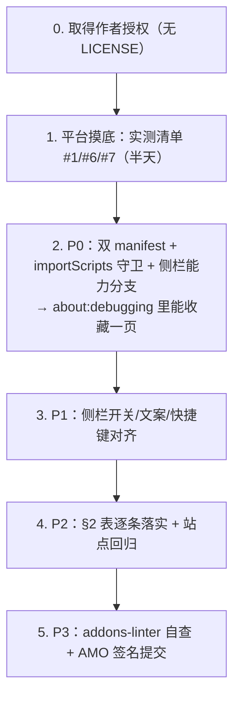

# LaterOn → Firefox 适配方案

> **目标**：把 LaterOn 1.66.1（Chrome/Edge MV3 扩展）移植成可在 Firefox 上安装、功能基本等价的扩展
> **代码基线**：`repo/` @ `00fde27be93656d650ac5c52adc2684d511adb53`（v1.66.1）
> **配套文件**：[`LaterOn-项目分析.md`](LaterOn-项目分析.md)（项目本身）、[`notes-background.md`](notes-background.md) / [`notes-content-scripts.md`](notes-content-scripts.md) / [`notes-ui.md`](notes-ui.md)（代码取证）、[`notes-firefox-platform.md`](notes-firefox-platform.md)（平台能力核查，每条带 MDN/BCD/Extension Workshop 出处）
> **日期**：2026-10-11
>
> **协议状态更新（2026-10-12）**：上游随后推送 `a1a5313` 采纳 **MIT 协议**（新增根目录 `LICENSE`，并在 README 增加「开源协议」章节），GitHub `license` 字段现为 `MIT`。因此本文件 §0 与 §6 里「仓库没有 LICENSE / 先解决授权问题」的判断是 **2026-10-11 当时的事实**，**已不再适用**；完整执行记录见 [`Firefox-适配技术方案.md`](Firefox-适配技术方案.md) 第 2.0 节与附录 H。

---

## 0. 结论摘要

**可行，属于「中等难度移植」，不是重写。**

三个真正的硬骨头（都必须动架构，不是改名）：

1. **侧栏**：Firefox 没有 `side_panel` / `chrome.sidePanel`，要换成 `sidebar_action` + `browser.sidebarAction`；`openPanelOnActionClick` 没有等价物，得自己用 `action.onClicked` 补；`open()` 还受用户手势约束。
2. **后台装载方式**：Firefox MV3 没有 Service Worker，只有事件页（window 上下文）。`background.js:1` 的 `importScripts` 在事件页里根本不存在，manifest 的 `service_worker` 键 Firefox 也不认。
3. **翻译功能**：`content-translation.js:39/65/82/86` 依赖 **Chrome 内建 AI API**（`Translator` / `LanguageDetector`）。Firefox 完全没有这套 API，而 Firefox 自带整页翻译（浏览器层，扩展调不到）。这个功能在 Firefox 上**必须整体降级或改接外部服务**，不是改一行参数。

**四个降低工作量的好消息**：

- **不需要改命名空间**。Firefox 的 `chrome.*` 命名空间完整可用，且 MV3 下异步 API 同样返回 Promise —— 全仓 **100+ 处 `await chrome.*` 调用可以一字不改**（改成 `browser.*` 反而会破坏 Chrome 121–147）。这也直接解掉了三份代码笔记里标记为「最高风险未知」的那一项。
- **不需要浏览器分支兼容层**。真正要加的特性探测只有侧栏一处。
- **i18n / 主题 / 浮层隔离 / 内容脚本**对 Firefox 基本零改动（`picker-ui.js:199` 白名单已含 `moz-extension:`）。
- **作者已经踩过一半的坑**：`contextMenus` 已在 `runtime.onInstalled` 里创建（Firefox 恰好要求如此，`background.js:280-287`）；后台已按「可被回收」设计（`chrome.alarms` + `storage.session`，`background.js:346-360`），与 Firefox 事件页模型天然契合。

**一个法律前提**：仓库**没有 LICENSE 文件**（GitHub `license: null`）。在你或他人分发 Firefox 版之前，必须先取得作者授权。技术上完全可以做，法律上目前不行。

**工作量粗估**（单人）：

| 阶段 | 内容 | 估计 |
|---|---|---|
| P0 | 能装上、能收藏、不报错 | 0.5–1 天 |
| P1 | 侧栏体验对齐（开/关/宽度/文案/快捷键） | 1–2 天 |
| P2 | 行为对齐与站点回归（标签页语义、注入、SPA） | 2–4 天 |
| P3 | AMO 签名与提交 | 1 天 |

---

## 1. 硬阻塞项（必须改架构）

### 1.1 侧栏：`sidePanel` → `sidebar_action`

| Chrome 侧现状 | 位置 | Firefox 现实 | 改法 |
|---|---|---|---|
| `manifest.side_panel.default_path` | `manifest.json:34-36` | 不存在该键 | 改 `sidebar_action: {default_panel: "sidepanel.html", default_title, default_icon}`（FF54+，MV3 可用） |
| `permissions: ["sidePanel"]` | `manifest.json:15` | 无此权限 | **删除**（否则触发 linter `MANIFEST_PERMISSION_UNSUPPORTED`） |
| `setPanelBehavior({openPanelOnActionClick:true})` | `background.js:265-273` | **无等价物** | 改 `chrome.action.onClicked.addListener(() => chrome.sidebarAction.open())`；回调内同步调用即满足手势要求 |
| `sidePanel.open({windowId})` | `sidepanel.js:1452-1453`、`library.js:2244/2249` | `sidebarAction.open()` 存在（FF57+），但**只能在 user action handler 内、且不能在 `await` 之后调用** | 直接调用点（`sidepanel.js:1452`）可换；`library.js:2241-2251` 是 async 且前面 await 过 → **大概率被拒**，应改为走已有的 `sidePanelFallback` 降级文案（`library.js:2196-2198`） |
| `sidePanel.close({windowId})` | `sidepanel.js:622` | **`sidebarAction.close()` 存在（FF57+）** | 换 `chrome.sidebarAction?.close()`，保留 `window.close()` 兜底（`sidepanel.js:625`）—— 但需实测从面板内调用的行为 |
| 图标点击开侧栏由浏览器原生处理 | 注释 `background.js:374` | Firefox 无此机制 | 用上面的 `action.onClicked`；另可加 Firefox 独有命令 `_execute_sidebar_action`（FF54+）给一个「开侧栏」快捷键 |
| 无宽度 API | `sidepanel.css:222-247` 的 620px 断点 | Firefox 侧栏宽度用户拖拽、无 API | 断点保留，但**必须实测**默认宽度下是否触发；`sidepanel.js:74` 的 58px 兜底按 Chrome 定的，可能要调 |

> **注意一处结论冲突**：UI 层代码笔记判「`sidePanel.close` 在 Firefox 完全无对应物」，平台核查则明确 `sidebarAction.close` 自 FF57 起存在。以平台核查（MDN 有出处）为准，但**行为需实测**。

### 1.2 后台：`service_worker` → 事件页

Firefox MV3 只有事件页（window 上下文），且 `background.js:1` 的 `importScripts("url-utils.js", "reading-position-background.js")` 是 `WorkerGlobalScope` 专有 API，**在事件页里不存在** → 顶层直接抛错、整个后台死掉。

改法（两处）：

1. **manifest 双写**（关键：addons-linter 的 `BACKGROUND_SERVICE_WORKER_NOFALLBACK` 是 **error**，`service_worker` 必须与 `scripts` 配对，不能只留一个）：

```jsonc
"background": {
  "service_worker": "background.js",                     // Chrome 用
  "scripts": ["url-utils.js", "reading-position-background.js", "background.js"]  // Firefox 用，按序加载、共享一个全局
}
```

2. **代码守卫**（`background.js:1`）：事件页下 `scripts` 数组已按顺序加载好这三个文件，所以 `importScripts` 不能再执行：

```js
if (typeof importScripts === "function") {
  importScripts("url-utils.js", "reading-position-background.js");
}
```

Chrome 121+ 忽略 `scripts`，Firefox 忽略 `service_worker` —— 同一份 JS 两端都能跑。

### 1.3 翻译：Chrome 内建 AI API 缺失

`content-translation.js` 全程依赖 `self.Translator` / `self.LanguageDetector`（`:39` 显式抛「当前 Chrome 不支持本机网页翻译」、`:65-76` 语言识别、`:82-93` 翻译器创建与模型下载进度）。Firefox **完全没有这两个 API**，且 Firefox 的整页翻译是浏览器层功能，不向扩展暴露。

三个可选方案：

| 方案 | 做法 | 代价 |
|---|---|---|
| **A. 隐藏（推荐）** | Firefox 版隐藏 `Alt+2`、右键菜单「翻译本页」、翻译入口按钮；引导用户用 Firefox 地址栏自带的翻译图标 | 零技术风险；功能变少，但 Firefox 用户本来就有更好的原生翻译 |
| B. 改接外部翻译服务 | 把 `content-translation.js` 的翻译后端换成某个在线 API | 引入网络依赖、隐私政策变更、密钥管理、合规成本；与项目「纯本地零后端」的定位冲突 |
| C. 等平台 | 若 Firefox 未来暴露翻译 API 再接 | 不可控 |

涉及位置：`content-translation.js`（整文件）、`background.js:565-569`（MAIN 世界注入）、右键菜单项（`background.js:232-257` 区域）、快捷键 `Alt+2`（`manifest.json` 的 `commands`）、`i18n.js` 相关文案、设置页快捷键列表。

> 采用方案 A 后，**不再需要 `world:'MAIN'`（FF128+）这个版本门槛**，最低版本可以只由 `storage.session` 决定（FF115）。

### 1.4 manifest 本身

`manifest.json` 是 Chrome 专有的，至少要改 4 处：

| 改动 | 原因 |
|---|---|
| 删 `permissions` 里的 `"sidePanel"` | Firefox 无此权限 |
| 删 `minimum_chrome_version: "121"` | Firefox 无意义（linter 只给通用 warning，但没必要留） |
| `side_panel` → `sidebar_action` | 见 1.1 |
| 加 `browser_specific_settings.gecko.{id, strict_min_version}` | MV3 **签名必需**（AMO 不再自动分配 ID） |

`strict_min_version` 取值依据：MV3 硬底线 **109**；用 `storage.session` → **115**；用 `world:'MAIN'` → **128**；用 `data_collection_permissions`（2025-11-03 起 AMO 新提交必需）→ **140**。**建议先取 `"115.0"`**（方案 A 隐藏翻译后无 128 需求）。

**无需改**：`web_accessible_resources`（现有 MV3 写法 FF109+ 合法）、`commands` 键位格式、`omnibox` 键、`options_page`、`action`、`icons`、`host_permissions`。

**构建产物拆分**：`scripts/build-release.py` 目前硬编码校验 `service_worker` / `side_panel` / `options_page` / icons / WAR（`88-108`），且 `RUNTIME_FILES` 是单一白名单。建议改为**按目标浏览器生成两份 manifest + 两个 zip**：

```
dist/LaterOn-1.66.1-chrome.zip    （side_panel + sidePanel 权限 + minimum_chrome_version）
dist/LaterOn-1.66.1-firefox.zip   （sidebar_action + background.scripts + gecko.id）
```

---

## 2. 语义差异（不报错，但行为会变）

| # | 位置 | Chrome 行为 | Firefox 行为 | 改法 |
|---|---|---|---|---|
| 1 | `library.js:2468` `chrome.windows.create({url, focused:true, type:"normal"})` | 支持 `focused` | **不支持该参数**（schema 校验可能直接抛 `Unexpected property`） | 条件传参：Firefox 去掉 `focused` |
| 2 | `background.js:184` `tabs.update({url})`（omnibox 打开） | 允许「更新当前活动标签」 | **要求 tabId** | 先 `tabs.query({active:true})` 再 update |
| 3 | `background.js:1683/1690`、`tab-navigation.js:22` `tab.pendingUrl` | 存在 | **不存在** | 去重退化到只看 `url`；两处属性读取要加兜底 |
| 4 | `background.js:1431/1582` `tab.discarded \|\| tab.status === "unloaded"` | `status` 可为 `"unloaded"` | Firefox 的 `status` 只有 `"loading"`/`"complete"` | 判定改为只看 `tab.discarded` |
| 5 | `background.js:903/1271-1299` `chrome.storage.session` | 96+ | **115+**，且无 `setAccessLevel` | 只在 background 用 → 可用；但 `strict_min_version` 要 ≥115，或降级到 `storage.local` + 显式过期 |
| 6 | `background.js:155/173` omnibox 描述里的 `<match>` / `<dim>` | 解析为高亮/弱化 XML | **不解析，当纯文本显示** | 去掉标签（或按平台分支） |
| 7 | `background.js:255-256` `contextMenus.create` 的 `contexts:["page","action"]` | 菜单持久化 | **从不持久化**，且 `"action"` context 支持需核实 | 已在 `onInstalled` 创建（`background.js:280-287`）✓；`"action"` 需实测 |
| 8 | `settings.js:71` `chrome.commands.getAll()` | 返回用户改过的键位 | 语义不同（用户改键在 about:addons） | 设置页快捷键区需重做 |
| 9 | `manifest.json` 的 `Alt+1`/`Alt+2`/`Alt+Shift+1` | — | 格式合法，但**被浏览器占用的组合会静默不触发** | 需实测；改用 `commands.update()` 或引导到 about:addons |
| 10 | `background.js:1665-1667` `isWebUrl` + 静默 `try/catch` | 受保护页面靠隐式拒绝 | Firefox 额外禁注 `about:*`、`addons.mozilla.org`、PDF viewer（`resource://pdf.js/`） | 增加显式判定 + **给用户可见的失败原因**（现在只有角标） |
| 11 | `background.js:1619`、`565`、`1219` 的 `executeScript({files:["content-metadata.js"]})` | 相对路径按扩展根解析 | Firefox 的 `tabs.executeScript`/`insertCSS` 按**页面 URL**解析相对路径（`scripting.*` 需实测） | **预防性统一改成绝对路径** `"/content-metadata.js"` |
| 12 | `background.js:570`、`1626` 依赖 `injection[0].result` 等于文件末表达式的完成值 | Chrome 行为 | **未验证** | 必须实测：失效则错误提示不再出现、元数据全退回标签页标题 |
| 13 | 缺 `host_permissions` 时 | 完全不执行 | Firefox 可能**部分执行成功** | 加 `permissions.contains` + `request` 引导；FF127 起才在安装提示里显示并授予 |
| 14 | 内容脚本 CSP 归属 | DOM API 受扩展 CSP 限制 | **多数 DOM API 受网页 CSP 限制**；自插入 `<script>` 更易被页面 CSP 拦 | LaterOn 不插 `<script>`，但 `innerHTML` 写页面 DOM（药丸、浮层）需在严格 CSP / Trusted Types 站点实测 |
| 15 | `sidepanel.js:31-41`、`library.js:2254-2260` 的 `windowId` 握手 | 侧栏可查询/定向到窗口 | 侧栏面板不是窗口对象，`windows.getCurrent()` 语义存疑 | 需重做或降级为「不区分窗口」 |
| 16 | `sidepanel.js:625` 兜底 `window.close()` | 关闭侧栏 | **不会关闭 Firefox 侧栏**（需实测） | 优先用 `sidebarAction.close()` |

**好消息**：全仓 grep **无命中** `tabs.onReplaced`、`use_dynamic_url`、`storage.session.setAccessLevel`、`chrome.offscreen`、`declarativeNetRequest`、`runtime.getContexts`、`captureVisibleTab`、`Tab.frozen` —— 平台核查里列的「Firefox 不支持」清单，大半这个项目根本没用。唯一的 `windows.create` 命中就是上表第 1 条。

---

## 3. P0：最小可行移植（让扩展在 Firefox 里装上并跑起来）

改动清单（按文件）：

**新增 / 生成 `manifest.firefox.json`**
```jsonc
{
  "manifest_version": 3,
  "name": "__MSG_extensionName__",
  "version": "1.66.1",
  "default_locale": "zh_CN",
  // 删除 minimum_chrome_version
  "permissions": ["activeTab","storage","unlimitedStorage","alarms","scripting","tabs","contextMenus"],
  //                                        ↑ 删除 "sidePanel"
  "host_permissions": ["http://*/*","https://*/*"],
  "background": {
    "service_worker": "background.js",
    "scripts": ["url-utils.js","reading-position-background.js","background.js"]
  },
  "sidebar_action": {                                  // 取代 side_panel
    "default_panel": "sidepanel.html",
    "default_title": "__MSG_actionTitle__",
    "default_icon": { "16":"icon16.png","32":"icon32.png","48":"icon48.png","128":"icon128.png" },
    "open_at_install": true
  },
  "browser_specific_settings": {
    "gecko": { "id": "lateron@<你的域名>", "strict_min_version": "115.0" }
  }
  // action / icons / commands / omnibox / options_page / web_accessible_resources 原样保留
}
```

**`background.js`**
1. `:1` 给 `importScripts` 加 `typeof` 守卫（见 §1.2）。
2. `:261-273` `setupSidePanelAction()` 改为按能力分支：
```js
async function setupSidePanelAction() {
  if (chrome.sidebarAction?.open) {                       // Firefox
    chrome.action.onClicked.addListener(() => {
      chrome.sidebarAction.open().catch(() => {});         // 必须在手势同步栈内
    });
    return true;
  }
  if (typeof chrome.sidePanel?.setPanelBehavior !== "function") return false;
  try { await chrome.sidePanel.setPanelBehavior({ openPanelOnActionClick: true }); return true; }
  catch { return false; }
}
```
3. `:184` omnibox 的 `tabs.update` 补 tabId；`:155/173` 去掉 `<match>`/`<dim>`；`:1431/1582` 的 `status === "unloaded"` 判定改写。
4. 翻译入口在 Firefox 分支下隐藏（方案 A）。

**`sidepanel.js`**：`:622` → `chrome.sidebarAction?.close?.()`；`:1452-1453` → `chrome.sidebarAction?.open?.()`（若被手势拒，走已有 fallback）。

**`library.js`**：`:2242-2249` 的 `sidePanel.open` 改为「Firefox 下直接走 `sidePanelFallback` 提示」；`:2468` `windows.create` 条件去掉 `focused`。

**`content-translation.js`**：Firefox 下不注入（`background.js:565-569` 加分支）。

**`scripts/build-release.py`**：出两份 manifest + 两个 zip；`validate_manifest()` 按目标校验不同键（Firefox 分支校验 `sidebar_action.default_panel` 与 `background.scripts`）。

**调试安装方式**（与 Chrome 不同）：Firefox 用 `about:debugging#/runtime/this-firefox` → 「临时载入附加组件」→ 选 `manifest.firefox.json`。永久安装必须经 AMO 签名。

---

## 4. P1：侧栏体验对齐

- `sidebar_action` 的 `open_at_install`（默认 true，装完自动开一次侧栏）、`default_title`、`default_icon`。
- 图标点击 → `action.onClicked` → `sidebarAction.open()`（P0 已含）。
- **宽度**：Firefox 侧栏宽度由用户拖拽、无 API。`sidepanel.css:6` 的 `min-width:280px`、`:220` 的 `max-width:330px`、`:222-247` 的 620px 断点都要在 Firefox 默认宽度下实测；`sidepanel.js:74` 的 `TOPBAR_FALLBACK_H = 58` 是按 Chrome 窄栏定的，可能要让 header 高度实测值优先。
- **侧栏 → 全屏库**：`sidepanel.js:1452-1453` 的 `open` 换成 `sidebarAction.open` 后仍受手势约束；更稳的做法是保留「先打开 library 标签页、再尝试收起侧栏」的顺序，并在 Firefox 下接受「侧栏不自动收起」的体验降级。
- **全屏库 → 侧栏**：`library.js:2242-2249` 改为提示用户点图标（复用 `sidePanelFallback` 文案，`i18n.js:113/239`）。
- **建议加一个 Firefox 独有快捷键**：manifest `commands` 里加 `{ "name": "open-sidebar", "suggested_key": {...} }`，后台绑定到 `_execute_sidebar_action`（FF54+ 独有）—— 这是 Firefox 唯一能「一键开侧栏」的机制。
- **Chrome 专有 URL 与文案**（必须改，否则用户点进去是死链）：
  - `settings.js:85` 的 `chrome://extensions/shortcuts` → `about:addons`（「管理扩展快捷键」）
  - `i18n.js:40/166` 硬编码同一 URL
  - `i18n.js:30/156`、`i18n.js:32/158`、`settings.html:92/106`、`boot.js:67-69` 的 Chrome 措辞
  - `settings.js:71` `chrome.commands.getAll()` 的返回语义
- **两处 UI 实现都要改**：`sidepanel.js`（1,563 行）与 `library.js`（2,523 行）是两份独立实现，侧栏相关改动必须各改一遍，保留 `?from=sidepanel` 现场传递机制（`library.js:256-283`），不要顺手合并。

---

## 5. P2：行为对齐与回归

按 §2 表逐条落实后，重点回归这些**只在真实浏览器里才暴露**的场景：

| 场景 | 关注点 |
|---|---|
| 抖音换视频（SPA） | `DOUYIN_SETTLE_MS = 1500`、`DOUYIN_POLL_MS = 100` 是按 Chrome 无头实测定的毫秒级时间线（`background.js:1375-1384`），Firefox 渲染时序不同 → 必须重新标定 |
| 重复注入 | `content-metadata.js` 会被反复注入（`background.js:1590-1612`），Firefox 下「内容脚本导航后仍残留、窗口属性被销毁」（bug 1525400）会让幂等性假设变化 |
| 批量收藏 | 整批可能跑数十秒；Firefox 事件页回收时机不同 → 需确认 `storage.session` 批次认领与 10 分钟过期阈值 |
| `injectedCssTabs` 去重 | SW/事件页重启后 `Set` 丢失 → 重复 `insertCSS`，视觉是否可见需实测 |
| 浮层（picker） | `pickerRunByTab` 内存态丢失会让 `background.js:1201-1203` 提前 return；Shadow DOM + `all:initial !important` 隔离在 Firefox 是否照样有效 |
| 严格 CSP 站点 | 药丸/浮层用 `innerHTML` 直接写页面 DOM，遇到 `require-trusted-types-for 'script'` 会被拒 |
| 首屏技巧 | `sidepanel.html:89-95` 的 `media="print"` → `link.sheet` → `"all"` 在 Firefox 的行为（`boot.js:30-42` 有三级定时器兜底） |
| 样式渲染 | `sidepanel.css:9` 的 `position:sticky` + `backdrop-filter: blur(15px)` 在 Firefox 侧栏合成层下需复测 |
| 站点清单 | YouTube / B 站 / 知乎 / 小红书 / 抖音 / 普通博客，逐个收藏一遍看标题摘要封面是否正确 |

---

## 6. P3：发布到 AMO

1. **`gecko.id` 固定**（`browser_specific_settings.gecko.id`），MV3 签名必需。
2. **签名与安装**：`about:debugging` 只支持临时加载（重启即失效）；永久安装走 AMO 签名，或自签名 + `xpinstall.signatures.required=false`（仅 Developer Edition / Nightly）。
3. **`data_collection_permissions`**：2025-11-03 起 AMO 新提交必需 → 需要 FF140+。LaterOn 本地收集网页内容，需如实申报。
4. **`addons-linter` 自查**：重点看 `BACKGROUND_SERVICE_WORKER_NOFALLBACK`（**error**，必须 `scripts` 配对）、`MANIFEST_PERMISSION_UNSUPPORTED`（`sidePanel` 权限）。
5. **隐私政策与数据声明**：项目本身零后端（全仓仅一处 `fetch`，抓的是页面自身 URL，`background.js:1482`），这是很大的加分项，应写进 AMO 页面。
6. **上游策略**：先解决**无 LICENSE** 的授权问题，再决定「独立 fork」还是「向上游提 PR」（后者更可能被合并，但要作者接受双 manifest 构建）。

---

## 7. 待实测清单（按优先级）

| # | 待验证项 | 为什么必须实测 | 验证方式 |
|---|---|---|---|
| 1 | Firefox MV3 下 `chrome.*` 是否返回 Promise | 决定要不要兼容层（平台核查结论为「是」，但这是一切的前提） | 事件页里 `chrome.storage.local.get("x").then(...)` 或 `await` 一次 |
| 2 | `sidebarAction.close()` 从面板内部调用 | UI 笔记与平台核查结论冲突 | 面板里点「展开全屏」看侧栏是否收起 |
| 3 | `sidebarAction.open()` 的手势约束 | `library.js:2241-2251` 是 async，可能被拒 | 从库页面调一次，看是否抛错 |
| 4 | `executeScript({files})` 的 `result` 语义 | `background.js:570/1626` 两处依赖 | 收藏一页，看错误提示与元数据是否正常 |
| 5 | `files` 相对路径解析基准 | 可能是页面 URL 而非扩展根 | 先原样跑；失败则改绝对路径 |
| 6 | `side_panel` 键是否被 Firefox 忽略还是报错 | 决定要不要双 manifest | `about:debugging` 加载时看 linter 报错 |
| 7 | `storage.session` 可用性与配额 | 批量收藏依赖它 | 触发一次批量收藏，重启浏览器看批次是否还在 |
| 8 | `alarms` 最小周期 | MDN 只写了 Chrome 的 30 秒下限 | 12 小时清理 alarm 是否按预期注册 |
| 9 | `Alt+1`/`Alt+2`/`Alt+Shift+1` 是否与 Firefox 冲突 | 占用时 handler 静默不触发 | 逐个按一遍 |
| 10 | `contextMenus` 的 `"action"` context | 支持情况未证实 | 右键工具栏图标看菜单是否出现 |
| 11 | Firefox 侧栏默认宽度 / 620px 断点 | 决定布局是否需要重排 | 拖动侧栏宽度，看断点切换是否正常 |
| 12 | `window.close()` 在侧栏内的行为 | 兜底路径 | 手动调一次 |
| 13 | `windows.getCurrent()` 在侧栏页的返回值 | `windowId` 握手协议 | 面板里打日志 |
| 14 | 重复 `insertCSS` 的视觉后果 | `injectedCssTabs` 丢失后的表现 | 重启扩展后重复触发翻译样式注入 |
| 15 | `innerHTML` 在 Trusted Types 站点 | 药丸/浮层会被拒 | 在启用 TT 的站点收藏一次 |
| 16 | `backdrop-filter` / `sticky` 渲染 | 视觉质量 | 目视 |
| 17 | `media="print"` 首屏技巧 | 侧栏白屏风险 | 冷启动侧栏看是否闪白 |
| 18 | `commands.getAll()` 返回内容 | 设置页快捷键区 | 打开设置页看列表 |
| 19 | `windows.create({focused:true})` 是否抛错 | 批量打开收藏时 | 触发一次「在新窗口打开全部」 |
| 20 | 内容脚本导航后残留（bug 1525400） | 幂等性与重复监听 | SPA 站内跳转后重复收藏，看是否出现双份 UI |

---

## 8. 建议执行顺序（若真要做）



**最省力的路径**：P0 只做「双 manifest + `importScripts` 守卫 + 侧栏能力分支 + 隐藏翻译」四件事，就能得到一个「能收藏、能看库、侧栏可用」的 Firefox 版；标签页语义与 SPA 标定可以后续迭代。

---

## 9. 证据与不确定

- 平台结论来自 [`notes-firefox-platform.md`](notes-firefox-platform.md)（314 行，每条带 MDN / BCD / Extension Workshop 出处，含 15 条「未证实」）。
- 代码结论来自三份逐行取证笔记，行号均对应归档点 `00fde27`。
- **本方案未做任何真实浏览器验证**：没有安装 Firefox、没有加载扩展、没有跑过测试。§7 的 20 项全部是待实测项，其中 #1（`chrome.*` 是否返回 Promise）是整个方案的基石。
- **一处已知冲突**已在上文标注：`sidePanel.close` 的 Firefox 对应物。
